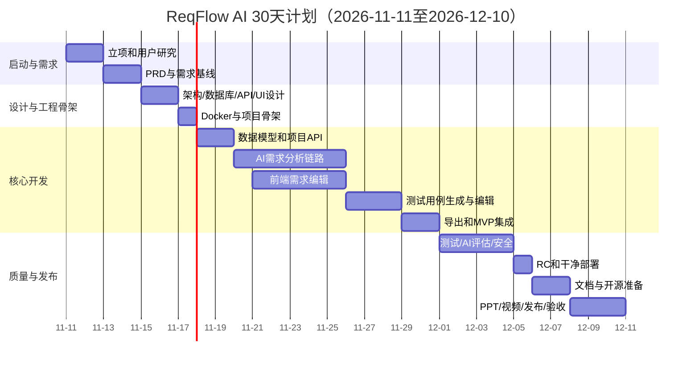
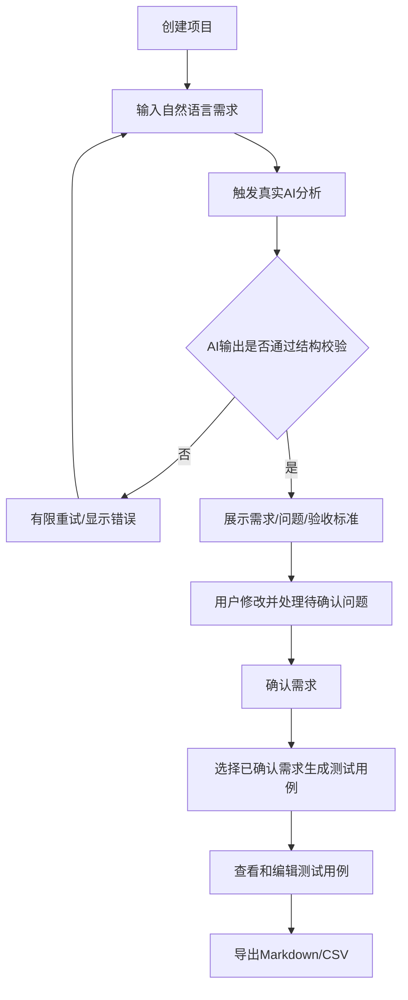
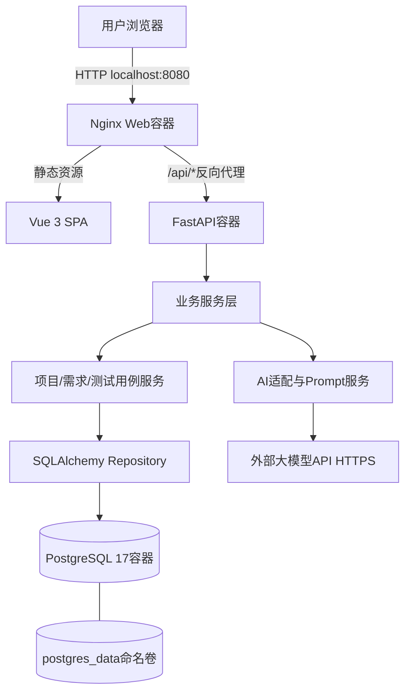
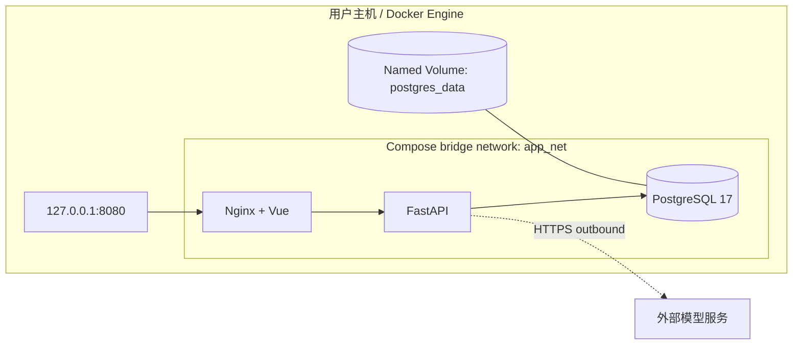
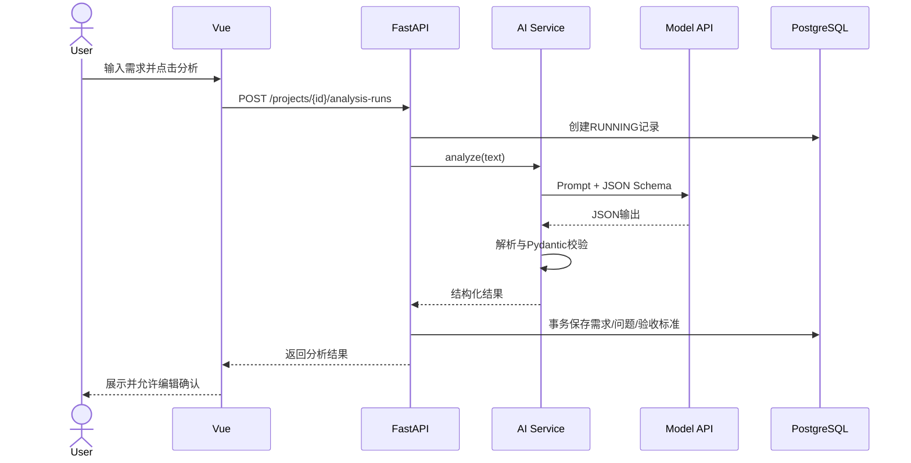
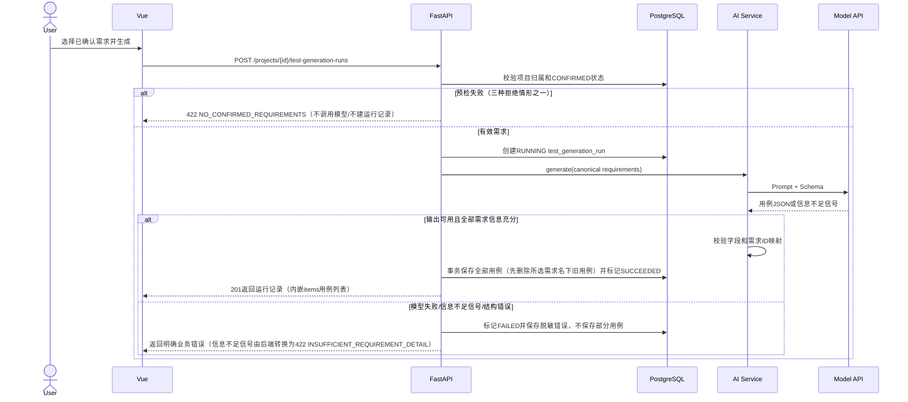
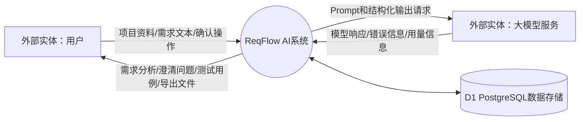
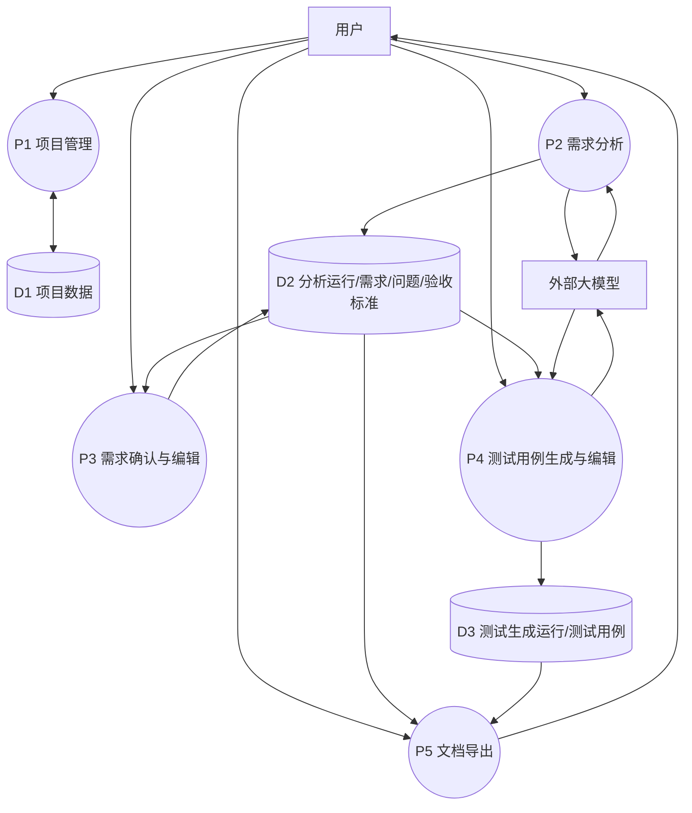
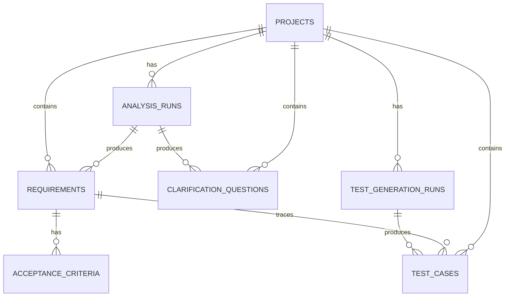

# ReqFlow AI 完整项目规划与工程文档

**文档版本：** 0.2.3（经四轮对抗性文档审查修订）  
**计划日期：** 2026-11-11至2026-12-10  
**团队：** 2人  
**项目状态：** 开发前规划基线；非可运行软件。

> 本文件由`docs/`中的独立文档按编号汇总生成。独立文档为维护主源；修改独立文档后必须重新生成本文件。当前压缩包不包含应用源码和Dockerfile，不能据此声称系统已可运行。所有实施状态、测试结果、部署结果和发布数据必须实际验证后填写。

## 文档目录

- [00 项目章程](docs/00-project-charter.md)
- [01 项目选型报告](docs/01-project-selection.md)
- [02 项目范围说明书与WBS](docs/02-scope-and-wbs.md)
- [03 软件过程实施计划与项目管理计划](docs/03-process-and-management-plan.md)
- [04 30天详细实施计划](docs/04-30-day-plan.md)
- [05 产品需求规格说明书（PRD）](docs/05-prd.md)
- [06 AI功能专项设计说明书](docs/06-ai-design.md)
- [07 系统总体设计与详细设计说明书](docs/07-system-design.md)
- [08 数据库设计说明书（PostgreSQL）](docs/08-database-design.md)
- [09 API接口设计说明书](docs/09-api-design.md)
- [10 UI/UX设计说明书](docs/10-ui-ux-design.md)
- [11 软件测试计划与测试用例](docs/11-test-plan-and-cases.md)
- [12 部署手册（正式交付基线）](docs/12-deployment-manual.md)
- [13 用户手册（目标功能说明）](docs/13-user-manual.md)
- [14 软件维护说明书](docs/14-maintenance-manual.md)
- [15 开源社区发布计划](docs/15-open-source-release.md)
- [16 项目汇报PPT脚本（建议14页）](docs/16-presentation-storyboard.md)
- [17 系统操作视频脚本](docs/17-demo-video-script.md)
- [18 项目总结报告（结项后填写）](docs/18-project-summary-template.md)
- [19 项目风险登记册](docs/19-risk-register.md)
- [20 七类交付物与最终验收清单](docs/20-deliverables-and-acceptance.md)
- [21 需求追踪矩阵](docs/21-requirements-traceability.md)
- [22 架构决策记录（ADR）](docs/22-architecture-decisions.md)
- [23 AI辅助开发规范](docs/23-ai-assisted-development-standard.md)
- [24 用例规格说明](docs/24-use-cases.md)
- [25 技术依据与官方参考](docs/25-technical-references.md)

---

# 00 项目章程

**项目名称：** ReqFlow AI（AI需求分析与测试用例生成工作台）  
**计划周期：** 2026-11-11—2026-12-10，共30个自然日  
**团队规模：** 2人  
**文档状态：** 规划基线，待团队评审批准

## 1. 项目背景

软件开发前期的需求整理和测试设计通常需要反复阅读自然语言描述、澄清模糊条件、拆分功能点并补充边界场景。对学生项目和小型团队中的个人开发者而言，这些工作容易遗漏，也占用有限的开发时间。

本项目拟开发一款AI增强型软件工程辅助工具，将自然语言软件需求转换为结构化需求、待确认问题、验收标准和测试用例。AI负责理解和生成建议，用户负责核验、修改和确认。

## 2. 项目目标

在30天内完成一个可运行、可演示、可部署、可开源的MVP，并形成可追溯的软件工程资料。

### 2.1 产品目标

1. 用户可以创建项目并提交自然语言需求。
2. 系统可以调用真实大模型，输出结构化需求和待确认问题。
3. 用户可以修改并确认需求和验收标准。
4. 系统可以根据已确认需求生成可编辑测试用例。
5. 用户可以导出Markdown需求文档和CSV测试用例。

### 2.2 工程目标

1. 前端、后端、数据库均采用明确分层。
2. 数据库统一采用PostgreSQL，不使用SQLite。
3. 提供Dockerfile、Docker Compose、健康检查和持久化数据卷。
4. 提供数据库迁移、自动化测试和干净环境部署验证记录。
5. 建立Git开源仓库并发布实际可运行版本。
6. 完成交付要求中的七类成果：源代码、部署包/可运行系统、工程文档、开源社区、汇报PPT、系统操作视频、项目总结。

## 3. 成功标准

| 编号 | 成功标准 | 验证证据 |
|---|---|---|
| SC-01 | 核心业务流程端到端可运行 | 录屏、验收记录、测试报告 |
| SC-02 | AI需求分析真实调用模型 | 脱敏请求日志、运行截图、模型配置说明 |
| SC-03 | AI测试用例生成可基于已确认需求执行 | 运行截图、需求与用例关联数据 |
| SC-04 | PostgreSQL持久化有效 | 重启/重建容器前后数据一致性记录 |
| SC-05 | Docker Compose干净环境部署成功 | 部署测试记录和命令输出 |
| SC-06 | 核心需求均有对应测试和验收证据 | 需求追踪矩阵 |
| SC-07 | 七类成果均有实际文件或交付记录 | 交付清单、仓库Release、PPT、视频 |

## 4. 项目范围摘要

**包含：** 单用户自托管Web系统、项目管理、AI需求分析、问题澄清、验收标准、AI测试用例生成、编辑、导出、PostgreSQL存储、容器部署。

**不包含：** 账号与多租户、实时协作、RAG知识库、语音输入、复杂文件解析、AI代码生成、自动化执行测试、第三方项目管理工具集成。

## 5. 主要约束与假设

- 只有两名团队成员，规划应控制并行任务数量。
- 30天按自然日计算，含周末；假定两名成员每日均能安排连续的项目时间。如实际可投入时间明显不足，先删减P1，不削减测试和部署。
- 大模型API需由团队自行准备合法可用的账号、API Key和调用额度；服务商和模型在Day 2技术验证后冻结。
- MVP为单用户本机本地部署，不提供账号认证；默认仅绑定127.0.0.1。
- 未经实际测试的功能、性能、AI准确率、用户反馈和开源社区数据不得写成已完成结果。

## 6. 组织与职责

| 角色 | 成员 | 职责 |
|---|---|---|
| 产品/前端负责人 | 成员A | PRD、流程与页面、前端实现、用户手册、PPT内容统筹 |
| 后端/AI负责人 | 成员B | 架构、数据库、API、AI服务、容器与部署、AI设计文档 |
| 共同责任 | A+B | 需求评审、架构评审、代码审查、集成测试、发布、演示和总结 |

## 7. 主要里程碑

- M1（Day 4，11-14）：需求基线冻结。
- M2（Day 7，11-17）：架构、接口、数据库和容器骨架可用。
- M3（Day 15，11-25）：AI需求分析垂直切片贯通。
- M4（Day 20，11-30）：MVP功能冻结。
- M5（Day 25，12-05）：候选发布版通过核心回归。
- M6（Day 29，12-09）：开源发布与交付文件齐备。
- M7（Day 30，12-10）：最终验收和复盘完成。

## 8. 项目审批记录

| 项目 | 填写内容 |
|---|---|
| 项目负责人确认 | 待团队填写 |
| 成员A确认 | 待填写 |
| 成员B确认 | 待填写 |
| 需求基线版本 | 0.1（规划） |
| 批准日期 | 待填写 |

---

# 01 项目选型报告

## 1. 选型约束

团队2人、30个自然日，必须交付源代码、可运行部署包、工程文档、真实开源仓库、汇报PPT、操作视频和项目总结。AI必须参与核心业务，不得只是聊天入口；应避免复杂硬件、模型训练、高并发和多第三方依赖。

## 2. 候选项目

| 项目 | 定位 | AI核心能力 | 主要风险 | 结论 |
|---|---|---|---|---|
| AI需求分析与测试用例工作台 | 自然语言需求转结构化需求及测试 | 需求抽取、歧义识别、验收标准和测试用例生成 | 输出质量需要校验 | **选定** |
| AI会议纪要与任务提取 | 会议记录转纪要和行动项 | 摘要、决策和任务抽取 | 同质化；语音功能扩大范围 | 不选 |
| AI学习资料分析助手 | 学习资料转摘要和练习 | 长文本理解、题目生成 | PDF/扫描件解析复杂 | 不选 |
| AI个人知识库问答 | 文档检索问答 | RAG、Embedding和生成 | 检索链路、评估和部署复杂 | 不选 |
| AI简历岗位匹配 | 简历与岗位要求分析 | 语义匹配、差距和改写 | 同质化、隐私和事实夸大 | 不选 |
| AI开发日志分析 | 日志错误诊断与排查建议 | 日志理解和诊断推理 | 误诊风险、上下文不足 | 不选 |

## 3. 评分模型

5分制；开发复杂度/风险维度按“越容易、风险越低分数越高”评分。

| 维度 | 权重 |
|---|---:|
| 30天可行性 | 25% |
| 复杂度及技术风险可控性 | 20% |
| AI功能实际价值 | 20% |
| 产品实用性 | 15% |
| 演示效果 | 10% |
| 开源价值 | 10% |

公式：总分 = Σ（维度权重 × 维度评分 ÷ 5）。

| 项目 | 可行性 | 风险可控 | AI价值 | 实用性 | 演示 | 开源 | 总分/100 |
|---|---:|---:|---:|---:|---:|---:|---:|
| **需求分析与测试用例工作台** | 4.6 | 4.4 | 4.7 | 4.5 | 4.8 | 4.8 | **92.1** |
| 会议纪要助手 | 4.8 | 4.8 | 4.0 | 4.1 | 4.8 | 4.4 | 89.9 |
| 简历岗位匹配 | 4.7 | 4.5 | 4.2 | 4.4 | 4.6 | 4.3 | 89.3 |
| 开发日志分析 | 4.1 | 3.8 | 4.6 | 4.5 | 4.8 | 4.7 | 86.6 |
| 学习资料助手 | 3.7 | 3.4 | 4.6 | 4.6 | 4.6 | 4.8 | 83.1 |
| 知识库问答 | 3.5 | 3.2 | 4.5 | 4.4 | 4.5 | 4.6 | 79.7 |

以上为规划判断，不是市场调研、用户测试或实际开发结果。项目启动后应以简短用户访谈和技术Spike补充验证。

## 4. 选定理由

1. 与软件工程专业直接相关，覆盖需求工程和测试设计。
2. AI承担不可被简单规则替代的自然语言理解与生成任务。
3. 可以把范围压缩为两个AI流程和少量管理能力。
4. 输入输出结构清晰，容易准备回归样本和验收标准。
5. 结果可编辑、可追踪、可导出，业务闭环明确。

## 5. 最终决策

正式项目为 **ReqFlow AI：AI需求分析与测试用例生成工作台**。MVP只实现项目管理、需求分析、需求编辑确认、测试用例生成编辑和导出。PostgreSQL为唯一数据库；Docker Compose为正式交付部署方式。

---

# 02 项目范围说明书与WBS

## 1. 项目范围目标

交付可运行的单用户Web MVP，支持从自然语言需求到已确认需求和测试用例的完整流程，并提供可复现容器部署及项目交付材料。

## 2. 范围边界

### 2.1 包含范围

- 项目创建、列表、详情、编辑、删除。
- 输入自然语言需求并真实调用模型分析。
- 提取需求条目、待确认问题、验收标准。
- 修改和确认AI生成的需求/验收标准；回答或忽略澄清问题。问题答案只保存到问题记录中，不自动回写需求，用户需手动编辑相关需求/验收标准。
- 根据已确认需求生成测试用例。
- 测试用例编辑和保存。
- 导出Markdown需求文档和CSV测试用例。
- 前端内置一段示例需求文本，可一键填入需求输入框并清空；示例文本不自动创建项目、不自动调用模型、不写入数据库。
- PostgreSQL持久化和Alembic迁移。
- Nginx、FastAPI、PostgreSQL三容器Docker Compose部署。
- 测试、部署、开源、汇报和总结材料。

### 2.2 不包含范围

账号体系、RBAC、多租户、实时协同、站内消息、RAG、向量数据库、模型微调、多智能体、自动代码生成、自动执行测试、Jira/禅道集成、语音转写、图像识别、扫描PDF OCR、复杂报表和移动端原生应用。

### 2.3 外部依赖

- 用户可访问的模型服务和有效API Key。
- 可用Docker环境。
- GitHub或Gitee仓库创建权限。
- 团队可获取演示用非敏感需求样例。

## 3. 范围变更规则

- P0功能不得因临时创意被替换。
- P1默认延期、不属于30天MVP验收；Day 20之后不再接受新功能开发（既定的测试、文档与发布任务除外），只处理缺陷修复与安全问题；启用任何P1须按范围变更规则经两名成员评审并记录。
- 新需求必须记录收益、工作量、风险、对关键路径影响和取舍建议。
- 任何新增功能都必须明确删除或推迟哪项工作；不得挤占最终测试、部署和交付时间。

## 4. 工作分解结构（WBS）

| WBS | 工作包 | 主要活动 | 主要交付 |
|---|---|---|---|
| 1.0 | 项目启动 | 章程、选题确认、团队分工、仓库初始化 | 项目章程、决策记录 |
| 1.1 | 用户与需求研究 | 用户访谈、场景、痛点、用户故事 | PRD初稿 |
| 1.2 | 范围基线 | MVP、非目标、验收条件、需求追踪 | PRD基线 |
| 2.0 | 系统设计 | 架构、模块、数据库、API、UI/UX | 设计文档 |
| 2.1 | 容器基础设施 | Compose、PostgreSQL健康检查、Nginx、环境变量 | 可启动骨架 |
| 3.0 | 后端开发 | 项目CRUD、ORM、迁移、API | 后端服务 |
| 3.1 | AI服务 | 模型适配、Prompt、Schema、异常处理 | AI需求分析与用例生成 |
| 4.0 | 前端开发 | 项目页、需求页、问题和测试用例页 | Web前端 |
| 4.1 | 系统集成 | 前后端联调、端到端流程 | MVP候选版 |
| 5.0 | 测试与质量 | 单元、接口、AI样本、回归、部署测试 | 测试报告、缺陷记录 |
| 6.0 | 发布准备 | README、许可证、贡献指南、Release | 开源仓库发布 |
| 6.1 | 成果展示 | PPT、操作视频、项目总结 | 汇报及总结材料 |
| 6.2 | 交付文档 | 编写部署手册、用户手册、维护说明书并与当前实现核对（对应Day 26） | docs/12部署手册、docs/13用户手册、docs/14维护说明书 |
| 7.0 | 项目收尾 | 验收、复盘、归档 | 最终交付包 |

## 5. 工作验收原则

每个工作包必须同时具备：任务负责人、完成定义、产物位置、测试/评审证据。代码合并不等同于功能验收；文档写完不等同于部署验证；模型返回文本不等同于AI功能验收。

---

# 03 软件过程实施计划与项目管理计划

## 1. 软件过程选择

采用 **轻量级迭代增量过程（结合Scrum的短周期计划与评审）**，不采用完整重型Scrum仪式，也不采用一次性瀑布交付。

### 1.1 选择理由

- 两人团队沟通链路短，完整Scrum角色和仪式成本偏高。
- 30天周期短，需要尽早形成可运行增量并暴露风险。
- AI模型输出效果和需求细节存在不确定性，适合通过样例迭代调整。
- 最终要求工程过程文档，因此必须保留需求、设计、评审、测试和变更记录。

### 1.2 迭代划分

| 迭代 | 日期/天数 | 目标 | 结束条件 |
|---|---|---|---|
| Iteration 0 | Day 1-7 | 需求基线、架构和工程骨架 | PRD/设计评审通过，PostgreSQL容器健康，前后端骨架启动 |
| Iteration 1 | Day 8-15 | AI需求分析垂直切片 | 可从页面提交需求，真实模型返回并保存结构化结果 |
| Iteration 2 | Day 16-20 | 核心MVP完成 | 需求确认、测试用例生成和核心页面打通，功能冻结 |
| Hardening | Day 21-25 | 测试、修复、部署候选版 | P0缺陷清零，关键回归通过，RC可部署 |
| Release | Day 26-30 | 文档、发布、展示、总结 | 七类成果逐项验收，有实际证据 |

## 2. 每日工作机制

- 每日开始：双方各用5分钟同步昨天完成、今天计划、阻塞项。
- 每日结束：更新任务看板、提交代码/文档、记录未完成原因。
- 每2-3天：集成主分支，保证可运行版本。
- 每个里程碑：开展演示和评审，记录问题、决定和行动人。
- 每个迭代结束（Day 7、15、20、25及结项）：使用`templates/retrospective-template.md`开展迭代回顾，记录做得好的事项、问题根因、AI输出纠正结论和可量化改进项及负责人。
- 每周至少一次：检查范围、进度、风险和关键路径。

不要求固定开长会；协作内容优先写入Git Issue、Pull Request和会议记录。

## 3. 需求管理

- 所有需求使用唯一编号：FR-xxx（功能）、NFR-xxx（非功能）；AI专项需求统一纳入FR/NFR编号体系追踪，不另设AI-xxx编号。
- 需求变更先登记，再评估工作量、风险和验收影响。
- PRD基线由双方评审后冻结；冻结后修改必须更新版本与追踪矩阵。
- AI提出的澄清问题不是已确认需求。用户可回答或标记忽略；回答仅保存到问题记录，不自动回写需求或触发AI重分析，用户需手动编辑相关需求/验收标准。未处理问题保持OPEN并持续提醒，不自动阻止用户对已核验需求作出明确确认。

## 4. 进度管理

- 使用30天计划作为基线，每天更新任务状态：未开始/进行中/阻塞/完成/取消。
- 功能开发任务在派发时按`templates/feature-task-template.md`建立任务单，登记需求编号、业务规则、验收标准与完成定义；任务状态随每日看板同步更新。
- 以里程碑而非代码行数衡量进度。
- 延期超过1天，先削减P1；延期超过2天，启动范围降级方案。
- 核心路径不得省略：需求冻结→数据/API契约→后端AI链路→前端集成→回归→干净环境部署→发布。

## 5. 团队职责

| 工作 | 成员A | 成员B | 共同 |
|---|---|---|---|
| 用户访谈与PRD | 主责 | 参与评审 | 批准基线 |
| UI/UX和前端 | 主责 | 接口协作 | 集成验收 |
| 数据库与迁移 | 参与评审 | 主责 | 设计评审 |
| FastAPI与业务API | 接口评审 | 主责 | 集成验收 |
| AI Prompt/模型适配 | 提供业务样例 | 主责 | AI效果评估 |
| Docker部署 | 验证操作流程 | 主责 | 干净部署验收 |
| 测试 | 前端/流程测试 | 后端/AI/DB测试 | 回归与签字 |
| 开源/PPT/视频 | PPT与页面演示 | 仓库/部署演示 | 最终汇报 |

## 6. 质量管理

- 每项功能须有验收标准和至少一个测试用例。
- 缺陷经每日Bug分诊确认后按`templates/bug-report-template.md`记录（要求见`docs/11`§9）；进入修复的缺陷由负责人另建`templates/bug-fix-task-template.md`修复任务单，覆盖根因分析、修复方案、回归测试与复测结果，跟踪至关闭。
- 主分支保持可构建、可启动；功能分支经另一成员审查后合并。
- 后端使用pytest；数据库集成测试必须连接PostgreSQL，不用SQLite替代。
- AI输出必须经过Pydantic/JSON结构校验；AI评价需用固定测试样本。
- 发布前执行全量回归、容器重建、数据持久化和备份恢复测试。
- 代码、PRD、API、数据库迁移和用户手册保持同步。

## 7. 配置与版本管理

- Git分支：`main`稳定分支 + 短期`feature/*`、`fix/*`、`docs/*`分支。
- Commit：`feat:`、`fix:`、`docs:`、`test:`、`refactor:`、`build:`。
- 需求基线：`docs/05-prd.md`，每次变更更新版本记录。
- 数据库结构：只通过Alembic migration改变。
- API契约：OpenAPI文档由FastAPI生成，同时维护`docs/09-api-design.md`。
- 环境配置：仅提交`.env.example`，真实`.env`不得进仓库。
- 发布标签：候选版`v0.9.0-rc1`，正式首版`v1.0.0`；只有实际通过验收后才打正式标签。

## 8. 沟通管理

| 沟通事项 | 频率 | 参与人 | 记录 |
|---|---|---|---|
| 每日同步 | 每天 | A、B | daily-log模板 |
| 需求/设计评审 | Day 4、6及必要时 | A、B | review-meeting模板 |
| 迭代演示 | Day 7、15、20、25 | A、B | 评审记录和演示结果 |
| Bug分诊 | 每天集成后 | A、B | Issue/缺陷表 |
| 发布验收 | Day 29-30 | A、B | 最终验收清单 |

## 9. 风险升级

若AI接口在Day 2仍无法连通，立即切换已验证的兼容服务商；Day 3仍无可用服务，则保留同一AI适配器接口，优先确保一个真实模型服务可用，不以模拟输出代替真实AI验收。若Day 20核心流程未贯通，取消所有P1功能。

---

# 04 30天详细实施计划

**计划周期：2026-11-11至2026-12-10（30个自然日）**。每天均安排明确产物；A为前端/产品负责人，B为后端/AI负责人。两人每日同步并互相评审。

## 1. 每日任务表

| Day/日期 | 阶段 | 成员A任务 | 成员B任务 | AI辅助方式 | 当日交付与验收 |
|---|---|---|---|---|---|
| 1 / 11-11 | 启动 | 目标用户与场景草案、仓库初始化 | 技术风险清单、API服务商候选 | AI辅助头脑风暴，人工筛选 | 项目章程、初始Issue；两人确认范围 |
| 2 / 11-12 | 需求研究 | 访谈2-3名潜在用户或同学，记录原话 | 真实模型API连通Spike、请求/响应样例 | AI整理访谈，不生成虚构结论 | 访谈记录、API验证证据；至少一个模型可真实调用；记录语言/运行时/数据库及依赖可用版本（docs/25） |
| 3 / 11-13 | 需求分析 | 用户故事、流程和页面清单 | AI能力边界、输出样本和风险 | AI生成用户故事初稿和边界样本 | PRD初稿、AI样例集 |
| 4 / 11-14 | 需求基线 | 整理验收条件、优先级和非目标 | 审查可行性及AI需求 | AI检查歧义，人工最终裁决 | PRD 0.1基线、需求追踪矩阵；M1评审通过 |
| 5 / 11-15 | 架构设计 | 低保真线框图、交互状态 | 总体架构、模块边界和部署视图 | AI辅助设计评审清单 | UI草图、系统架构图 |
| 6 / 11-16 | 详细设计 | 页面组件、前端路由、API消费约定 | PostgreSQL ER、表结构、API契约 | AI审查字段和API一致性 | DB/API/UI设计评审通过 |
| 7 / 11-17 | 工程骨架 | Vue项目初始化、Nginx静态托管、前端测试框架选型验证（候选 Vitest） | FastAPI项目、PostgreSQL 17 Compose、健康检查 | AI生成Docker配置初稿并人工检查 | 三容器骨架启动；数据库健康；前端测试框架选型验证（候选 Vitest）完成；前后端依赖锁定并提交lock文件；M2 |
| 8 / 11-18 | 后端基础 | 前端项目列表页面静态骨架 | SQLAlchemy模型、Alembic首个迁移 | AI生成ORM/迁移草稿 | PostgreSQL表创建成功，迁移可重复执行 |
| 9 / 11-19 | 项目管理 | 项目列表/创建/详情UI | 项目CRUD API与测试 | AI生成接口测试初稿 | 前后端项目CRUD联调通过 |
| 10 / 11-20 | AI基础 | 需求输入表单、加载/错误状态、示例需求静态文本+一键填入/清空（FR-014，标注示例输入，不写库） | AI Provider适配层、配置、安全与超时 | AI检查供应商兼容性和异常路径 | 可读取模型配置；无Key时给出明确提示；示例需求一键填入/清空可用（FR-014，标注示例输入，不写库） |
| 11 / 11-21 | AI需求分析 | 需求结果页布局与数据映射 | 需求分析Prompt、JSON Schema、Pydantic模型 | AI对Prompt进行反例测试 | 固定样例可返回结构化需求和问题列表 |
| 12 / 11-22 | AI链路 | 前端触发分析、显示进度 | 分析API、保存AnalysisRun和结果 | AI辅助编写异常处理及日志 | 浏览器可提交输入并真实生成结果 |
| 13 / 11-23 | 数据编辑 | 需求条目、问题、验收标准编辑界面 | 需求/问题/验收条件持久化API | AI生成边界测试场景 | 编辑后刷新数据不丢失 |
| 14 / 11-24 | AI质量 | 准备需求分析结果人工评分表 | JSON修复重试、超时、限长、敏感日志检查 | AI协助生成测试样本，但人工标注标准答案 | AI测试样本集和第一次质量记录 |
| 15 / 11-25 | 迭代演示 | 演示完整需求分析和编辑流程 | 修复后端阻断、确认部署链路 | AI代码审查与缺陷归因 | AI需求分析垂直切片验收；M3 |
| 16 / 11-26 | 前端完善 | 统一导航、项目工作区和状态反馈 | 完善测试用例生成数据模型/API | AI辅助组件测试草稿 | 页面结构稳定、接口契约无冲突 |
| 17 / 11-27 | 用例生成 | 测试用例列表、详情与编辑UI | 测试用例生成Prompt和API | AI生成正反例并检查覆盖 | 已确认需求可生成结构化用例 |
| 18 / 11-28 | 用例持久化 | 测试用例编辑/保存交互 | 用例保存、查询、更新API | AI辅助SQL/API边界审查 | 用例可编辑，重启后数据仍存在 |
| 19 / 11-29 | 导出 | Markdown/CSV下载交互与文件名 | 导出服务、编码和内容校验 | AI审查导出字段与PRD一致性 | 两类导出文件可打开且内容正确 |
| 20 / 11-30 | MVP冻结 | 全流程验收、记录UI问题 | 全链路API/DB检查、冻结数据结构 | AI辅助追踪矩阵核对 | 需求→确认→用例→导出贯通；M4；停止加新功能 |
| 21 / 12-01 | 测试 | 前端流程测试、浏览器兼容检查 | 后端单元/接口/PostgreSQL集成测试 | AI生成测试数据和反例 | 第一轮测试记录、Bug列表 |
| 22 / 12-02 | AI评估 | 按评分量表评审模型结果 | 执行固定样本集、记录失败类型 | AI帮助聚类错误，人工判定 | AI质量评估表；不得只报告成功样本 |
| 23 / 12-03 | 安全与异常 | 空状态、错误提示、长文本交互测试 | API Key保护、输入限制、异常脱敏、日志审查 | AI代码安全审查辅助 | 核心安全检查通过，严重问题有处置 |
| 24 / 12-04 | 回归 | 端到端回归、问题复测 | 数据库迁移、备份恢复、容器健康测试 | AI辅助对照需求追踪 | P0用例通过，缺陷状态明确 |
| 25 / 12-05 | 发布候选 | 演示脚本预演、截图素材准备 | 干净环境部署、Compose重建和数据持久化 | AI审查部署步骤和失败提示 | RC候选版；P0缺陷清零；M5 |
| 26 / 12-06 | 文档 | 用户手册、UI截图、README使用部分 | 部署手册、维护手册、AI/DB文档核对 | AI整理文档草稿，人工对照实际实现 | 文档与当前代码一致 |
| 27 / 12-07 | 开源准备 | README、PPT初稿、许可证检查；LICENSE定稿：LICENSE 版权主体已替换为真实团队信息、正文仅含标准 MIT 文本（无占位符、无批注） | 贡献指南、Changelog、发布检查、CODE_OF_CONDUCT联系方式定稿 | AI辅助文案和拼写检查 | 仓库发布材料完整，密钥扫描通过，THIRD-PARTY-NOTICES.md（第三方许可证清单） |
| 28 / 12-08 | 成果展示 | PPT定稿、系统录屏 | 发布包、操作视频中的部署演示与复核 | AI辅助旁白和字幕初稿 | PPT、视频初版、演示环境冻结 |
| 29 / 12-09 | 发布 | 汇报演练、检查视频与截图 | 创建真实Release、标签和部署包 | AI辅助最终清单核对 | 开源仓库和Release真实可访问；M6 |
| 30 / 12-10 | 收尾 | 汇报、总结、收集评审反馈 | 最终验收、归档代码与证据 | AI协助整理复盘，人工核实 | 七类交付逐项签收、总结报告；M7 |

## 2. 甘特图（计划基线）



## 3. 里程碑与验收

| 里程碑 | 日期 | 验收条件 |
|---|---|---|
| M1 需求基线 | 11-14 | PRD、非目标、验收标准、用户故事评审通过 |
| M2 设计与骨架 | 11-17 | 架构/DB/API基线可读，三容器骨架和PostgreSQL健康检查通过 |
| M3 AI垂直切片 | 11-25 | 浏览器真实请求模型，结构化需求成功保存 |
| M4 MVP冻结 | 11-30 | 需求确认、用例生成、编辑和导出主流程贯通 |
| M5 发布候选 | 12-05 | 核心回归通过、P0清零、干净环境部署成功 |
| M6 开源发布 | 12-09 | 仓库、许可证、README、Release真实发布 |
| M7 最终验收 | 12-10 | 七类交付有文件和证据，项目总结据实完成 |

## 4. 关键路径

需求基线（Day 4）→ 数据模型/API契约（Day 6）→ PostgreSQL与后端骨架（Day 7-9）→ AI需求分析真实链路（Day 10-15）→ 需求确认与用例生成（Day 16-20）→ 全流程回归（Day 21-24）→ 干净环境部署（Day 25）→ 开源发布（Day 29）→ 最终验收（Day 30）。

## 5. 延期降级策略

- Day 10模型适配失败：切换到已验证的服务商，不增加多模型路由功能。
- Day 15未贯通：暂停UI美化和非核心分析字段，先打通真实AI输入输出保存。
- Day 20未完成：删除P1功能，不删除需求分析、确认、用例生成、PostgreSQL和Docker部署。
- Day 25部署失败：暂停PPT视觉优化和非必要功能，集中修复部署路径。
- 任何情况下保留至少3天做最终发布和验收，不以增加功能挤占。

---

# 05 产品需求规格说明书（PRD）

**版本：** 0.1（规划基线）  
**产品：** ReqFlow AI  
**状态：** 待Day 4评审冻结

## 1. 产品概述

ReqFlow AI是一款面向软件工程学生、初级产品人员和小型团队个人成员（独立使用）的AI辅助需求分析与测试设计工具。用户输入自然语言需求，系统调用大模型提取结构化需求、待确认问题和验收标准；用户确认后，系统进一步生成可编辑测试用例并支持导出。

## 2. 产品目标与非目标

### 2.1 目标

- 降低自然语言需求整理成本。
- 辅助发现需求歧义、缺失条件和边界场景。
- 将已确认需求转化为可审阅的测试用例。
- 保留需求与测试用例之间的关联，便于追踪。

### 2.2 非目标

- 替代产品经理、开发人员或测试人员作出最终判断。
- 自动确定用户未提供的业务规则。
- 自动生成或执行程序代码。
- 成为完整项目管理/缺陷管理平台。
- 提供企业账号、权限和多租户能力。

## 3. 目标用户与画像

| 用户 | 特征 | 主要目标 | 使用频率假设 |
|---|---|---|---|
| 软件工程学生 | 做课程设计或团队项目 | 从需求描述快速得到需求条目和测试用例 | 项目阶段高频 |
| 初级产品人员 | 需求经验有限 | 检查需求完整性、组织验收标准 | 按需求迭代使用 |
| 小型团队中的个人开发者/成员 | 缺少专职测试/分析资源 | 独立整理需求并形成初版测试清单 | 按版本使用 |

以上画像为待验证假设；Day 2应通过简短访谈校验。

## 4. 用户痛点与核心场景

1. 需求以聊天、段落或口头描述形式存在，结构不统一。
2. 用户容易遗漏输入限制、异常流程、权限或边界条件。
3. 验收标准不具体，开发完成后容易出现理解分歧。
4. 测试用例从零编写耗时，异常和边界场景覆盖不足。

核心场景：用户创建项目→粘贴一段需求→得到需求拆分和待确认问题→回答/忽略问题→用户手动将已确认的答案补充到需求描述或验收标准→确认需求→生成测试用例→编辑→导出。

## 5. 用户流程



## 6. 功能需求

优先级：P0必须完成，P1有时间再做，P2不纳入30天MVP。

| 编号 | 功能 | 描述 | 优先级 | 验收标准 |
|---|---|---|---|---|
| FR-001 | 创建项目 | 输入项目名称、描述 | P0 | 校验必填项，创建后进入详情页 |
| FR-002 | 项目列表 | 查看项目名称、更新时间 | P0 | 列表正确显示数据库记录 |
| FR-003 | 项目详情/编辑/删除 | 管理项目信息 | P0 | 修改刷新后保留；删除需二次确认 |
| FR-004 | 需求输入 | 输入需求原文，限制长度 | P0 | 空文本拒绝；超长有明确提示 |
| FR-005 | AI需求分析 | 生成摘要、需求条目、问题、验收标准 | P0 | 真实模型调用，结构校验成功后保存 |
| FR-006 | 查看/编辑需求 | 用户可编辑标题、描述、类型、优先级 | P0 | 编辑后保存并在刷新后保留 |
| FR-007 | 待确认问题 | 查看问题、回答或忽略 | P0 | 未确认事项不自动变为正式需求 |
| FR-008 | 验收标准 | 查看、修改、关联需求 | P0 | 标准可追踪到所属需求 |
| FR-009 | 确认需求 | 用户明确确认需求条目 | P0 | 只有CONFIRMED需求可进入默认生成范围 |
| FR-010 | AI测试用例生成 | 根据已确认需求生成测试用例 | P0 | 用例具备步骤、预期结果和需求关联 |
| FR-011 | 编辑测试用例 | 修改前置条件、步骤、预期结果、优先级 | P0 | 保存后数据持久化 |
| FR-012 | Markdown导出 | 导出项目需求及验收标准 | P0 | 文件编码UTF-8，内容与页面一致 |
| FR-013 | CSV导出 | 导出测试用例 | P0 | UTF-8 with BOM，列头稳定 |
| FR-014 | 示例需求输入 | 提供一段前端内置、无个人信息的示例需求文本，可一键填入输入框并清空 | P0 | 点击后只填充输入框并显示“示例输入”；未提交分析前不写入数据库 |
| FR-015 | 测试用例质量建议 | 检查重复或缺失场景 | P1 | 作为建议，不自动覆盖用户内容 |
| FR-016 | 需求模板 | 提供登录/注册等常用模板 | P1 | 模板可一键填充输入框 |
| FR-017 | PDF导出 | 导出格式化文档 | P2 | 不影响核心交付 |

## 7. 用户故事与验收条件

### US-01 创建项目
作为项目成员，我希望创建一个项目，以便在独立空间管理需求和测试用例。

- Given 用户进入系统首页；When 输入合法项目名称并提交；Then 项目被保存并出现在项目列表。
- 项目名称不能为空，建议长度1-80字符；描述可选。

### US-02 分析需求
作为需求整理者，我希望粘贴自然语言需求并获得结构化分析。

- Given 项目已创建且模型配置可用；When 提交非空需求文本；Then 系统调用真实模型并返回需求摘要、需求条目、待确认问题和验收标准。
- 输出需通过JSON结构校验；失败时说明原因，不显示伪造结果。
- 原文未提供依据的业务规则必须列为待确认问题；MVP输出结构不提供独立假设字段，不得把模型推测写成需求或验收标准。

### US-03 确认需求
作为需求整理者，我希望修改并确认AI输出。

- Given AI已生成需求；When 用户修改并点击确认；Then 需求状态变为CONFIRMED并持久化。
- 未确认需求不得默认进入测试用例生成。

### US-04 生成测试用例
作为测试人员，我希望根据已确认需求生成测试用例。

- Given 至少存在一条已确认需求；When 触发生成；Then 系统返回测试用例，每条用例至少包含标题、类型、优先级、前置条件、步骤和预期结果，并关联来源需求。
- 没有已确认需求时，系统提示先确认需求。

### US-05 编辑和导出
作为项目成员，我希望修改用例并导出。

- Given 测试用例已保存；When 修改并保存；Then 刷新后仍显示修改内容。
- 导出文件可被常用文本编辑器或表格软件读取，导出字段与当前数据一致。

## 8. 关键业务规则

1. AI输出是草稿，不是权威需求；用户确认是业务状态变更的唯一入口。
2. 只有`CONFIRMED`状态的需求参与测试用例生成；其他需求统一保持`DRAFT`。澄清问题使用独立的OPEN/RESOLVED/IGNORED状态。
3. 每条测试用例关联且仅关联一条需求（单一`requirement_id`）；生成与保存新用例时，其关联需求状态必须为CONFIRMED；既有用例的查看、编辑与导出不受该时点约束。
4. 不完整的信息应保持未知，不能由模型自行补齐为确定事实。
5. 测试用例生成采用全有或全无：所选已确认需求中只要存在无法形成明确预期结果的需求，本次生成整体拒绝，不保存部分用例，并提示用户补充需求后重试。
6. 澄清问题属于一次分析运行（analysis_run），不是自动绑定到某条需求。回答问题只将答案保存到问题记录中，不会自动回写需求、验收标准或重新调用AI；用户需手动把答案补充到相关需求/标准后再确认。存在未处理问题时系统持续显示提醒，但不自动替用户确认或拒绝需求。用户明确点击确认即代表其对当前需求内容作出人工确认；问题本身的OPEN状态不会因需求确认而自动改变。
7. AI调用失败时，不得写入一份看似成功的空结果；保存失败状态和可理解错误。
8. 删除项目前确认；项目删除采用数据库级级联删除，UI需提示相关需求和用例也会删除。

## 9. 非功能需求

| 编号 | 类别 | 要求 |
|---|---|---|
| NFR-001 | 易部署 | 在Docker环境执行文档命令即可启动Web、API、PostgreSQL |
| NFR-002 | 持久化 | 重启或重建应用容器不丢失PostgreSQL卷数据 |
| NFR-003 | 可用性 | 页面显示加载、空数据、成功、失败和超时状态 |
| NFR-004 | 安全 | 默认回环地址绑定；密钥仅在后端；数据库不映射公网端口 |
| NFR-005 | 输入控制 | 需求文本默认最大12000字符，可配置；拒绝空文本 |
| NFR-006 | 可维护性 | 使用分层模块、类型校验、数据库迁移和结构化日志 |
| NFR-007 | 兼容性 | 以最新版Chrome/Edge桌面浏览器为主验收范围 |
| NFR-008 | 可追踪性 | 每个测试用例关联需求ID；AI运行记录保存模型和Prompt版本 |
| NFR-009 | 可恢复性 | 提供pg_dump备份和恢复步骤 |
| NFR-010 | 性能 | 非AI列表/详情请求目标P95<500ms（本地演示环境目标，需实测）；AI调用耗时依赖外部服务，不承诺固定时延 |
| NFR-011 | 健康检查 | db/backend/web三级健康检查，端点与判定见系统设计说明书（docs/07 §3）与部署手册（docs/12 §6） |

## 10. 页面清单

1. 首页/项目列表。
2. 新建项目弹窗或页面。
3. 项目工作区（需求输入、需求分析结果、待确认问题、验收标准）。
4. 测试用例列表和编辑抽屉/弹窗。
5. 设置/模型配置说明页（不在前端展示密钥；部署级配置由环境变量控制）。
6. 错误和空状态页面。

## 11. MVP验收

FR-001至FR-014全部通过；关键业务流程从项目创建到导出连续可用；真实模型至少成功完成一次需求分析和一次测试用例生成；PostgreSQL持久化和干净环境Compose部署测试通过。FR-014仅要求前端填充静态示例文本，不建立示例项目或数据库记录。


## 12. 用例说明

用例规格唯一主源为`docs/24-use-cases.md`；本节仅保留用例摘要与指针，不重复详细用例定义（参与者、前置条件、主/备选流程、后置条件），如两处表述不一致以docs/24为准。

- UC-01 项目创建与管理：创建、编辑、删除项目并持久化，详见docs/24。
- UC-02 AI需求分析：输入自然语言需求或加载示例需求，调用真实模型生成结构化分析结果，详见docs/24。
- UC-03 审阅需求和澄清问题：编辑需求/验收标准、回答或忽略澄清问题、确认需求，详见docs/24。
- UC-04 测试用例生成与导出：基于已确认需求生成、编辑并导出测试用例，详见docs/24。
- UC-05 Docker部署与数据恢复：干净环境Compose部署、三级健康检查与备份恢复，详见docs/24。

---

# 06 AI功能专项设计说明书

## 1. AI功能定位

AI不是独立聊天页，而是两项核心业务服务：

- `RequirementAnalysisService`：将用户需求文本转成结构化需求、待确认问题和验收标准。
- `TestCaseGenerationService`：根据用户确认后的需求生成测试用例。

规则校验、状态控制和数据持久化由普通后端代码完成；自然语言理解、语义拆分、歧义提示和用例生成由真实大模型完成。

## 2. 模型接入策略

- 后端建立统一`LLMProvider`接口，隔离供应商差异。
- 配置项：`AI_BASE_URL`、`AI_API_KEY`、`AI_MODEL`、超时、输入长度、最大输出Token、重试次数（`AI_MAX_RETRIES`，默认1；合并预算语义见§8）。
- 第一版只接入一个已验证供应商；OpenAI兼容接口可作为适配方式，但不得假设所有供应商完全兼容。
- 模型/服务商在Day 2通过真实调用Spike后冻结。
- MVP不训练模型、不微调、不使用RAG、不构建Agent工具调用链。

## 3. AI任务流程

### 3.1 需求分析

1. 校验项目存在、需求非空且未超长；超长时返回422 `INPUT_TOO_LARGE`，不创建运行记录（错误码映射见§8与`docs/09-api-design.md`§8）。
2. 创建`analysis_runs`记录，状态初始化为RUNNING。
3. 清洗输入（去除无效控制字符，不擅自改写业务语义）。
4. 构建Prompt：角色、任务、边界、结构化输出要求、用户原始需求。
5. 请求模型。
6. 解析JSON并执行Pydantic验证。
7. 若结构错误，最多进行一次定向修复重试；该重试与5xx网络退避重试共用合并预算（`AI_MAX_RETRIES=1`）：单次API请求内模型调用总计最多2次（首次调用+1次重试），任一先发生即消耗唯一重试机会，不叠加；不得无限重试。
8. 校验通过后，在一个数据库事务中保存需求、问题和验收标准，分析记录标记成功。
9. 返回结果；失败时记录可诊断错误，前端显示重试建议。

### 3.2 测试用例生成

1. 读取用户所选需求ID（`requirement_ids`）对应的需求和验收标准。
2. 预检：拒绝情形恰为三种——当前项目没有已确认需求；所选需求ID不属于当前项目；所选需求ID状态不为CONFIRMED。任一命中即返回422 `NO_CONFIRMED_REQUIREMENTS`，不调用模型、不创建运行记录；不得静默过滤未确认或不属于本项目的ID后继续生成（与`docs/09-api-design.md`§5预检口径完全一致）。
3. 校验所选需求文本总长度；超限时返回422 `INPUT_TOO_LARGE`并提示用户缩小范围，不静默截断、不创建运行记录。
4. Prompt要求测试场景覆盖正常、异常、边界路径，且每条用例关联来源需求。
5. 在调用模型前创建`test_generation_runs`记录，状态初始化为RUNNING，并保存所选需求ID、provider/model/prompt_version。
6. 结构化输出校验通过后，在同一事务中先删除所选需求名下的既有旧用例，再写入本次生成的全部`test_cases`，并将运行记录更新为SUCCEEDED；替换按需求进行，本次未选中需求的用例不受影响。
7. 模型失败、输出不合法或发现所选需求信息不足时，将运行记录更新为FAILED并保存脱敏错误信息；不得保存部分测试用例，也不得删除旧用例（生成失败时所选需求的既有用例保持原样）。预检失败（第2步三种情形）时，不调用模型、不创建运行记录。
8. 用户可以编辑成功生成的用例，不将AI输出视为最终测试结论；需求被编辑回DRAFT后，其既有用例保留（可查看、编辑、导出），不自动删除，待重新确认并再次生成时按需求整体替换。

## 4. 结构化输出契约

### 4.1 需求分析JSON示例

```json
{
  "summary": "用户可通过手机号注册和登录，并可发起密码重置。",
  "requirements": [
    {
      "temp_id": "R1",
      "title": "手机号注册",
      "description": "用户可提交手机号创建账号。",
      "requirement_type": "functional",
      "priority": "high",
      "source_excerpt": "用户可以使用手机号注册账号",
      "acceptance_criteria": []
    },
    {
      "temp_id": "R2",
      "title": "手机号登录",
      "description": "用户可使用手机号和密码登录。",
      "requirement_type": "functional",
      "priority": "high",
      "source_excerpt": "并通过手机号和密码登录",
      "acceptance_criteria": [
        {"criterion_text": "用户使用已注册的手机号和密码可完成登录。"}
      ]
    }
  ],
  "questions": [
    {
      "question": "注册时是否要求短信验证码？",
      "reason": "原始描述未说明手机号格式、验证方式和账号唯一性规则；在规则确认前不生成具体验收标准。"
    },
    {
      "question": "密码重置时如何验证用户身份？",
      "reason": "原文仅表述“忘记密码后可以重新设置密码”，未说明身份验证方式与重置流程；在规则确认前不生成对应需求和验收标准。"
    }
  ]
}
```

上述为结构样例，不代表某个模型已实际生成或具备准确率保证。

`acceptance_criteria`元素结构定义：每条验收标准是一个对象，模型输出仅含一个字段`criterion_text`（字符串，非空，必须可观察、可验证），如上方R2中的`{"criterion_text": "用户使用已注册的手机号和密码可完成登录。"}`。字段名与数据库设计`acceptance_criteria`表的`criterion_text`列及API响应中的验收标准子对象对齐；`id`、`requirement_id`、`sort_order`、`created_at`、`updated_at`由后端持久化时生成，不属于模型输出。数组顺序即`sort_order`来源：后端按数组下标从0开始递增写入`sort_order`。某条需求缺少给出可验证标准所需的规则时，其`acceptance_criteria`为空数组，并将缺失规则写入`questions`（如上例R1），不得编造标准。

### 4.2 测试用例JSON示例

以下示例假设用户已经明确确认：“手机号必须为11位数字且未被注册；注册成功后创建账号并提示成功。”该规则仅用于展示结构，不是系统擅自补充的默认规则。

```json
{
  "test_cases": [
    {
      "requirement_temp_id": "R1",
      "title": "使用未注册的11位手机号完成注册",
      "test_type": "positive",
      "priority": "high",
      "preconditions": ["手机号为11位数字", "该手机号尚未注册"],
      "steps": ["打开注册页面", "输入11位未注册手机号", "提交注册"],
      "expected_result": "系统创建账号并显示注册成功提示。"
    }
  ]
}
```

`test_cases`与`error`互斥，单次模型输出必须二选一。若所选已确认需求中任何一条仍不足以设计明确预期结果，模型不输出`test_cases`，而是输出错误信号对象（HTTP状态码只能由后端产生，模型不返回422）：

```json
{
  "error": {
    "code": "INSUFFICIENT_REQUIREMENT_DETAIL",
    "details": ["R2: 未说明密码错误时的处理规则，无法确定异常路径的预期结果"]
  }
}
```

`details`每个元素为`"<需求编号>: <缺失的信息>"`格式的字符串，其中需求编号使用本次生成上下文中的需求临时ID（即`requirement_temp_id`所指）。后端检测到该信号后转换为HTTP 422响应（`error.code=INSUFFICIENT_REQUIREMENT_DETAIL`），将对应生成运行记录置为FAILED并保存脱敏错误，不保存任何部分测试用例。临时ID仅用于模型-后端之间，对外响应由后端将其映射为对应需求的业务编号（`requirement_code`）与缺失信息摘要后放入`error.details`数组（结构与映射规定见`docs/09-api-design.md`§1、§5），用户可据此定位需补充的需求。

## 5. Prompt设计原则

- 只依据用户提供的信息；不得发明产品规则、政策或数据。
- 将原文明确表达的需求与待确认问题分开；不输出独立的“模型推断”事实，避免推断被误认为需求。
- 每条需求尽量保留原文依据或摘录。
- 不确定时提出问题，不擅自填充。
- 输出必须符合JSON Schema，不要在JSON外增加解释文字。
- 测试用例必须引用需求临时ID，便于后端映射到持久化需求ID。

### 5.1 需求分析System Prompt草案

```text
你是软件需求分析助理。你的任务是把用户提供的软件需求整理成结构化草稿。
严格遵守：
1. 只把原文明确表达的内容写入requirements。
2. 缺失、歧义、互相冲突或无法确定的条件写入questions。
3. 不得把常见行业做法自动补成用户需求。
4. 每条需求尽可能提供source_excerpt，且不得伪造原文。
5. 验收标准必须可观察、可验证；缺少必要规则时写成待确认问题。
6. 返回符合指定JSON Schema的JSON，不输出Markdown围栏或额外说明。
```

### 5.2 测试用例System Prompt草案

```text
你是软件测试设计助理。仅根据已确认需求和验收标准设计测试用例。
覆盖适用的正常、异常和边界场景；不要发明未确认的业务规则。
每条用例必须给出来源需求临时ID、前置条件、步骤、预期结果、类型和优先级。
若所选已确认需求中任何一条仍不足以设计明确预期结果，则输出错误信号对象{"error":{"code":"INSUFFICIENT_REQUIREMENT_DETAIL","details":["<需求临时ID>: <缺失的信息>"]}}，不输出test_cases（两者互斥；HTTP 422状态码由后端依据该信号转换产生，后端不保存任何部分测试用例）；用户需先手动补充需求/验收标准并保存，再重新确认和发起生成。MVP不保存独立的用例澄清问答。
输出必须符合指定JSON Schema。
```

## 6. 澄清问题答复语义

澄清问题属于单次`analysis_run`，不自动关联某条需求。用户提交答案后，后端只更新该问题的`answer`和`status=RESOLVED`；不会自动改写需求/验收标准，也不会自动再次调用模型。用户必须手动把答案补充到相关需求描述或验收标准并保存，再明确确认需求。若用户忽略问题，则`status=IGNORED`且`answer`为空；未处理问题保持`OPEN`。

## 7. 上下文管理

- MVP只向模型发送当前项目本次分析文本，不加载其他项目数据。
- 用例生成只发送用户选中的、已确认需求和验收标准。
- 不维护长期对话历史，不做向量检索。
- 输入前进行长度校验；超出上限时提示用户拆分，不自动截掉尾部。
- 日志不记录API Key；原始需求文本会按数据库设计保存于`analysis_runs.source_text`，用于查看分析历史和追踪结果。用户应避免提交真实个人敏感信息、凭证和未经授权的数据。

## 8. 异常处理

| 异常 | 错误码（HTTP状态） | 后端处理 | 用户提示 |
|---|---|---|---|
| 未配置API Key/Model | `AI_NOT_CONFIGURED`（503） | 不发起模型请求；若已创建`analysis_runs`记录，则将其标记为FAILED并记录配置缺失 | 请按部署说明配置AI服务 |
| 网络/DNS失败 | `AI_PROVIDER_UNREACHABLE`（502） | 标记调用失败；若已创建运行记录则更新为FAILED，按错误类型执行有限重试 | 模型服务暂不可达，请检查网络 |
| 401/403 | `AI_PROVIDER_AUTH_FAILED`（502） | 不重试或只允许配置修复后重试 | API凭据或权限无效 |
| 429/额度不足 | `AI_RATE_LIMITED`（429） | 不快速循环重试 | 服务限流或额度不足，请稍后重试/检查额度 |
| 5xx | `AI_PROVIDER_ERROR`（502，重试后仍失败） | 最多一次退避重试；与JSON结构修复重试共用合并预算，任一先发生即消耗唯一重试机会 | 模型服务异常 |
| 超时 | `AI_PROVIDER_TIMEOUT`（504） | 终止请求，记录超时 | 处理超时，可缩短需求后重试 |
| JSON无效 | `AI_INVALID_OUTPUT`（502，修复重试后仍失败） | 定向修复一次，仍失败则报错；与5xx退避重试共用合并预算，不叠加 | AI结果格式不符合要求，请重试 |
| 输出截断 | `AI_INVALID_OUTPUT`（502） | 检测缺失字段/finish状态；不保存不完整结果 | 输出不完整，请拆分需求 |
| 需求信息不足 | `INSUFFICIENT_REQUIREMENT_DETAIL`（422） | 模型输出`error.code=INSUFFICIENT_REQUIREMENT_DETAIL`错误信号（与`test_cases`互斥，见§4.2）；后端检测到后转换为HTTP 422，将运行记录置为FAILED并保存脱敏错误，不保存任何部分测试用例 | 部分需求缺少设计预期结果所需信息，请补充需求/验收标准并重新确认后重试 |
| 用户取消/重复提交 | —（前端与请求状态拦截，无错误码） | 前端禁用重复按钮；后端使用请求状态约束 | 显示处理中或取消结果 |

上表错误码与`docs/09-api-design.md`§8的AI错误码映射表一致；两类运行记录（`analysis_runs`/`test_generation_runs`）的`error_code`列（VARCHAR(80)）取值即该表，状态FAILED时写入对应码。预检类拒绝（输入超限422 `INPUT_TOO_LARGE`、生成预检422 `NO_CONFIRMED_REQUIREMENTS`）发生在模型调用之前且不创建运行记录，见§3与`docs/09-api-design.md`§5。

重试预算统一口径：单次API请求内模型调用总计最多2次（首次调用+1次重试）；`AI_MAX_RETRIES=1`为5xx网络退避重试与JSON结构修复重试的合并预算——任一先发生即消耗唯一重试机会，不叠加。

## 9. Token与成本控制

- 仅在用户点击时调用模型，不自动循环。
- 设置输入字符数与输出Token上限。
- 需求分析和用例生成使用独立Prompt版本号。
- 记录供应商、模型、Prompt版本、请求耗时、Token用量（供应商提供时）。
- 默认`AI_MAX_RETRIES=1`（合并预算：单次API请求内模型调用总计最多2次，见§8）；不做多模型竞价和自动路由。
- 建立日常手工成本记录；正式模型用量和单价以供应商实际账单为准。

## 10. 安全与隐私

- API Key只在后端环境变量中，不经前端返回。
- `.env`加入`.gitignore`；发布前执行密钥扫描。
- 对日志中的用户输入做长度限制和必要脱敏；避免打印Authorization头。
- 在输入区提示不要粘贴密码、个人身份证件、生产密钥或未授权数据。
- AI输出当作不可信数据，必须验证Schema、字段长度和枚举值。
- 对模型输出进行HTML转义，禁止直接作为HTML执行。

## 11. AI效果评估方案

准备至少12条固定需求样本，覆盖：简单CRUD、登录/注册、订单/预约流程、权限边界、异常输入、模糊描述、冲突描述和缺少验收条件。

| 维度 | 评分方法 | 建议通过目标（待实测） |
|---|---|---|
| 结构合法性 | 是否可解析并通过Schema | 100%（允许一次修复后） |
| 事实忠实度 | 是否把未给出的规则写为确定事实 | 关键虚构项为0；问题能被标注 |
| 需求覆盖 | 重要原始要求是否被提取 | 样本人工评分平均≥4/5 |
| 澄清有效性 | 是否发现关键歧义/缺失 | 样本人工评分平均≥4/5 |
| 用例可执行性 | 步骤和预期结果是否明确 | 平均≥4/5 |
| 需求追踪 | 每条用例是否关联来源需求 | 100% |

评价由两名成员独立抽样打分，分歧讨论后记录；不允许只挑成功样本。

## 12. 降级策略

- 没有API Key：允许创建/管理项目、浏览和编辑已经保存的需求及用例；不支持通过AI新建需求或生成新用例，AI按钮提示配置缺失。不得展示虚假的AI成功输出。
- 模型暂时不可用：显示失败原因，用户可稍后重试；已保存数据仍可查看和编辑。
- 示例需求：前端可提供显式标注“示例输入”的静态文本，仅用于填充输入框；用户实际提交后仍须真实调用模型。单纯填充示例文本不计入AI功能实测证据。

---

# 07 系统总体设计与详细设计说明书

## 1. 设计目标

**API路径约定：** 所有业务接口统一使用`/api/v1`前缀；本文件时序图如为简洁省略该前缀，实际实现必须与`docs/09-api-design.md`保持一致。健康检查完整路径为`/api/v1/health/live`和`/api/v1/health/ready`。

采用简单、可维护、可容器化的单体后端架构。一个FastAPI应用承载业务API和AI服务；PostgreSQL负责持久化；Nginx同时托管前端静态资源并反向代理API。MVP不引入微服务、Redis、消息队列或向量数据库。

## 2. 总体架构



## 3. 部署视图



容器划分：

1. `web`：前端静态资源和反向代理；宿主机只暴露可配置Web端口，默认绑定127.0.0.1。
2. `backend`：业务API和AI服务；不直接暴露宿主机端口。
3. `db`：PostgreSQL；不映射宿主机端口，只允许Compose网络内后端访问。

三个容器均配置健康检查：`db`使用`pg_isready`，`backend`访问`/api/v1/health/ready`（需验证数据库连接），`web`访问Nginx的`/health`。Compose使用`condition: service_healthy`控制backend等待db、web等待backend。

## 4. 模块划分

| 模块 | 责任 | 不负责 |
|---|---|---|
| 前端页面 | 输入、展示、编辑、下载、状态反馈 | 不直接调用模型或访问数据库 |
| API层 | 参数校验、鉴权边界（MVP无用户认证）、响应格式 | 不承载复杂Prompt文本 |
| 项目服务 | 项目CRUD、删除事务 | AI调用 |
| 需求服务 | 需求、问题、验收标准状态和持久化 | 自行猜测业务规则 |
| AI服务 | Provider适配、Prompt、解析、重试、日志 | 直接向前端暴露Key |
| 测试用例服务 | 基于确认需求生成、编辑和保存 | 自动执行测试 |
| 导出服务 | Markdown/CSV格式化 | 改写业务数据 |
| Repository/ORM | 数据访问和事务 | UI逻辑 |

## 5. 后端建议目录

```text
backend/
├── app/
│   ├── api/v1/              # 路由和依赖
│   ├── core/                # 配置、日志、异常
│   ├── db/                  # Session、Base、迁移配置
│   ├── models/              # SQLAlchemy模型
│   ├── schemas/             # Pydantic请求/响应模型
│   ├── repositories/        # 数据访问
│   ├── services/            # 项目、需求、用例、导出服务
│   ├── services/ai/         # provider、prompts、parsers
│   └── main.py
├── alembic/
├── tests/
├── Dockerfile
└── requirements.txt / lock文件
```

## 6. 前端建议目录

```text
frontend/src/
├── api/                     # API客户端
├── assets/
├── components/              # 共用组件
├── layouts/
├── views/                   # ProjectList、ProjectWorkspace
├── router/
├── stores/                  # 仅必要的轻状态
├── types/                   # API类型
└── main.ts
```

## 7. 关键业务序列

### 7.1 需求分析序列



### 7.2 测试用例生成序列



## 8. 错误处理设计

统一错误响应：

```json
{
  "error": {
    "code": "AI_PROVIDER_TIMEOUT",
    "message": "模型服务响应超时，请稍后重试。",
    "request_id": "<uuid>"
  }
}
```

`error`对象还可携带可选的`details`字符串数组，用于承载可定位的业务细节（如`INSUFFICIENT_REQUIREMENT_DETAIL`时给出各需求的`requirement_code`与缺失信息摘要）；完整结构与AI错误码映射表见`docs/09-api-design.md`§1、§8。

- 400：请求格式错误。
- 404：项目/需求/用例不存在。
- 409：状态冲突或重复操作。
- 422：字段校验或业务前置条件不满足（含`NO_CONFIRMED_REQUIREMENTS`、`INSUFFICIENT_REQUIREMENT_DETAIL`、`INPUT_TOO_LARGE`）。
- 429：模型服务限流（`AI_RATE_LIMITED`）。
- 502：上游模型调用失败（不可达`AI_PROVIDER_UNREACHABLE`、认证失败`AI_PROVIDER_AUTH_FAILED`、上游5xx`AI_PROVIDER_ERROR`、无效输出`AI_INVALID_OUTPUT`）。
- 503：未配置AI（`AI_NOT_CONFIGURED`）。
- 504：模型服务响应超时（`AI_PROVIDER_TIMEOUT`）。
- 500：未预期服务异常；日志保留request_id，不向用户返回堆栈。

## 9. 安全设计

- MVP仅单用户本机本地；无账号系统。
- Compose默认Web端口绑定127.0.0.1；公网使用前必须补充认证、HTTPS、访问控制、限流和密钥管理。
- 数据库不暴露宿主机端口。
- API Key只在后端环境变量中。
- 采用参数化ORM查询；限制输入长度；输出内容HTML转义。
- 不记录密钥、Authorization头和完整敏感请求。
- 删除项目需二次确认并级联删除关联数据。

## 10. 技术选型依据

- Vue 3 + TypeScript适合有限页面的交互式Web应用。
- FastAPI提供类型化请求校验和OpenAPI接口文档，适合小型Python API。
- SQLAlchemy 2.x + psycopg 3以同步方式访问PostgreSQL，降低并发模型和调试复杂度。
- Alembic管理Schema演进，避免手工改库。
- Backend从`DB_HOST`、`DB_PORT`、`POSTGRES_DB`、`POSTGRES_USER`、`POSTGRES_PASSWORD`读取连接字段，并使用SQLAlchemy `URL.create("postgresql+psycopg", ...)`构造连接，避免密码中保留特殊字符时手工拼接URL出错。
- Docker Compose统一开发、测试和演示部署。
- PostgreSQL是正式且唯一数据库；禁止为测试另设SQLite替代路径。

## 11. 性能与容量边界

MVP面向小规模单用户自托管场景，不承诺高并发。列表和详情采用分页/合理索引；AI请求设置超时和输出上限。性能目标必须在目标设备上实测并记录，不能仅写目标数值作为实际结果。


## 12. 数据流图（DFD）

### 12.1 上下文图（Level 0）



### 12.2 一级数据流图（Level 1）



数据存储仅包含项目、AI运行记录、需求、待确认问题、验收标准和测试用例；不保存模型供应商密钥。

---

# 08 数据库设计说明书（PostgreSQL）

## 1. 数据库决策

正式数据库：**PostgreSQL 17**。本项目不使用SQLite，不提供SQLite降级路径。开发、测试、演示和最终部署统一使用PostgreSQL，减少数据库行为不一致。

访问方式：SQLAlchemy 2.x同步Session + psycopg 3。所有Schema变更通过Alembic迁移管理。主键使用UUID；时间字段使用`TIMESTAMPTZ`并按UTC存储；半结构化模型原始结果使用JSONB，核心业务字段使用独立列。

## 2. ER图



## 3. 表结构

### 3.1 projects

| 字段 | 类型 | 约束 | 说明 |
|---|---|---|---|
| id | UUID | PK | 项目ID |
| name | VARCHAR(80) | NOT NULL | 项目名称 |
| description | TEXT | NULL | 项目描述 |
| created_at | TIMESTAMPTZ | NOT NULL | 创建时间 |
| updated_at | TIMESTAMPTZ | NOT NULL | 更新时间 |

索引：`updated_at DESC`。

### 3.2 analysis_runs

| 字段 | 类型 | 约束 | 说明 |
|---|---|---|---|
| id | UUID | PK | 分析运行ID |
| project_id | UUID | FK projects.id ON DELETE CASCADE | 所属项目 |
| source_text | TEXT | NOT NULL | 用户本次输入 |
| status | VARCHAR(20) | NOT NULL | RUNNING/SUCCEEDED/FAILED |
| provider | VARCHAR(80) | NULL | 模型供应商标识 |
| model | VARCHAR(120) | NULL | 模型名称 |
| prompt_version | VARCHAR(40) | NOT NULL | Prompt版本 |
| result_json | JSONB | NULL | 已校验的结构化结果 |
| error_code | VARCHAR(80) | NULL | 失败错误码 |
| error_message | TEXT | NULL | 脱敏错误描述 |
| latency_ms | INTEGER | NULL | 调用耗时 |
| input_tokens | INTEGER | NULL | 供应商返回时记录 |
| output_tokens | INTEGER | NULL | 供应商返回时记录 |
| created_at | TIMESTAMPTZ | NOT NULL | 开始时间 |
| finished_at | TIMESTAMPTZ | NULL | 完成时间 |

索引：`(project_id, created_at DESC)`。

### 3.3 requirements

| 字段 | 类型 | 约束 | 说明 |
|---|---|---|---|
| id | UUID | PK | 需求ID |
| project_id | UUID | FK projects.id ON DELETE CASCADE | 所属项目 |
| analysis_run_id | UUID | FK analysis_runs.id ON DELETE SET NULL | 来源分析 |
| requirement_code | VARCHAR(32) | NOT NULL | 如REQ-001，项目内唯一 |
| title | VARCHAR(160) | NOT NULL | 标题 |
| description | TEXT | NOT NULL | 需求描述 |
| requirement_type | VARCHAR(30) | NOT NULL | functional/non_functional/constraint |
| priority | VARCHAR(10) | NOT NULL | high/medium/low |
| status | VARCHAR(24) | NOT NULL | DRAFT/CONFIRMED |
| source_excerpt | TEXT | NULL | 原文依据 |
| sort_order | INTEGER | NOT NULL DEFAULT 0 | 排序 |
| created_at | TIMESTAMPTZ | NOT NULL | 创建时间 |
| updated_at | TIMESTAMPTZ | NOT NULL | 更新时间 |

约束：`UNIQUE(project_id, requirement_code)`。索引：`(project_id, status, sort_order)`。

### 3.4 clarification_questions

| 字段 | 类型 | 约束 | 说明 |
|---|---|---|---|
| id | UUID | PK | 问题ID |
| project_id | UUID | FK projects.id ON DELETE CASCADE | 所属项目 |
| analysis_run_id | UUID | FK analysis_runs.id ON DELETE CASCADE | 来源分析 |
| question | TEXT | NOT NULL | 待确认问题 |
| reason | TEXT | NOT NULL | 为什么需要确认 |
| status | VARCHAR(20) | NOT NULL | OPEN/RESOLVED/IGNORED |
| answer | TEXT | NULL | 用户回答 |
| created_at | TIMESTAMPTZ | NOT NULL | 创建时间 |
| updated_at | TIMESTAMPTZ | NOT NULL | 更新时间 |

约束由应用服务校验：`RESOLVED`必须提供非空`answer`；`OPEN`和`IGNORED`的`answer`必须为空。将问题标记为IGNORED时清空既有答案。索引：`(project_id, status)`。

### 3.5 acceptance_criteria

| 字段 | 类型 | 约束 | 说明 |
|---|---|---|---|
| id | UUID | PK | 验收标准ID |
| requirement_id | UUID | FK requirements.id ON DELETE CASCADE | 所属需求 |
| criterion_text | TEXT | NOT NULL | 可验证的验收标准 |
| sort_order | INTEGER | NOT NULL DEFAULT 0 | 排序 |
| created_at | TIMESTAMPTZ | NOT NULL | 创建时间 |
| updated_at | TIMESTAMPTZ | NOT NULL | 更新时间 |

索引：`(requirement_id, sort_order)`。

### 3.6 test_generation_runs

| 字段 | 类型 | 约束 | 说明 |
|---|---|---|---|
| id | UUID | PK | 生成运行ID |
| project_id | UUID | FK projects.id ON DELETE CASCADE | 所属项目 |
| status | VARCHAR(20) | NOT NULL | RUNNING/SUCCEEDED/FAILED |
| provider | VARCHAR(80) | NULL | 模型供应商 |
| model | VARCHAR(120) | NULL | 模型名称 |
| prompt_version | VARCHAR(40) | NOT NULL | Prompt版本 |
| source_requirement_ids | JSONB | NOT NULL | 本次选择的需求ID列表 |
| result_json | JSONB | NULL | 校验后的结果 |
| error_code | VARCHAR(80) | NULL | 失败错误码 |
| error_message | TEXT | NULL | 脱敏错误描述 |
| latency_ms | INTEGER | NULL | 调用耗时 |
| input_tokens | INTEGER | NULL | 供应商返回时记录 |
| output_tokens | INTEGER | NULL | 供应商返回时记录 |
| created_at | TIMESTAMPTZ | NOT NULL | 创建时间 |
| finished_at | TIMESTAMPTZ | NULL | 完成时间 |

### 3.7 test_cases

| 字段 | 类型 | 约束 | 说明 |
|---|---|---|---|
| id | UUID | PK | 用例ID |
| project_id | UUID | FK projects.id ON DELETE CASCADE | 所属项目 |
| requirement_id | UUID | FK requirements.id ON DELETE CASCADE | 关联需求 |
| generation_run_id | UUID | FK test_generation_runs.id ON DELETE SET NULL | 来源生成运行 |
| case_code | VARCHAR(32) | NOT NULL | 如CASE-001（与文档测试用例ID TC-001区分） |
| title | VARCHAR(180) | NOT NULL | 用例标题 |
| test_type | VARCHAR(20) | NOT NULL | positive/negative/boundary |
| priority | VARCHAR(10) | NOT NULL | high/medium/low |
| preconditions | JSONB | NOT NULL DEFAULT '[]' | 前置条件数组 |
| steps | JSONB | NOT NULL | 有序步骤数组 |
| expected_result | TEXT | NOT NULL | 预期结果 |
| created_at | TIMESTAMPTZ | NOT NULL | 创建时间 |
| updated_at | TIMESTAMPTZ | NOT NULL | 更新时间 |

约束：`UNIQUE(project_id, case_code)`。每条测试用例关联且仅关联一条需求（单一`requirement_id`）；生成与保存新用例时，其关联需求状态必须为CONFIRMED；既有用例的查看、编辑与导出不受该时点约束。索引：`(project_id, requirement_id)`、`(project_id, priority)`。

用例生命周期约束说明：需求由CONFIRMED被编辑回DRAFT后，其既有用例保留——可查看、编辑、导出，不自动删除；重新生成用例时，在同一生成事务内先删除所选需求名下的旧用例再写入新用例（按需求替换，与全有或全有一致；生成失败不删旧用例）。

## 4. 数据完整性规则

- 删除项目时关联数据级联删除；产品界面须二次确认。
- 需求状态仅由业务服务校验后更新。
- 每条测试用例关联且仅关联一条需求（单一`requirement_id`）；生成与保存新用例时，其关联需求状态必须为CONFIRMED，后端保存前验证；既有用例的查看、编辑与导出不受该时点约束。
- 需求代码和业务测试用例代码（`REQ-001`、`CASE-001`）由服务层生成；为避免并发重复，生成时先对所属`projects`行执行`SELECT ... FOR UPDATE`，在同一事务内分配下一个编号，并由`UNIQUE(project_id, requirement_code)`和`UNIQUE(project_id, case_code)`作为最终保护。测试计划中的`TC-001`仅是测试执行用例编号，不是产品数据编号。
- JSONB仅用于步骤列表、原始模型结果等变化较大的结构；查询频繁字段仍使用普通列。
- 不保存API Key或Authorization信息。

## 5. 迁移策略

1. SQLAlchemy模型是代码层映射；Alembic migration是数据库变更依据。
2. 每次Schema变更先生成迁移，再人工检查upgrade/downgrade。
3. 测试环境使用真实PostgreSQL容器运行迁移。
4. 发布前备份数据库；升级失败需保留备份并按回滚说明处理。
5. 禁止直接手工修改线上表结构。

## 6. 备份与恢复

备份：

```bash
docker compose --env-file deploy/.env -f deploy/docker-compose.yml exec -T db \
  sh -c 'pg_dump --clean --if-exists -U "$POSTGRES_USER" "$POSTGRES_DB"' > backup.sql
```

恢复（--clean 产物会先删除同名对象再重建；仍建议优先在测试环境演练）：

```bash
cat backup.sql | docker compose --env-file deploy/.env -f deploy/docker-compose.yml exec -T db \
  sh -c 'psql -v ON_ERROR_STOP=1 -U "$POSTGRES_USER" "$POSTGRES_DB"'
```

备份文件含用户需求数据，应限制访问权限并避免提交Git。

---

# 09 API接口设计说明书

**Base Path：** `/api/v1`。除健康检查表中明确写出的完整路径外，业务接口表中的路径均为相对路径；实际请求须在路径前拼接`/api/v1`。  
**格式：** JSON；导出接口返回文件流。  
**认证：** MVP单用户本机本地部署，无用户登录；因此不得直接暴露公网。

## 1. 通用约定

- 主键使用UUID字符串。
- 时间使用ISO 8601 UTC格式。
- 成功响应统一采用资源直返：单个资源返回资源对象（运行记录类单资源可内嵌`items`子资源数组，属内嵌明细而非分页信封，见§5生成接口）；列表返回`{ "items": [], "total": 0, "page": 1, "page_size": 20 }`；无内容操作返回HTTP 204。不得在部分接口额外包裹`data`。
- 错误响应统一采用`{"error":{"code":"...","message":"...","request_id":"...","details":[...]}}`；`details`为可选字符串数组，承载可供用户定位问题的业务细节，无细节时省略该字段。AI相关`code`取值见§8错误码映射表。
- 列表接口支持`page`和`page_size`，默认20，最大100。
- 请求体由Pydantic校验；未知字段默认拒绝或明确忽略，团队需统一配置。

## 2. 健康检查

| 方法 | 路径 | 用途 |
|---|---|---|
| GET | `/api/v1/health/live` | 进程存活，不依赖DB |
| GET | `/api/v1/health/ready` | 检查数据库连接并返回就绪状态；Compose后端健康检查使用此路径 |

## 3. 项目接口

| 方法 | 路径 | 用途 | 主要响应 |
|---|---|---|---|
| POST | `/projects` | 创建项目 | 项目对象 |
| GET | `/projects` | 分页项目列表 | items、total、page |
| GET | `/projects/{project_id}` | 项目详情 | 项目对象 |
| PATCH | `/projects/{project_id}` | 更新名称/描述 | 更新后项目 |
| DELETE | `/projects/{project_id}` | 删除项目及关联内容 | 204 |

创建项目请求示例：

```json
{"name":"校园报修系统","description":"用于整理报修需求和测试用例"}
```

## 4. 需求分析接口

| 方法 | 路径 | 用途 |
|---|---|---|
| POST | `/projects/{project_id}/analysis-runs` | 触发AI需求分析 |
| GET | `/projects/{project_id}/analysis-runs` | 查询分析历史 |
| GET | `/analysis-runs/{run_id}` | 获取分析运行详情 |
| GET | `/projects/{project_id}/requirements` | 获取需求列表 |
| PATCH | `/requirements/{requirement_id}` | 修改需求；编辑CONFIRMED需求后状态自动回到DRAFT |
| POST | `/requirements/{requirement_id}/confirm` | 确认需求；对已CONFIRMED需求重复调用为幂等成功（200） |
| PATCH | `/clarification-questions/{question_id}` | 回答或忽略问题；回答只更新问题记录，不自动改写需求 |
| PATCH | `/acceptance-criteria/{criterion_id}` | 修改验收标准；对CONFIRMED需求的验收标准执行编辑后，该需求状态同样回到DRAFT |

需求编辑与确认状态语义：`status`仅有DRAFT和CONFIRMED两种。对CONFIRMED需求执行PATCH编辑后，状态自动回到DRAFT，需重新确认；PATCH响应返回更新后的需求对象，其中`status`为`DRAFT`。对CONFIRMED需求的验收标准执行PATCH编辑，同样使该需求状态回到DRAFT（与需求编辑对称）。对已CONFIRMED需求重复调用confirm为幂等成功：返回200，状态保持CONFIRMED不变，不报错。需求由CONFIRMED回到DRAFT后，其已生成的测试用例保留——仍可查看、编辑、导出，不自动删除；重新确认并再次生成用例时，该需求名下旧用例在生成事务内被新用例替换（见§5）。

触发分析请求：

```json
{"source_text":"用户可以使用手机号注册账号，并通过手机号和密码登录。忘记密码后可以重新设置密码。"}
```

成功返回HTTP 201，响应体为本次分析运行对象（与`GET /analysis-runs/{run_id}`返回同一AnalysisRun结构，见§7），关键结构如下：

```json
{
  "id":"<uuid>",
  "status":"SUCCEEDED",
  "summary":"...",
  "requirements":[{"id":"<uuid>","requirement_code":"REQ-001","title":"手机号注册","status":"DRAFT"}],
  "questions":[{"id":"<uuid>","question":"注册是否需要验证码？","reason":"原文未说明手机号格式、验证方式和账号唯一性规则","status":"OPEN","answer":null}]
}
```

分析运行获取契约：

- `GET /projects/{project_id}/analysis-runs`：分页列表（结构见§1），`items`元素为运行摘要对象，字段`id, status, provider, model, prompt_version, requirements_count, questions_count, open_questions_count, error_code, created_at, finished_at`，按`created_at`倒序排列。
- `GET /analysis-runs/{run_id}`：单资源直返（无分页包裹），返回§7 AnalysisRun完整对象——在摘要对象字段基础上增加`project_id`、`error_message`、`latency_ms`、`input_tokens`、`output_tokens`，以及`source_text`（本次原始输入）、`summary`（分析摘要）、`requirements`（该次运行产出的需求摘要数组，元素含`id, requirement_code, title, status`）与`questions`（数组，元素为ClarificationQuestion结构，见§7）。`questions`与`requirements`反映数据库最新状态（含用户后续的回答与需求编辑），不是分析完成时`result_json`的快照。

页面C刷新后对未处理问题的持续提醒（`docs/05-prd.md`§8业务规则第6条）以列表中的`open_questions_count`与详情中的`questions`数组为数据来源。完整数据模型见§7 AnalysisRun。

问题答复请求示例：

```json
{"status":"RESOLVED","answer":"注册必须使用11位数字手机号；是否要求短信验证码仍需产品负责人确认。"}
```

忽略请求示例：`{"status":"IGNORED"}`。`RESOLVED`必须携带非空`answer`；`IGNORED`必须不传答案或将答案置空；`OPEN`只用于初始未处理状态，不接受用户直接设置。答复不会自动修改需求、验收标准或触发AI重分析。用户需手动编辑相关需求/标准后再确认。

## 5. 测试用例接口

| 方法 | 路径 | 用途 |
|---|---|---|
| POST | `/projects/{project_id}/test-generation-runs` | 基于已确认需求生成用例 |
| GET | `/projects/{project_id}/test-cases` | 查询用例列表 |
| PATCH | `/test-cases/{test_case_id}` | 编辑用例 |

生成请求：

```json
{"requirement_ids":["<confirmed-requirement-uuid>"]}
```

预检拒绝情形恰为三种——没有已确认需求／所选需求ID不属于当前项目／所选需求ID状态不为CONFIRMED——均返回422和`NO_CONFIRMED_REQUIREMENTS`，不调用模型、不创建生成运行记录；任一情形命中即整体拒绝，不得静默过滤未确认或不属于本项目的ID后继续生成。通过预检后先创建`RUNNING`的`test_generation_runs`记录。后端检测到模型输出的信息不足信号（`error.code=INSUFFICIENT_REQUIREMENT_DETAIL`，与`test_cases`互斥，模型侧输出契约见`docs/06-ai-design.md`§4.2）后，返回422和`INSUFFICIENT_REQUIREMENT_DETAIL`，将该运行记录置为`FAILED`并保存脱敏错误，同时将模型信号`details`中的需求临时ID（如R1/R2）映射为对应需求的`requirement_code`与缺失信息摘要后放入响应`error.details`数组（见§1），用户可据此定位需补充的需求；本次生成全量失败且不保存任何部分用例。模型调用/结构校验失败同样将运行记录置为`FAILED`；各失败情形均不删除既有旧用例。成功时在同一事务内先删除所选需求名下的既有旧用例，再写入本次生成的全部新用例，并将运行记录置为`SUCCEEDED`——按需求替换，本次未选中的需求其用例不受影响（需求被编辑回DRAFT后其既有用例保留，直至重新确认并再次生成时被替换，见§4）。

生成接口为同步接口：成功返回HTTP 201，响应体为本次运行记录对象（`status=SUCCEEDED`，含`provider`、`model`、`prompt_version`等），并内嵌`items`数组，即本次生成并已保存的测试用例，元素与§7 TestCase结构一致；失败按§8错误码映射表返回，不含`items`。成功响应示例：

```json
{
  "id": "<run-uuid>",
  "project_id": "<project-uuid>",
  "status": "SUCCEEDED",
  "provider": "...",
  "model": "...",
  "prompt_version": "...",
  "source_requirement_ids": ["<requirement-uuid>"],
  "error_code": null,
  "latency_ms": 8600,
  "input_tokens": 900,
  "output_tokens": 1600,
  "created_at": "2026-11-11T08:00:00Z",
  "finished_at": "2026-11-11T08:00:09Z",
  "items": [
    {"id":"<uuid>","requirement_id":"<requirement-uuid>","case_code":"CASE-001","title":"使用未注册的11位手机号完成注册","test_type":"positive","priority":"high","preconditions":["手机号为11位数字","该手机号尚未注册"],"steps":["打开注册页面","输入11位未注册手机号","提交注册"],"expected_result":"系统创建账号并显示注册成功提示。"}
  ]
}
```

## 6. 导出接口

| 方法 | 路径 | Content-Type | 文件 |
|---|---|---|---|
| GET | `/projects/{project_id}/exports/requirements.md` | `text/markdown; charset=utf-8` | 需求文档 |
| GET | `/projects/{project_id}/exports/test-cases.csv` | `text/csv; charset=utf-8` | 测试用例表；导出编码定死为UTF-8 with BOM，保证Excel直接打开中文不乱码 |

## 7. 主要数据模型

### Requirement

`id, project_id, requirement_code, title, description, requirement_type, priority, status, source_excerpt, acceptance_criteria[]`

`acceptance_criteria[]`元素含`id, criterion_text, sort_order`，与数据库`acceptance_criteria`表列对齐；AI输出侧的`acceptance_criteria`元素结构与`sort_order`映射规则见`docs/06-ai-design.md`§4.1。`status`取值DRAFT/CONFIRMED，编辑与确认的状态语义见§4。

### ClarificationQuestion

`id, question, reason, status, answer`

### AnalysisRun

`id, project_id, status, provider, model, prompt_version, source_text, summary, error_code, error_message, latency_ms, input_tokens, output_tokens, requirements_count, questions_count, open_questions_count, created_at, finished_at, requirements[], questions[]`

与数据库`analysis_runs`表对应（`result_json`仅供后端内部使用，不直接对外暴露；`summary`由后端从`result_json`投影对外返回）；`status`取值RUNNING/SUCCEEDED/FAILED，`error_code`取值见§8映射表。`requirements_count`、`questions_count`、`open_questions_count`为服务端按数据库最新数据计算的派生字段（`open_questions_count`为状态OPEN的问题数）。`requirements[]`为该次运行产出需求的摘要数组（`id, requirement_code, title, status`），`questions[]`为ClarificationQuestion数组；两者均反映数据库最新状态而非`result_json`快照。列表接口返回运行摘要对象、单资源接口直返完整对象，契约见§4。

### TestGenerationRun

`id, project_id, status, provider, model, prompt_version, source_requirement_ids[], error_code, error_message, latency_ms, input_tokens, output_tokens, created_at, finished_at`

与数据库`test_generation_runs`表对应（`result_json`仅供后端内部使用）；字段语义与AnalysisRun一致。生成成功响应（见§5）内嵌的`items`用例数组即校验后`result_json`的对外投影。`status`取值RUNNING/SUCCEEDED/FAILED，`error_code`取值见§8映射表。

### TestCase

`id, requirement_id, case_code, title, test_type, priority, preconditions[], steps[], expected_result`

## 8. 同步调用与超时

MVP不引入后台任务队列。AI请求由API同步等待，前端显示加载状态并禁用重复点击；模型单次HTTP请求超时默认60秒；单次API请求内模型调用总计最多2次（首次调用+1次重试），`AI_MAX_RETRIES=1`为5xx网络退避重试与JSON结构修复重试的合并预算——任一先发生即消耗唯一重试机会，不叠加；Nginx读取超时设置为150秒，为两次调用及有限退避预留时间；前端AI请求超时建议设置为160秒，普通CRUD请求可使用较短超时。若调整重试次数或单次超时，必须同步调整Nginx与前端超时设置。调用前创建RUNNING运行记录，调用完成后更新为SUCCEEDED或FAILED。若实际服务时延经测试经常超过该值，再评估异步任务，不在首版提前引入Redis/Celery。

**AI错误码映射表**（与`docs/06-ai-design.md`§8异常处理表保持一致）：

| 场景 | HTTP状态码 | `error_code` |
|---|---|---|
| 未配置AI仍调用 | 503 | `AI_NOT_CONFIGURED` |
| 网络/DNS失败 | 502 | `AI_PROVIDER_UNREACHABLE` |
| 上游返回401/403 | 502 | `AI_PROVIDER_AUTH_FAILED` |
| 上游返回429 | 429 | `AI_RATE_LIMITED` |
| 上游5xx（重试后仍失败） | 502 | `AI_PROVIDER_ERROR` |
| 请求超时 | 504 | `AI_PROVIDER_TIMEOUT` |
| JSON无效/输出截断（修复重试后仍失败） | 502 | `AI_INVALID_OUTPUT` |
| 生成输入超限 | 422 | `INPUT_TOO_LARGE`（预检拒绝，不创建运行记录；分析文本超长同码预检拒绝） |
| 预检失败：没有已确认需求／所选需求ID不属于当前项目／所选需求ID状态不为CONFIRMED | 422 | `NO_CONFIRMED_REQUIREMENTS`（不调用模型、不创建运行记录，见§5） |
| 模型输出信息不足信号 | 422 | `INSUFFICIENT_REQUIREMENT_DETAIL`（运行记录置为FAILED，见§5） |

数据库两类运行记录表（`analysis_runs`/`test_generation_runs`）的`error_code`列（VARCHAR(80)）取值即本表；运行记录状态为FAILED时写入对应错误码。

## 9. 幂等与并发

- 前端在请求中禁用重复提交。
- 生成接口可接收可选`Idempotency-Key`；如实现成本过高，至少以请求状态和按钮禁用避免双击。
- 更新接口使用`updated_at`或版本字段防止静默覆盖；MVP可先采用最后写入生效，并在UI提示保存成功。
- 生成用例时校验所有需求ID存在、属于当前项目且为CONFIRMED；任一不满足即整体拒绝（422 `NO_CONFIRMED_REQUIREMENTS`，见§5预检），不静默过滤后继续生成。

## 10. 配置与字段映射约定

- 后端数据库配置读取`DB_HOST`、`DB_PORT`、`POSTGRES_DB`、`POSTGRES_USER`、`POSTGRES_PASSWORD`；使用SQLAlchemy `URL.create("postgresql+psycopg", ...)`构造连接，不要求单独维护可能需要URL转义的`DATABASE_URL`。
- 需求资源字段固定使用`requirement_code`；业务测试用例资源字段固定使用`case_code`（格式`CASE-001`）。不得在API响应中缩写为`code`。测试计划中的`TC-001`仅为验证用例编号。
- 模型输出中的`temp_id`仅用于单次AI响应内关联；持久化时由后端映射到数据库UUID和业务编号。
- 项目示例内容由前端静态样例填充，不新增示例项目API或数据库表；未点击“分析”前不写入数据库。

## 11. 接口验收

- 所有成功路径和典型错误路径有接口测试。
- 删除项目后关联记录不可再查询。
- 数据库不可用时ready返回失败，live仍可返回成功。
- API Key、Prompt内部密钥和堆栈不出现在响应中。

---

# 10 UI/UX设计说明书

## 1. 设计原则

- 以“项目工作区”为核心，不做复杂后台。
- 先呈现用户输入和结果，再呈现AI运行元信息。
- AI生成内容统一标注“AI草稿/待确认”；确认操作由用户主动触发。
- 重要操作有反馈；危险操作二次确认。
- 加载、空状态、错误和成功状态必须完整设计。

## 2. 信息架构

```text
ReqFlow AI
├── 项目列表
│   ├── 新建项目
│   └── 项目工作区
│       ├── 需求分析
│       ├── 需求条目
│       ├── 待确认问题
│       ├── 验收标准
│       └── 测试用例
└── 设置/模型配置说明页
```

## 3. 页面定义

### 页面A：项目列表

- 顶部：产品名称、简短说明、新建项目按钮。
- 主体：项目卡片/表格，展示名称、描述摘要、更新时间。
- 空状态：说明创建项目的价值，并给出新建入口。
- 删除操作要求二次确认，并说明会删除关联需求和用例。

### 页面B：创建/编辑项目

字段：项目名称（必填，1-80字符）、项目描述（选填）。
校验：名称去除首尾空格后不能为空；提交期间禁用按钮；失败保留已输入内容。

### 页面C：项目工作区

推荐使用页签或侧边导航：
1. 需求分析：原始输入、需求输入区敏感信息警示文案（请勿粘贴密码、个人身份证件、生产密钥或未授权数据，对应docs/06 §10）、加载示例需求按钮、分析按钮、AI运行状态；示例只填充输入框，用户可清空，未提交前不写数据库；分析完成后在结果区顶部展示AI生成的需求摘要（对应FR-005与用户手册docs/13 §3）。
2. 需求条目：业务编号`requirement_code`（如`REQ-001`，与导出文件中的业务编号一致）、标题、描述、类型、优先级、状态、来源摘录。
3. 待确认问题：问题、原因、回答输入框、已解决/忽略操作；问题属于分析运行级别；回答只保存问题记录，不会自动回写需求/标准或重新调用AI，需由用户手动编辑相关需求/标准。需求确认不会自动关闭问题。
4. 验收标准：按需求分组显示，支持编辑；编辑已确认（CONFIRMED）需求的验收标准会使所属需求状态回到草稿（DRAFT），需重新确认后才能用于生成用例（与需求编辑联动一致）；已生成的用例不自动删除，仍可查看、编辑和导出。
5. 测试用例：生成入口、用例列表和编辑面板；生成入口需提示：重新生成会在同一生成事务内替换所选需求下的旧用例，生成失败时旧用例保留。

### 页面D：测试用例

表格列：业务用例编号（如`CASE-001`）、标题、来源需求、类型、优先级、操作。MVP不提供独立的用例审核状态流转。
编辑区字段：前置条件、步骤列表、预期结果、优先级。
导出：CSV按钮；需求导出在需求页提供Markdown按钮。

### 页面E：设置/模型配置说明页

- 展示当前模型配置来源与部署提示，只读页面；与PRD页面清单第5项命名一致。
- 不展示API Key等密钥值；部署级配置由环境变量控制，如需修改按部署手册更新`deploy/.env`后重启。

## 4. 交互状态

| 状态 | 页面表现 | 可执行操作 |
|---|---|---|
| 初始空状态 | 引导创建项目/输入需求 | 新建、输入 |
| AI处理中 | Spinner、文字提示、按钮禁用 | 可离开页面，不重复提交 |
| AI成功 | 结果分区显示，标注AI草稿；OPEN问题持续显示提醒 | 编辑、回答问题、忽略问题、确认（用户明确确认需求不自动关闭问题） |
| AI失败 | 错误摘要、request_id（非敏感） | 修改输入、重试 |
| 未配置AI | 配置说明，不展示虚假结果 | 管理项目、查看/编辑已有需求和用例；不能新建AI分析结果或生成新用例 |
| 无已确认需求 | 解释生成用例的前置条件 | 返回确认需求 |
| 保存中/成功/失败 | 按钮状态和Toast | 重试或继续 |
| 删除确认 | 明确级联删除影响 | 取消/确认 |

## 5. 视觉规范（首版建议）

- 风格：简洁、偏工具型、低装饰、清晰层级。
- 主色：蓝色系；成功绿色；警告橙色；错误红色；中性色用于背景和分隔。
- 字体：系统无衬线字体栈；正文14-16px，标题按层级递增。
- 间距：采用4/8px基础间距系统。
- 卡片圆角8px；表单标签清晰；按钮文字明确。
- 不用颜色作为唯一状态表达，同时显示文本或图标。

## 6. 可访问性与易用性

- 表单控件有可见标签和错误提示。
- 键盘可完成核心操作。
- 重要状态不只依赖颜色。
- 大段需求输入框支持清晰字符上限提示：上限默认12000字符（后端`AI_MAX_INPUT_CHARS`配置），前端按该默认值提示，最终以后端校验为准。
- 需求输入区持续显示敏感信息警示文案（请勿粘贴密码、个人身份证件、生产密钥或未授权数据）。
- 文本、表格在常见桌面分辨率下不横向溢出。

## 7. UI验收

- 主要操作从项目列表最多3步进入。
- AI分析结果明确区分草稿与已确认内容。
- 每个加载/错误/空状态均有界面。
- 桌面Chrome/Edge下无阻断性布局问题。
- AI调用失败不导致用户已有内容丢失。

---

# 11 软件测试计划与测试用例

## 1. 测试目标

验证ReqFlow AI的核心业务功能、AI调用真实性、数据持久化、接口可靠性、容器部署和文档一致性。测试结论只能基于实际执行记录。

## 2. 测试范围

**包含：** 项目CRUD、需求输入与分析、结构化输出验证、需求编辑/确认、问题回答/忽略、验收标准编辑、测试用例生成/编辑、Markdown/CSV导出、PostgreSQL迁移与持久化、AI异常、Compose部署。

**不包含：** 高并发压测、企业级权限、安全认证体系、复杂文件兼容性、模型训练效果评估。

## 3. 测试环境

- Docker Engine + Docker Compose v2。
- PostgreSQL 17容器；测试数据库与开发数据库隔离。
- Chrome/Edge桌面浏览器。
- 后端pytest；前端测试框架由 Day 7 技术验证确定（候选 Vitest，见 docs/04 Day 7）。
- AI测试使用受控API Key和固定测试样本；记录供应商、模型、Prompt版本和日期。
- CI可使用PostgreSQL服务容器；不允许用SQLite替代数据库集成测试。

## 4. 测试策略

| 层级 | 内容 | 工具/方法 | 负责人 |
|---|---|---|---|
| 单元测试 | 业务服务、Schema、导出格式、Prompt解析 | pytest/前端单测 | B后端，A前端 |
| API测试 | 状态码、字段校验、错误响应 | FastAPI TestClient/HTTPX | B |
| DB集成测试 | 迁移、CRUD、外键、级联、事务 | PostgreSQL容器 | B |
| AI质量测试 | 固定样本、忠实度、覆盖度、可执行性 | 人工量表+自动Schema校验 | A+B |
| UI功能测试 | 页面、交互、状态、下载 | 浏览器手工测试 | A |
| 端到端测试 | 创建→分析→确认→生成→导出 | 手工脚本/必要时Playwright | A+B |
| 部署测试 | 干净环境、健康检查、持久化、备份恢复 | Docker Compose | B主责、A复核 |

## 5. 进入/退出标准

### 进入条件

- PRD基线已评审。
- 开发环境和测试数据库可用。
- 测试用例明确，测试数据脱敏。

### 退出条件

- 所有P0用例已执行。
- P0缺陷为0；P1缺陷有明确取舍和记录。
- AI质量样本结果已记录，失败样本未被隐藏。
- 干净环境部署、数据库持久化和备份恢复完成。
- 测试报告由两人评审。

## 6. 核心功能测试用例

| 用例ID | 需求 | 前置条件 | 操作 | 预期结果 | 优先级 |
|---|---|---|---|---|---|
| TC-001 | FR-001 | 系统可用 | 新建合法项目 | 项目保存并出现在列表 | P0 |
| TC-002 | FR-001 | 系统可用 | 项目名为空提交 | 前端/后端拒绝并提示 | P0 |
| TC-003 | FR-003 | 存在项目 | 修改名称并刷新 | 新名称持久化 | P0 |
| TC-004 | FR-003 | 存在项目及关联数据 | 删除项目并确认 | 项目及关联数据级联删除 | P0 |
| TC-005 | FR-004 | 项目存在 | 输入空需求分析 | 返回校验提示，不调用模型 | P0 |
| TC-006 | FR-005 | AI配置有效 | 提交普通需求 | 真实模型返回结构化结果并保存 | P0 |
| TC-007 | FR-005 | AI配置有效 | 输入包含明显歧义的需求 | 输出待确认问题，不擅自补成事实 | P0 |
| TC-008 | FR-005 | AI配置无效 | 提交分析 | 不发起模型请求；分析运行记录为FAILED并记录配置缺失；显示配置错误，不伪造成功结果 | P0 |
| TC-009 | FR-005 | 模型返回非法JSON | 触发分析 | 最多修复一次；仍失败则分析运行记录为FAILED并记录脱敏错误，不保存不完整需求 | P0 |
| TC-010 | FR-006 | 已生成需求 | 编辑标题并保存 | 刷新后更新保留 | P0 |
| TC-011 | FR-007 | 存在待确认问题 | 填写回答并保存 | 状态RESOLVED且回答持久化 | P0 |
| TC-012 | FR-007 | 存在待确认问题 | 点击忽略 | 状态IGNORED | P0 |
| TC-013 | FR-009 | 存在草稿需求 | 确认需求 | 状态CONFIRMED | P0 |
| TC-014 | FR-010 | 没有确认需求 | 请求生成用例 | 返回NO_CONFIRMED_REQUIREMENTS | P0 |
| TC-015 | FR-010 | 有已确认需求、AI配置有效 | 触发用例生成 | 真实模型返回用例，关联需求正确 | P0 |
| TC-016 | FR-011 | 存在用例 | 编辑步骤和预期结果 | 保存后刷新数据不丢失 | P0 |
| TC-017 | FR-012 | 项目存在需求 | 导出Markdown | UTF-8文件可打开，需求/标准齐全 | P0 |
| TC-018 | FR-013 | 项目存在用例 | 导出CSV | 文件以UTF-8 BOM开头；列头稳定、逗号/换行转义正确；Excel直接打开中文不乱码 | P0 |
| TC-019 | NFR-002 | 系统已保存数据 | `docker compose down`（完整命令形态见docs/12 §5）后重新up | 项目和用例仍存在 | P0 |
| TC-020 | NFR-002 | 系统已保存数据 | 重建web/backend容器 | 数据库数据仍存在 | P0 |
| TC-021 | NFR-001 | 干净Docker环境 | 按部署手册从零启动 | 三服务健康，页面可访问 | P0 |
| TC-022 | NFR-009 | 存在备份 | 备份后恢复到测试实例 | 恢复数据可查询 | P0 |
| TC-023 | NFR-004 | 系统运行 | 检查浏览器网络/仓库 | 前端无API Key，仓库无真实密钥 | P0 |
| TC-024 | NFR-004 | 部署配置 | 检查端口映射 | DB/API未直接暴露宿主机端口，默认仅回环访问 | P0 |

| 用例ID | 需求 | 前置条件 | 操作 | 预期结果 | 优先级 |
|---|---|---|---|---|---|
| TC-025 | FR-014 | 项目工作区需求输入框可用 | 点击“加载示例需求”再清空 | 输入框被静态示例文本填充；未提交前数据库无新增分析记录；清空后可正常输入 | P0 |
| TC-026 | NFR-003 | 系统可访问 | 分别触发空状态、AI处理中、成功、失败和超时场景 | 五类状态展示明确，失败/超时不清空用户输入 | P0 |
| TC-027 | NFR-005 | 项目存在 | 提交12001字符需求文本 | 前后端拒绝，明确提示，不调用模型 | P0 |
| TC-028 | NFR-007 | Windows/macOS任一测试环境 | 在当前稳定版Chrome和Edge桌面端分别完成核心流程冒烟 | 项目创建、分析结果展示、用例编辑和下载均无阻断问题；记录版本 | P0 |
| TC-029 | NFR-008 | 已成功完成分析和用例生成 | 检查运行记录与用例数据 | 记录provider/model/prompt_version；每条用例保存来源requirement_id；导出业务编号与页面一致 | P0 |
| TC-030 | NFR-010 | 固定测试主机、PostgreSQL和无外部AI依赖 | 对项目列表/详情等非AI接口各预热5次后测量100次 | 记录环境、样本、P50/P95；本地演示环境目标P95<500ms；未达标需如实记录，不可伪称通过 | P0 |
| TC-031 | FR-008 | 项目存在已保存的验收标准，所属需求为CONFIRMED | 修改一条验收标准并刷新页面 | 标准文本更新保留，仍关联原需求；所属需求状态回到DRAFT，需重新确认后方可用于生成 | P0 |
| TC-032 | FR-010 | 选择的已确认需求中至少有一条缺少生成明确预期结果的必要信息 | 请求生成测试用例 | 返回422 `INSUFFICIENT_REQUIREMENT_DETAIL`；生成运行记录置为FAILED；本次请求不保存任何部分用例；用户可补充需求后重试 | P0 |
| TC-033 | FR-010 | 测试用例生成模型调用超时或返回非法结构 | 请求生成测试用例 | 运行记录最终为FAILED并保存脱敏错误码/信息；不保存任何测试用例；已存在的用例不受影响 | P0 |
| TC-034 | FR-002 | 已创建的项目数量超过一页（默认page_size=20） | 项目列表翻页至第2页 | 响应items/total/page/page_size正确；第2页数据正确且与第1页不重复 | P0 |
| TC-035 | FR-006/FR-010 | 需求已CONFIRMED且已生成测试用例 | 需求编辑状态联动与用例替换：编辑该需求→重新确认→再次生成用例 | 编辑后需求状态回到DRAFT，旧用例仍可查看和导出；再次生成后该需求的旧用例被新用例替换，其他需求的用例不受影响 | P0 |

## 7. AI测试样本集建议

至少12份样本：

1. 简单项目CRUD描述。
2. 手机号注册/登录描述。
3. 密码重置但缺少验证规则。
4. 订单创建与取消流程。
5. 预约系统存在时间冲突规则。
6. 权限要求不完整。
7. 输入边界（长度、空值、格式）。
8. 两条相互矛盾的要求。
9. 含多个角色的需求。
10. 非功能需求（响应时间/可用性）。
11. 仅有业务目标、没有具体流程的模糊描述。
12. 输入包含无关文本或提示注入尝试。

每份样本保存原文、人工参考要点、模型输出、人工评分、问题分类和Prompt版本。样本不得使用真实个人敏感信息。

## 8. Bug严重等级

- P0阻断：数据丢失、核心流程无法使用、密钥泄露、部署失败。
- P1严重：核心功能错误或AI结果错误到无法审阅，但有临时替代路径。
- P2一般：非核心功能或明显体验缺陷。
- P3轻微：文案、间距和非阻断视觉问题。

## 9. 缺陷记录模板

使用`templates/bug-report-template.md`。每条缺陷必须包含环境、步骤、预期/实际结果、日志或截图、严重等级、负责人和复测结论。

## 10. 测试报告模板

使用`templates/test-report-template.md`。至少记录版本、环境、用例总数、通过/失败/阻塞数量、缺陷列表、AI样本评分、部署测试和未解决风险。

TC-025~TC-035等用例的执行记录可使用`templates/test-case-template.md`作为载体，逐条填写实际结果、状态和证据（呼应AUDIT_REPORT OPEN-07）。

### 非功能需求检查补充

- NFR-006可维护性通过代码审查清单检查模块边界、类型、迁移和日志，不以单一功能测试替代。
- NFR-004安全通过TC-023/024及发布前密钥扫描检查。
- NFR-001/002/003/005/007/008/009分别由TC-021/019-020/026/027/028/029/022覆盖。
- NFR-010为本地环境目标，由TC-030实测；该指标不代表外部模型API时延。
- NFR-011健康检查由TC-021部署测试验证db/backend/web三级健康状态（端点与判定见docs/07、docs/12）。

## 11. 最终验收标准

- P0测试用例全部通过。
- P0缺陷清零。
- AI真实调用证据齐备；演示/测试夹具数据明确标记，不冒充真实模型输出。
- PostgreSQL迁移、数据持久化、备份恢复验证通过。
- Docker Compose干净部署可复现。
- 七类交付物有实际文件或发布证据。

---

# 12 部署手册（正式交付基线）

> 本文为目标部署方案。当前规划文档包尚不包含`frontend/`、`backend/`源码及两个Dockerfile，因此此刻不能直接执行成功的镜像构建。必须在这些文件实现后，由Day 7和Day 25分别验证Compose配置与干净环境部署；不得将文档/配置文件存在视为部署已通过。

## 1. 部署目标

用户只需准备Docker环境，复制环境变量示例并配置模型API，即可通过Docker Compose启动完整系统。应用由三个容器组成：Nginx+Vue、FastAPI、PostgreSQL。

## 2. 环境要求

- 支持Docker Engine/Desktop的64位操作系统。
- Docker Compose v2插件。
- 建议预留至少2GB可用内存和2GB磁盘空间（最终按镜像/数据实测调整）。
- 访问外部模型API所需的网络。
- 不要求宿主机安装Node.js、Python或PostgreSQL。

## 3. 配置文件

将`deploy/.env.example`复制为`deploy/.env`。至少修改：

- `POSTGRES_PASSWORD`：换成足够长的随机密码。
- `AI_BASE_URL`：模型服务API地址。
- `AI_API_KEY`：真实API密钥。
- `AI_MODEL`：服务商支持的模型名称。
- `APP_PORT`：Web访问端口。
- `POSTGRES_IMAGE`：开发默认`postgres:17-alpine`；正式Release前必须记录已验证的不可变镜像Digest，并将该Digest写入发布配置。

真实`.env`不得提交Git。若密码含特殊字符，应使用符合Compose环境变量解析规则的值；后端使用SQLAlchemy `URL.create("postgresql+psycopg", ...)`基于独立字段构造数据库连接，避免手工拼接URL时密码特殊字符编码错误。

## 4. 镜像构建约束（开发时必须遵守）

- `backend/Dockerfile`的工作目录必须固定为`/app`，并把后端代码、`alembic/`、`alembic.ini`和锁定的Python依赖安装到镜像中，保证Compose命令`alembic upgrade head && uvicorn app.main:app ...`在该目录可执行。
- `frontend/Dockerfile`采用多阶段构建：Node构建Vue静态资源，Nginx镜像负责运行；从仓库根构建上下文复制`deploy/nginx.conf`到`/etc/nginx/conf.d/default.conf`。
- 若Web健康检查使用`wget`，最终Nginx镜像必须提供该命令；否则Dockerfile需安装探针依赖或将健康检查调整为镜像内确实存在的命令。
- 构建上下文为仓库根；`.dockerignore`已排除`.git`、`deploy/.env`、`artifacts/`、`docs/`、`templates/`，防止真实密钥进入镜像构建上下文。
- 两个Dockerfile不得依赖宿主机预装Node.js、Python或PostgreSQL。

## 5. 启动

```bash
cp deploy/.env.example deploy/.env
# 编辑 deploy/.env 后执行：
docker compose --env-file deploy/.env -f deploy/docker-compose.yml config
docker compose --env-file deploy/.env -f deploy/docker-compose.yml up -d --build
```

启动顺序与迁移行为：

1. PostgreSQL启动并通过`pg_isready`健康检查。
2. FastAPI容器每次启动前执行`alembic upgrade head`；首次部署创建初始表结构，后续启动检查并应用尚未执行的迁移。
3. FastAPI就绪后，Nginx容器启动并提供静态页面及API代理。Compose同时通过Nginx容器内的`wget`请求`/health`检查Web服务健康状态。

访问：`http://127.0.0.1:8080`（以配置的APP_PORT为准）。

## 6. 状态与日志

```bash
docker compose --env-file deploy/.env -f deploy/docker-compose.yml ps
docker compose --env-file deploy/.env -f deploy/docker-compose.yml logs -f db backend web
```

健康检查：

- DB：`pg_isready`。
- Backend：`GET /api/v1/health/ready`，必须验证数据库连通。
- Web：Compose执行容器内`wget http://127.0.0.1/health`；人工再检查浏览器首页和`/health`。

## 7. 停止与升级

停止并保留数据：

```bash
docker compose --env-file deploy/.env -f deploy/docker-compose.yml down
```

重新构建并启动：

```bash
docker compose --env-file deploy/.env -f deploy/docker-compose.yml up -d --build
```

**危险操作：** `docker compose down -v`会删除命名卷及数据库数据。只有明确需要销毁测试数据时才可使用。

## 8. 数据备份与恢复

备份：

```bash
docker compose --env-file deploy/.env -f deploy/docker-compose.yml exec -T db \
  sh -c 'pg_dump --clean --if-exists -U "$POSTGRES_USER" "$POSTGRES_DB"' > backup.sql
```

恢复（先备份当前库。--clean 产物会先删除同名对象再重建；仍建议优先在测试环境演练）：

```bash
cat backup.sql | docker compose --env-file deploy/.env -f deploy/docker-compose.yml exec -T db \
  sh -c 'psql -v ON_ERROR_STOP=1 -U "$POSTGRES_USER" "$POSTGRES_DB"'
```

## 9. 常见问题

| 现象 | 可能原因 | 处理 |
|---|---|---|
| Web端口无法访问 | 端口被占用/容器未启动 | 检查APP_PORT和Compose状态 |
| Backend一直unhealthy | DB未ready、迁移失败、应用异常 | 查看backend与db日志 |
| 数据库认证失败 | 用户/密码配置不一致 | 核对.env；首次初始化后改环境变量不自动更改既有数据库用户密码 |
| AI配置错误 | URL、Key或模型名无效 | 核对服务商配置和调用额度 |
| AI请求超时 | 网络、模型服务繁忙或输入过长 | 检查网络，缩短输入，查看request_id |
| 重建后数据消失 | 误删Volume或更换Compose项目名/卷 | 检查卷状态，优先从备份恢复 |
| Nginx返回502 | Backend未就绪或代理地址错误 | 检查backend健康状态和Nginx配置 |

## 10. 安全注意事项

- 默认将Web端口绑定在127.0.0.1；未实现登录认证前禁止公网暴露。
- 数据库端口不映射到宿主机。
- 对外发布前必须补充HTTPS、访问认证、限流、密钥轮换和备份策略。
- 不公开上传`.env`、备份SQL、日志或真实用户输入。

## 11. 干净环境部署验收

使用未安装Python/Node/PostgreSQL的测试主机或干净虚拟机：

本清单第4、5、8步中的compose命令均按§5完整形式执行（`docker compose --env-file deploy/.env -f deploy/docker-compose.yml …`）。

1. 安装Docker和Compose v2。
2. 克隆实际仓库。
3. 配置`.env`。
4. 执行`docker compose config`。
5. 执行`up -d --build`。
6. 检查三个容器健康状态。
7. 访问Web，执行需求分析和用例生成。
8. 创建数据后执行`down`再`up`，确认数据仍在。
9. 完成pg_dump与恢复演练。
10. 记录操作系统、Docker版本、耗时、截图、日志和结果。

验收结果：待Day 25执行后填写。

---

# 13 用户手册（目标功能说明）

> 本手册描述计划交付的MVP操作。上线前须根据实际页面截图和按钮名称校准。

## 1. 进入系统

按部署手册启动后，在浏览器打开部署地址。首次使用时项目列表为空，点击“新建项目”。

## 2. 创建项目

填写项目名称（必填）和描述（选填），点击保存。成功后进入项目工作区。建议一个实际产品或课程设计对应一个项目。在项目列表或工作区可再次编辑项目名称和描述并保存（FR-003）。

## 3. 输入需求并分析

在“需求分析”区域粘贴自然语言需求，或点击“加载示例需求”将内置静态文本填入输入框（可清空/修改；未点击“AI分析”前不会创建数据库记录）。检查内容不包含密码、API Key、身份证件或无授权数据，然后点击“AI分析”。系统显示处理中状态。成功后展示需求摘要、需求条目、待确认问题和验收标准。

AI输出仅是草稿，必须检查其是否忠实于原始需求。MVP不会把模型推测作为独立假设字段保存；缺失规则应表现为待确认问题。模型提出的建议也不能自动当作业务规则。

## 4. 修改和确认需求

逐条检查需求的标题、描述、类型、优先级和来源摘录；对待确认问题填写答案或标记忽略；调整验收标准。回答问题只保存到问题记录，不会自动回写需求/标准，也不会自动重新调用AI。用户需手动将答案补充到相关需求描述或验收标准并保存。澄清问题属于分析运行级别，仍为OPEN的问题会持续显示提醒；用户可在检查具体需求后明确点击确认，但确认需求不会自动关闭问题。只有经过用户检查并点击确认的需求，才进入默认测试用例生成范围。编辑已确认的需求或其验收标准会使该需求回到草稿状态，需重新确认后才能用于生成；已生成的旧用例不会自动删除，仍可查看、编辑和导出。

## 5. 生成测试用例

进入“测试用例”区域，选择已确认需求，点击生成。系统生成用例标题、类型、优先级、前置条件、步骤和预期结果，并显示来源需求。检查是否有遗漏或模型臆造内容，必要时编辑后保存。对已有用例的需求重新生成时，会整体替换所选需求下的旧用例；生成失败时旧用例保留，不受影响。若所选需求仍缺少明确预期结果所需的信息，系统会拒绝本次生成且不保存部分用例；请先补充需求/验收标准，再确认并重试。

## 6. 导出

- 需求页：导出Markdown需求文档。
- 测试用例页：导出CSV，可使用Excel、Numbers或LibreOffice打开；CSV为UTF-8 with BOM编码，Excel直接打开中文不乱码。

导出前确认页面数据已保存。

## 7. AI不可用时

若系统提示未配置模型、额度不足或服务超时：检查部署环境中的AI配置和网络。已经保存的项目、需求和用例仍可查看及编辑；未配置AI时不能创建新的AI分析结果或生成新的AI测试用例。输入框中的预置示例文本会标记为“示例输入”；只有用户提交并成功调用真实模型后，生成结果才属于真实AI运行结果。

## 8. 删除项目

删除前请导出需要保留的资料。删除项目会同时删除关联需求、问题、验收标准、分析记录、用例生成记录和测试用例，且不可直接撤销。

## 9. 使用边界

ReqFlow AI是辅助工具，不保证自动生成内容完全正确。正式开发和测试前，团队仍需由负责人审核需求、确认验收条件并执行测试。

---

# 14 软件维护说明书

> 本手册描述计划交付的运维方案。当前规划文档包尚不包含`frontend/`、`backend/`源码及两个Dockerfile，所述功能与维护流程尚未实现；实现后须按实际命令与验证记录校准，不得将文档/配置文件存在视为维护流程已验证。

## 1. 维护目标

保障自托管MVP可启动、数据可恢复、AI配置可调整、依赖可更新，并确保代码、数据库迁移和工程文档一致。

## 2. 日常维护

- 定期查看`docker compose --env-file deploy/.env -f deploy/docker-compose.yml ps`和服务日志。
- 检查磁盘空间、PostgreSQL卷容量和备份文件。
- 不在日志中记录API Key或敏感输入。
- 重要更新前进行数据库备份。
- 依赖更新前运行自动化测试和容器构建。

## 3. 版本升级

1. 阅读CHANGELOG和迁移说明。
2. 停止非必要写入并备份数据库。
3. 拉取新版本或Release。
4. 检查`.env`新增/变更项。
5. 执行Compose构建和启动，后端运行Alembic迁移。若仅backend镜像更新，升级后应同时重启web服务（或执行`nginx -s reload`），以刷新Nginx对上游容器地址的解析（静态proxy_pass仅在配置加载时解析）。
6. 验证健康检查、项目读取、AI调用、导出和数据完整性。
7. 若升级失败，保留日志和备份；按迁移兼容性计划回滚代码，并按部署手册§8的恢复命令恢复数据（`pg_dump --clean --if-exists`产物会先删除同名对象再重建；仍建议优先在测试环境演练，恢复使用`psql -v ON_ERROR_STOP=1`）。

## 4. 数据维护

- 使用pg_dump逻辑备份。
- 备份文件加密或存储在受限目录，不提交到仓库。
- 每次发布至少做一次恢复演练；仅“备份命令成功”不能证明可恢复。
- 版本升级涉及破坏性Schema变更时，先测试备份恢复和迁移回滚。

## 5. AI维护

- 模型供应商、模型名称或Prompt变化时更新配置/Prompt版本。
- 用固定AI样本集对比新旧输出。
- 记录错误率、结构校验失败、超时和Token用量（供应商可提供时）。
- 不将单次成功调用作为质量证明。
- 服务商变更时做真实调用、错误码、超时和结构输出兼容测试。

## 6. 故障排查顺序

1. `docker compose --env-file deploy/.env -f deploy/docker-compose.yml ps`确认容器状态。
2. 查看web/backend/db日志。
3. 检查数据库健康与连接配置。
4. 检查Alembic迁移版本。
5. 检查AI配置、网络、服务商状态和额度。
6. 在不泄露密钥的前提下记录request_id、错误码和复现步骤。

## 7. 维护责任

| 项目 | 主责 | 备份责任 |
|---|---|---|
| 前端依赖/构建 | 成员A | 成员B审查 |
| 后端依赖/API | 成员B | 成员A审查 |
| PostgreSQL/迁移/备份 | 成员B | 成员A复核恢复记录 |
| AI模型和Prompt | 成员B | 成员A评审业务结果 |
| 文档和发布说明 | 成员A | 成员B校验技术一致性 |

## 8. 已知限制

MVP没有账号认证和多租户隔离，不适合直接作为公网多用户服务。若未来需要公网、多用户或企业部署，必须先完成认证授权、租户隔离、审计日志、HTTPS、访问限流和安全测试。

---

# 15 开源社区发布计划

## 1. 平台选择

建议GitHub作为主仓库，便于面向国际开发者展示、管理Issue/PR和Release；若课程或本地网络环境要求，也可同步维护Gitee镜像。最终以真实创建的仓库地址为准，不在文档中虚构URL、Star、下载量或反馈。

## 2. 开源许可证

建议MIT License，适合小型学习/工具项目，条款简洁。正式发布前需将LICENSE中的版权主体占位符替换为真实团队/组织信息，并核查所有第三方依赖许可证。

## 3. 仓库必备文件

- README.md：项目介绍、功能、架构、截图、部署和AI配置。
- LICENSE：正式许可证。
- CONTRIBUTING.md：贡献流程。
- CODE_OF_CONDUCT.md：协作行为准则。
- CHANGELOG.md：版本变更。
- THIRD-PARTY-NOTICES.md：第三方依赖许可证清单，Release前按Day 2-7锁定的版本复核更新。
- .gitignore：排除密钥、构建产物、数据库备份。
- .dockerignore：Docker构建上下文排除规则（与.gitignore防护面对齐，排除*.sql、*.dump、*.log、backups/等）。
- docs/：工程文档。
- frontend/、backend/、tests/、deploy/：源代码、测试和部署。
- `deploy/.env.example`：仅包含配置键和安全占位值。

## 4. 发布步骤

1. 创建真实公开仓库，补充描述、Topics和默认分支。
2. 将代码和文档提交到main，确认`.env`、数据库备份和个人数据未提交。
3. 检查README中的部署命令能在干净环境执行。
4. 执行测试和安全检查，记录版本号、Commit SHA和测试报告。
5. 创建Release候选版并由两人复核。
6. 核心验收通过后打`v1.0.0`标签并发布Release。
7. 发布截图、操作视频、文档链接和问题反馈渠道；`ReqFlow_AI_项目汇报.pptx`与`ReqFlow_AI_系统操作演示.mp4`以Release附件发布。
8. 后续Issue按Bug/Feature/Docs分类维护。

## 5. README必须展示

项目一句话定位、适用人群、核心流程、功能截图、AI能力边界、技术栈、架构图、快速部署、模型配置、示例需求输入（静态样例，不是内置示例项目）、限制、安全提醒、许可证、贡献指南和已知问题。

## 6. 发布前检查

- [ ] 公开仓库真实可访问。
- [ ] LICENSE 版权主体已替换为真实团队信息、正文仅含标准 MIT 文本（无占位符、无批注）。
- [ ] 依赖许可证已检查。
- [ ] CODE_OF_CONDUCT联系渠道已补充为真实有效方式。
- [ ] THIRD-PARTY-NOTICES.md已按锁定版本复核并随仓库发布。
- [ ] 无真实API Key、密码、日志和用户数据。
- [ ] 默认部署不会意外暴露数据库端口。
- [ ] 未实现功能未标记为已完成。
- [ ] README命令经过实际验证。
- [ ] Release附件及版本说明与代码一致。

## 7. 维护约定

对外问题不承诺即时响应；两名维护者至少在项目交付期内定期查看Issue。Bug修复需补测试，功能新增需经过范围评估。真实仓库地址、Release链接和发布时间在发布后补录。

---

# 16 项目汇报PPT脚本（建议14页）

> PPT只展示真实完成的功能和证据。开发前阶段可先制作结构稿，正式答辩前替换截图、测试结果和仓库信息。

| 页码 | 标题 | 核心内容 | 需要的素材 | 讲述重点 |
|---:|---|---|---|---|
| 1 | ReqFlow AI | 项目名称、副标题、团队成员、日期 | 产品主界面或品牌图 | 用一句话说明项目价值 |
| 2 | 项目背景 | 需求模糊、验收不清、测试设计耗时 | 需求文本示例（脱敏） | 解释为什么选这个问题 |
| 3 | 目标用户与痛点 | 学生、初级产品人员、小团队 | 用户旅程/访谈摘录（仅真实访谈） | 哪些工作被重复消耗 |
| 4 | 产品定位与目标 | 自然语言需求到测试用例 | 核心流程图 | 聚焦一个闭环，不做大平台 |
| 5 | 核心功能 | 项目、需求、问题、验收标准、测试用例、导出 | 页面截图 | 说明用户如何操作 |
| 6 | AI核心能力 | 需求理解、问题识别、结构化输出、用例生成 | 真实输入输出截图 | 明确AI做什么、用户做什么 |
| 7 | AI质量与边界 | Schema校验、待确认问题、失败处理、样本评估 | 评分表和失败样本 | AI不是绝对正确，设计了校验与人工确认 |
| 8 | 系统架构 | Nginx/Vue、FastAPI、PostgreSQL、外部模型 | 部署架构图 | 三容器，简单、可维护 |
| 9 | 数据库与接口设计 | 核心实体、需求追踪、API | ER图/接口图 | 使用PostgreSQL和迁移管理 |
| 10 | 开发过程 | 迭代增量、30天里程碑、AI辅助开发 | 甘特图/任务板 | 过程如何落地而非只写理论 |
| 11 | 团队分工 | A前端产品、B后端AI、共同测试 | 分工图 | 如何减少接口等待 |
| 12 | 测试与部署 | 自动化测试、AI样本、容器干净部署 | 实际测试记录、终端截图 | 只报告实际通过结果 |
| 13 | 开源与成果 | 仓库、Release、许可证、视频 | 真实仓库截图/二维码 | 开源状态以实际链接为准 |
| 14 | 总结与展望 | 完成情况、不足、下一步 | 交付物清单 | 真实复盘，不夸大效果 |

## 汇报建议

- 总时长控制在12分钟以内：每页25-40秒（14页合计约5分50秒至9分20秒），核心演示可占2-2.5分钟；按上限计算9分20秒+2分30秒=11分50秒，仍在12分钟以内，按下限计算约7分50秒。
- 尽量使用真实系统截图，不用纯文字堆叠。
- 关键指标只展示实际测量值；没有数据时明确写“未测量/暂不结论”。
- 说明AI服务调用需要外部模型配置，不将模型能力描述成自研大模型。

---

# 17 系统操作视频脚本

> 本脚本描述计划实现的功能，录制安排在开发完成之后；正式录制前须根据实际页面、按钮名称和操作结果校准画面与旁白，不得宣称未实现功能。

**建议时长：** 4-6分钟  
**分辨率：** 1920×1080，16:9，30fps  
**格式：** MP4，H.264；音频AAC。  
**工具建议：** OBS录屏，系统麦克风或独立麦克风录音，剪映/DaVinci Resolve剪辑。

| 场景 | 预计时长 | 画面与操作 | 旁白要点 | 准备数据 |
|---|---:|---|---|---|
| 1 项目介绍 | 20秒 | 展示产品首页和名称 | ReqFlow AI解决需求整理和测试设计问题 | 首页 |
| 2 部署启动 | 35秒 | 终端展示Compose启动和容器状态 | 三个容器：Web、API、PostgreSQL；数据卷持久化 | 已配置脱敏.env，禁止录入真实Key |
| 3 创建项目 | 25秒 | 创建“校园报修系统”项目 | 介绍项目工作区 | 示例项目名和描述 |
| 4 输入需求 | 35秒 | 粘贴预先准备的非敏感需求 | 用户输入自然语言需求 | 手机号注册/登录/密码重置场景或校园报修需求 |
| 5 AI需求分析 | 55秒 | 点击分析，展示真实加载和结果 | 展示需求摘要、功能条目、待确认问题和验收标准 | 有效模型配置 |
| 6 人工确认 | 40秒 | 修改一个需求、回答一个澄清问题、确认需求 | AI提供草稿，人负责确认 | 事先准备一条合理回答 |
| 7 生成测试用例 | 50秒 | 选已确认需求，点击生成，展示用例 | 展示步骤、预期结果、优先级和需求关联 | 已确认需求 |
| 8 编辑导出 | 35秒 | 修改用例，导出CSV和Markdown并打开 | 说明结果可编辑和复用 | 桌面文件夹 |
| 9 数据持久化 | 25秒 | 重建web/backend或down/up后刷新页面 | 展示PostgreSQL卷保留数据 | 已保存项目 |
| 10 结束 | 15秒 | 展示仓库、文档、版本号 | 简述项目成果和开源入口 | 真实仓库和Release |

## 录制检查

- 使用演示API Key，不显示终端历史、环境变量和密钥。
- 关闭通知和无关应用，清理浏览器书签/个人信息。
- 提前演练一遍完整流程；AI响应异常时不要伪造画面，可切换到明确标记的样例数据并在旁白中说明。
- 保留未经剪辑的原始录屏作为证据。
- 字幕和旁白与实际操作一致，不宣称未实现功能。

---

# 18 项目总结报告（结项后填写）

> 本文是结项模板，不得在开发前填写虚构结果、性能数据、用户评价或社区指标。

## 1. 项目概况

- 项目名称：ReqFlow AI
- 项目周期：2026-11-11至2026-12-10（实际日期如有变更据实填写）
- 团队成员及职责：待填写
- 仓库地址/Release：待实际发布后填写

## 2. 项目目标完成情况

| 目标 | 计划 | 实际完成情况 | 证据 | 状态 |
|---|---|---|---|---|
| AI需求分析 | 真实模型结构化分析 | 待填写 | 日志/截图/测试 | 待验收 |
| AI测试用例生成 | 基于确认需求生成用例 | 待填写 | 截图/关联数据 | 待验收 |
| PostgreSQL | 统一数据库 | 待填写 | Compose/迁移/测试 | 待验收 |
| 容器化部署 | Docker Compose一键部署 | 待填写 | 干净环境记录 | 待验收 |
| 工程文档 | 完整且一致 | 待填写 | docs目录 | 待验收 |
| 开源发布 | 真实仓库与Release | 待填写 | URL/标签 | 待验收 |
| PPT和视频 | 可用于汇报和演示 | 待填写 | 文件 | 待验收 |

## 3. 实际实现功能

逐项列出已实现、部分实现、未实现功能及原因。不得把计划功能写成实际完成。

## 4. AI技术应用情况

- 实际供应商/模型：
- Prompt版本：
- 结构化输出方式：
- 实际测试样本数量：
- 结构合法率：
- 人工评分结果：
- 典型成功案例：
- 典型失败案例：
- 成本或Token数据（如可获取）：

## 5. 软件过程实施情况

描述迭代计划执行偏差、需求变更、评审记录、测试与质量控制实际情况，并引用对应Issue/PR/会议记录。

## 6. 团队协作与AI辅助开发

分别填写A/B承担任务、协作方式、AI工具用于哪些环节、人工审查方式，以及AI生成错误如何发现和纠正。

## 7. 问题及解决

| 问题 | 影响 | 根因 | 解决方案 | 是否复发 |
|---|---|---|---|---|
| 待填写 | | | | |

## 8. 测试与部署结果

记录自动化测试数量和通过情况、P0/P1缺陷、浏览器环境、PostgreSQL迁移、备份恢复、干净环境部署等证据。

## 9. 开源发布情况

填写真实仓库URL、许可证、Release标签、发布时间、Issue/PR情况。没有数据的字段写“未统计”，不能编造。

## 10. 不足与后续计划

按重要性排序，区分产品功能、AI质量、工程架构、用户体验和安全方面的问题。未来迭代需重新评估范围和资源。

## 11. 结论

据实说明哪些目标完成、哪些未完成、项目是否达到课程/项目验收要求。

---

# 19 项目风险登记册

概率/影响/等级：高/中/低；等级按概率×影响综合判定（概率与影响均为高、或一高一中时为高；均为中、或一高一低时为中；其余为低）。等级与状态在每日同步会更新，更新时同步修改更新日期列。

| ID | 风险描述 | 概率 | 影响 | 等级 | 预警信号 | 应对策略 | 负责人 | 状态 | 更新日期 |
|---|---|---|---|---|---|---|---|---|---|
| R-01 | 模型API不可用或Key无效 | 中 | 高 | 高 | Day 2无法完成真实调用 | Day 2做Spike；准备一个备用服务商；统一适配层 | B | 监控中 | 2026-11-11 |
| R-02 | AI输出格式不稳定 | 高 | 高 | 高 | Schema解析失败率上升 | JSON Schema/Pydantic校验、一次修复重试、固定样本集 | B | 监控中 | 2026-11-11 |
| R-03 | AI擅自补充未给出的规则 | 中 | 高 | 高 | 输出出现原文没有的确定规则 | Prompt只提取原文事实，缺失条件输出为澄清问题；禁止模型推测写入需求/标准；用户手动补充答案并确认；进行事实忠实度评测 | A+B | 监控中 | 2026-11-11 |
| R-04 | 功能范围蔓延 | 高 | 高 | 高 | 不断提出账号、协作、RAG等需求 | P0/P1边界；Day20冻结；新增需求必须交换范围 | A | 监控中 | 2026-11-11 |
| R-05 | 前后端契约不一致 | 中 | 中 | 中 | 联调时字段频繁变更 | Day6冻结API Schema；PR更新契约 | A+B | 监控中 | 2026-11-11 |
| R-06 | PostgreSQL迁移或卷配置错误 | 中 | 高 | 高 | 容器重启丢数据/迁移失败 | Day7验证健康检查；集成测试用PG；备份恢复 | B | 监控中 | 2026-11-11 |
| R-07 | Docker在干净环境无法部署 | 中 | 高 | 高 | 本机可运行但干净机器失败 | Day 25完成干净环境验证；开发默认 postgres:17-alpine 仅用于开发；Release 前锁定不可变镜像 Digest | B | 监控中 | 2026-11-11 |
| R-08 | 密钥误提交或日志泄露 | 中 | 高 | 高 | Git扫描发现Key | `.env`忽略、密钥扫描、演示脱敏、立即轮换 | B | 监控中 | 2026-11-11 |
| R-09 | 两人工作量分配不均 | 中 | 中 | 中 | 某模块长期阻塞 | 每日同步；任务WIP限制；共同处理关键路径 | A+B | 监控中 | 2026-11-11 |
| R-10 | 文档与代码不一致 | 中 | 中 | 中 | 实际字段/API和文档不同 | PR必须更新文档；Day26专项核对 | A+B | 监控中 | 2026-11-11 |
| R-11 | 演示网络/模型服务异常 | 中 | 高 | 高 | 录制前服务不稳定 | 提前演练；保留真实运行证据；样例仅标记演示数据 | A+B | 监控中 | 2026-11-11 |
| R-12 | 最终交付时间不足 | 中 | 高 | 高 | Day20未冻结MVP | 取消P1；预留Day26-30交付；不牺牲测试部署 | A+B | 监控中 | 2026-11-11 |
| R-13 | 公网部署缺少认证 | 中 | 高 | 高 | 有人要求直接开放公网访问 | 默认回环绑定；无认证不暴露公网；写入限制说明 | B | 监控中 | 2026-11-11 |
| R-14 | 第三方依赖许可不兼容 | 低 | 中 | 低 | 发布前发现特殊许可证 | Release前核查依赖许可证并记录；已识别 psycopg 3 为 LGPL-3.0-only（以未修改独立库经 SQLAlchemy 调用，与 MIT 兼容），详见 THIRD-PARTY-NOTICES.md；发布前按锁定版本复核 | A+B | 监控中 | 2026-11-11 |

## 风险复核规则

- 每日同步更新高风险项状态。
- 新风险出现时新增编号，不覆盖历史记录。
- 风险发生后转为Issue/缺陷，记录实际影响和纠正措施。
- 项目总结报告引用本登记册中的实际处理案例。

---

# 20 七类交付物与最终验收清单

## 1. 交付物矩阵

| 类别 | 具体文件/成果 | 负责人 | 计划完成日 | 形成方式 | 验收证据 |
|---|---|---|---|---|---|
| 1 源代码 | frontend/、backend/、tests/、迁移、配置示例 | A前端；B后端 | Day 25 | 实际编码与审查 | Git提交、测试报告、lock文件已提交 |
| 2 部署包/系统 | Dockerfile、Compose、Nginx配置、.env.example、部署手册 | B | Day 25 | 构建和干净环境验证 | 容器状态、访问截图、部署记录、lock文件已提交 |
| 3 工程文档 | docs/全部设计、计划、测试、维护文档 | A/B分工 | Day 27 | 持续维护与最终核对 | 文档清单、评审记录 |
| 4 开源社区 | 真实GitHub/Gitee仓库、LICENSE、README、Release | B主责，A协助 | Day 29 | 人工创建与发布 | 仓库URL、Release URL、Commit SHA、依赖许可证清单（THIRD-PARTY-NOTICES.md）已随仓库发布 |
| 5 汇报PPT | ReqFlow_AI_项目汇报.pptx | A主责 | Day 28 | 以真实截图和数据制作 | 文件、演练记录 |
| 6 操作视频 | ReqFlow_AI_系统操作演示.mp4 | A主责，B演示部署 | Day 28 初版，Day 29 定稿 | OBS录屏和剪辑 | 视频文件、播放检查 |
| 7 项目总结 | project-summary.md | A/B共同 | Day 30 | 基于记录和实际证据填写 | 双方确认、证据链接 |

## 2. 最终验收表

| 编号 | 验收项 | 完成标准 | 方法 | 实际状态/证据 |
|---|---|---|---|---|
| A-01 | 项目创建 | 新建、列表、编辑、删除可用 | TC-001至TC-004、TC-034 | 待执行 |
| A-01a | 需求输入校验 | 空文本/超长被拒绝且不调用模型 | TC-005、TC-027 | 待执行 |
| A-02 | AI需求分析 | 实际调用模型并生成结构化需求 | TC-006/007 | 待执行 |
| A-03 | AI错误处理 | 配置错误、超时、非法JSON处理正确 | TC-008/009、TC-026（超时状态展示） | 待执行 |
| A-04 | 需求确认 | 可编辑需求、处理问题、确认状态 | TC-010至TC-013、TC-031（验收标准编辑） | 待执行 |
| A-05 | AI用例生成 | 基于已确认需求生成且关联正确 | TC-014/015/032/033 | 待执行 |
| A-05a | 测试用例编辑 | 修改步骤/预期结果后刷新不丢失 | TC-016 | 待执行 |
| A-05b | 需求编辑状态联动与用例替换 | CONFIRMED需求被编辑后回DRAFT且旧用例保留可导出；重新确认并再次生成后，该需求旧用例被新用例替换，其他需求用例不受影响 | TC-035 | 待执行 |
| A-06 | 导出 | Markdown和CSV可读取且字段正确 | TC-017/018 | 待执行 |
| A-06a | 示例需求 | 静态示例填充/清空，不写入数据库直至提交 | TC-025 | 待执行 |
| A-07 | PostgreSQL | 迁移成功、CRUD正确 | DB集成测试 | 待执行 |
| A-08 | 容器部署 | 干净环境一条Compose命令启动 | TC-021 | 待执行 |
| A-09 | 数据持久化 | down/up及重建容器后数据保留 | TC-019/020 | 待执行 |
| A-10 | 备份恢复 | pg_dump及恢复演练通过 | TC-022 | 待执行 |
| A-11 | 安全 | 无密钥提交、DB/API不直接对公网 | TC-023/024 | 待执行 |
| A-11a | 非功能需求 | 状态、长度限制、浏览器兼容、追踪和性能目标均有证据 | TC-026至030及代码审查 | 待执行 |
| A-12 | 工程文档 | 文档与实现一致，目录完整 | 逐份评审 | 待执行 |
| A-13 | 开源仓库 | 真实公开仓库、许可证、Release | 访问仓库核验 | 待执行 |
| A-14 | PPT | 内容准确、截图真实、可正常播放 | 打开并演练 | 待制作 |
| A-15 | 视频 | 真实展示部署和核心业务流程 | 完整播放检查 | 待录制 |
| A-16 | 总结报告 | 结果基于实际数据和证据 | 两人交叉审查 | 待填写 |

## 3. 交付文件清单

```text
ReqFlow-AI/
├── README.md
├── LICENSE
├── CONTRIBUTING.md
├── CODE_OF_CONDUCT.md
├── CHANGELOG.md
├── THIRD-PARTY-NOTICES.md            # 第三方依赖许可证清单
├── AUDIT_REPORT.md                   # 对抗性审查报告
├── MASTER_PROJECT_DOCUMENT.md        # 完整规划总文档（docs/镜像）
├── .gitignore
├── .dockerignore                     # Docker构建上下文排除规则
├── frontend/                         # 实际前端源码
├── backend/                          # 实际后端源码
├── tests/                            # 自动化测试
├── tools/                            # 一致性检查脚本与结果清单（开发阶段创建，OPEN-10）
├── deploy/                           # Compose、Nginx、环境变量示例
├── docs/                             # 工程文档
├── templates/                        # 过程模板
└── artifacts/
    ├── ReqFlow_AI_项目汇报.pptx
    ├── ReqFlow_AI_系统操作演示.mp4
    ├── test-report.md
    ├── deployment-verification.md
    └── project-summary.md
```

PPT 与视频同时以 Release 附件发布（见 docs/15）。

## 4. 当前文档包的交付边界

本压缩包当前交付的是规划与工程文档、部署配置草案和模板。对抗性审查详情见仓库根目录`AUDIT_REPORT.md`。它不包含实际`frontend/`、`backend/`、`tests/`源代码，也不包含`frontend/Dockerfile`和`backend/Dockerfile`；因此当前不能直接构建并运行完整系统。上述文件必须在开发期间按本基线创建，并在Day 25完成Compose干净环境部署验证。不得将本规划包作为已完成的“源代码/部署包”提交。LICENSE 当前为待定稿占位版本（版权主体于发布前替换，见 docs/15 §2）。

## 5. 最终签字

| 检查人 | 结论 | 日期 | 签字/记录 |
|---|---|---|---|
| 成员A | 待验收 | 待填写 | |
| 成员B | 待验收 | 待填写 | |
| 项目负责人/指导教师 | 待验收 | 待填写 | |

任何未验证项目保持“待验收”，不得为了清单完整而提前勾选。

---

# 21 需求追踪矩阵

本矩阵覆盖PRD全部FR-001至FR-017及NFR-001至NFR-011。P1/P2需求标记为延期，不属于30天MVP验收；其余P0需求必须有测试或评审证据。UC 引用均指向 docs/24（用例规格唯一主源）。

## 1. 功能需求追踪

| 需求ID | 需求描述 | 优先级/基线 | 设计章节 | API/数据 | 测试/验收 | 证据 |
|---|---|---|---|---|---|---|
| FR-001 | 创建项目 | P0 | PRD 6、UC-01、UI 3 | POST /api/v1/projects；projects | TC-001/002 | 项目创建截图/API测试 |
| FR-002 | 项目列表 | P0 | PRD 6、UI 3 | GET /api/v1/projects；projects | TC-001/034 | 列表与分页测试 |
| FR-003 | 项目详情/编辑/删除 | P0 | PRD 6、UC-01、DB 3.1 | GET/PATCH/DELETE /api/v1/projects/{id} | TC-003/004 | CRUD及级联删除测试 |
| FR-004 | 需求输入 | P0 | PRD 6、UC-02、AI 3 | POST /api/v1/projects/{id}/analysis-runs；analysis_runs.source_text | TC-005/027 | 输入校验、边界测试 |
| FR-005 | AI需求分析 | P0 | PRD 6、AI 3-5、系统设计 7.1 | analysis-runs/requirements/questions/criteria | TC-006至009 | 真实调用、失败记录、AI评估 |
| FR-006 | 编辑需求 | P0 | PRD 6、UI 3 | PATCH /api/v1/requirements/{id}；requirements | TC-010/035 | 修改后持久化测试；CONFIRMED需求编辑后状态回DRAFT、既有用例保留 |
| FR-007 | 处理待确认问题 | P0 | PRD 6、AI 3、UC-03 | PATCH /api/v1/clarification-questions/{id} | TC-011/012 | 状态和回答持久化 |
| FR-008 | 编辑验收标准 | P0 | PRD 6、DB 3.5 | PATCH /api/v1/acceptance-criteria/{id} | TC-031 | 字段和关联测试 |
| FR-009 | 确认需求 | P0 | PRD 7、UC-03 | POST /api/v1/requirements/{id}/confirm | TC-013 | 状态与前置规则测试 |
| FR-010 | AI测试用例生成 | P0 | PRD 6、AI 3、系统设计 7.2 | POST /api/v1/projects/{id}/test-generation-runs；test_cases | TC-014/015/032/033/035 | 真实模型调用、来源关联、信息不足/模型失败时全量拒绝并记录失败运行；重新生成按需求替换旧用例 |
| FR-011 | 编辑测试用例 | P0 | PRD 6、DB 3.7 | PATCH /api/v1/test-cases/{id} | TC-016 | 编辑持久化测试 |
| FR-012 | Markdown导出 | P0 | PRD 6、API 6 | GET /api/v1/projects/{id}/exports/requirements.md | TC-017 | 文件内容和编码 |
| FR-013 | CSV导出 | P0 | PRD 6、API 6 | GET /api/v1/projects/{id}/exports/test-cases.csv | TC-018 | CSV内容、转义及编码 |
| FR-014 | 示例需求输入 | P0 | PRD 6、UC-02、UI 3、用户手册 3、7 | 前端静态样例，不调用API、不写DB | TC-025 | 输入框截图、未提交前无DB写入证明 |
| FR-015 | 测试用例质量建议 | P1，延期 | PRD 6 | 不纳入MVP | 不测试；范围冻结后不实现 | 若未来实现再增测试 |
| FR-016 | 需求模板 | P1，延期 | PRD 6 | 不纳入MVP | 不测试；范围冻结后不实现 | 若未来实现再增测试 |
| FR-017 | PDF导出 | P2，不纳入 | PRD 6 | 不纳入MVP | 不测试 | 后续版本评估 |

## 2. 非功能需求追踪

| 需求ID | 需求描述 | 设计/实现依据 | 测试/评审 | 证据 |
|---|---|---|---|---|
| NFR-001 | 容器化易部署 | 系统设计、Compose、部署手册 | TC-021 | 干净环境部署日志和截图 |
| NFR-002 | PostgreSQL持久化 | DB设计、postgres_data命名卷 | TC-019/020 | down/up和容器重建前后数据比对 |
| NFR-003 | 加载/空/成功/失败/超时状态 | PRD、UI/UX | TC-026 | 浏览器状态截图/录屏 |
| NFR-004 | 安全（本地绑定、后端密钥、DB不暴露） | ADR-006、系统设计、安全说明 | TC-023/024 + 密钥扫描 | 扫描报告、端口检查 |
| NFR-005 | 输入最大12000字符 | PRD、AI设计、Compose配置 | TC-027 | 前后端拒绝及模型未被调用的记录 |
| NFR-006 | 可维护性（分层、类型、迁移、日志） | 系统设计、AI开发规范 | 代码审查清单 | PR记录、迁移审查、代码审查结论 |
| NFR-007 | Chrome/Edge桌面兼容 | PRD、UI/UX | TC-028 | 浏览器版本与冒烟测试记录 |
| NFR-008 | 需求/测试及AI运行可追踪 | DB设计、AI设计、API | TC-029 | provider/model/prompt_version和requirement_id记录 |
| NFR-009 | 数据备份恢复 | DB设计、部署手册 | TC-022 | pg_dump及测试实例恢复记录 |
| NFR-010 | 非AI列表/详情P95目标 | PRD 9 | TC-030 | 固定测试环境的P50/P95记录；目标未达标如实说明 |
| NFR-011 | 健康检查（db/backend/web三级） | 系统设计 3、部署手册 6 | 部署验证/审查（TC-021） | 部署验证记录（三容器健康状态与端点判定输出） |

## 3. 变更规则

实施中如增删需求，必须同步更新PRD、接口/数据设计、测试用例和本矩阵。P1/P2不允许悄悄转成P0；任何范围调整须经两名成员评审并记录决定。

---

# 22 架构决策记录（ADR）

## ADR-001：采用ReqFlow AI作为正式选题

- 状态：已选定（待团队立项确认）
- 决策：开发AI需求分析与测试用例生成工作台。
- 背景：30天、2人、需要完整软件工程交付且必须含真实AI功能。
- 理由：业务闭环明确、AI价值具体、需求和测试可追踪、开发范围可控。
- 代价：模型生成质量需额外评估，必须保留人工确认。

## ADR-002：正式数据库采用PostgreSQL，不使用SQLite

- 状态：已确定
- 决策：开发、测试、演示和部署均使用PostgreSQL 17。
- 理由：满足用户明确要求；统一数据库行为；容器化易部署。
- 影响：必须提供PostgreSQL服务、Alembic迁移、db/backend/web三项健康检查、命名卷和备份恢复方案。开发期间以`postgres:17-alpine`作为主版本基线；正式Release前必须锁定已验证的不可变镜像Digest。

## ADR-003：采用Docker Compose三容器部署

- 状态：已确定
- 决策：web(Nginx+Vue)、backend(FastAPI)、db(PostgreSQL)三个服务。
- 理由：组件边界清晰，同时避免微服务复杂度。
- 影响：Nginx暴露Web端口；Backend/DB不映射宿主机端口；DB使用命名卷。

## ADR-004：采用轻量迭代增量过程

- 状态：已确定
- 决策：按需求基线、设计、AI垂直切片、MVP、质量加固、发布六阶段推进。
- 理由：团队规模小、需求和模型效果存在不确定性、必须尽早集成。

## ADR-005：MVP不引入RAG/队列/多智能体

- 状态：已确定
- 决策：两个同步AI流程，直接调用外部模型。
- 理由：缩短实现链路、降低故障点，将时间投入核心业务和验证。
- 触发重新评估条件：模型响应时间经实测经常超出网关超时，或需求上下文超过输入限制。

## ADR-006：MVP不提供登录认证

- 状态：已确定但需安全约束
- 决策：作为单用户本机本地工具运行，默认仅绑定127.0.0.1。
- 风险：任何可访问Web端口的用户都可能读写数据。
- 约束：未补充认证、HTTPS、访问控制和审计之前不得公网暴露。

---

# 23 AI辅助开发规范

## 1. 目的

统一两名成员使用AI编程助手的方式，减少上下文缺失、越权修改、错误代码和文档漂移。AI生成内容始终是候选实现，最终责任由代码提交者承担。

## 2. 工具配置建议

| 类别 | 工具建议 | 使用范围 |
|---|---|---|
| IDE | VS Code或团队已熟悉的IDE，保持一致 | 编辑、调试、扩展 |
| AI编码助手 | 选择一种主力工具（如Claude Code、Cursor或同类工具），避免多套规则冲突 | 需求拆解、实现草稿、测试草稿、代码解释 |
| 版本管理 | Git + GitHub/Gitee | 任务、分支、评审、发布 |
| API调试 | Bruno/Postman或HTTPie，团队只选一种主要工具 | API请求和响应验证 |
| 数据库查看 | pgAdmin或DBeaver，任选其一 | PostgreSQL表、数据和查询检查 |
| 容器 | Docker Engine/Desktop + Compose v2 | 构建、启动、日志和部署 |
| 图表 | Mermaid（文档内）或draw.io | 架构/流程/ER图 |

工具以团队实际安装和可用情况为准。不要为了“AI开发”引入不必要的插件、Agent框架或MCP服务。

## 3. 标准工作流

```text
读取Issue和相关文档
  → 明确输入/输出/验收标准
  → 检查现有代码与依赖
  → 让AI先给修改计划
  → 人工确认修改范围
  → AI小步生成/修改代码
  → 人工逐段审查
  → 运行格式/类型/单元/集成测试
  → 检查差异与日志
  → 更新文档
  → 发起PR并由另一成员审查
  → 合并并验证主分支
```

## 4. 向AI描述任务的方法

每次提示必须包含：背景、目标、相关文件、允许修改范围、禁止修改范围、技术约束、接口/数据契约、验收标准、测试命令和输出格式。使用`templates/ai-coding-task-template.md`。

## 5. 上下文提供规则

- 先提供项目README、相关PRD条款、架构/接口/数据库设计和当前文件。
- 只提供当前任务需要的上下文，不将整个仓库无差别灌入。
- 说明哪些文档是基线，哪些代码是现状。
- 若文档和代码冲突，先报告差异，不让AI自行选择并覆盖。
- 不向外部模型提供真实API Key、个人隐私、生产数据或未授权源代码。

## 6. 修改范围控制

- 一个任务尽量只解决一个可验收问题。
- 要求AI先列出拟修改文件和原因。
- 未明确授权不得重构公共模块、升级依赖、修改数据库结构或改写部署配置。
- 涉及Schema/API的变更必须先更新契约或开ADR。
- 不接受“顺便优化”导致的大范围diff。
- 修改后查看`git diff --stat`和完整diff，确认没有删除无关功能。

## 7. 代码审查要求

- 阅读AI新建和修改的每个文件。
- 检查边界输入、异常路径、事务和资源清理。
- 检查AI返回数据是否经过Schema校验。
- 检查SQL是否参数化、输出是否正确转义。
- 检查API Key是否只在后端环境变量中。
- 检查PostgreSQL类型、JSONB内容、外键和迁移是否一致。
- 不以“代码看起来合理”代替实际运行。

## 8. 测试要求

每次功能实现至少运行与修改范围相关的测试；涉及DB时使用PostgreSQL容器。至少手工验证一个成功路径和一个失败/边界路径。未能运行的测试需明确记录原因和剩余风险。

## 9. 错误AI代码处理

1. 保存错误信息和最小复现。
2. 让AI解释其假设和可能根因，不直接要求无限次“重新生成”。
3. 缩小修复范围，明确禁止改动区域。
4. 人工验证修复逻辑并增加回归测试。
5. 若连续两次修复无效，暂停AI生成，改为人工定位或查阅官方文档。

## 10. Git与代码合并

- 每个Issue对应一个短期分支。
- 功能完成后发PR，描述变更、测试命令和实际结果。
- 另一成员至少检查一次。
- 合并前保证主分支可构建。
- 禁止强推覆盖他人工作；必要时先同步并解决冲突。

## 11. 文档同步

- 表字段变化：同步数据库文档和迁移说明。
- API变化：同步OpenAPI/接口设计/前端类型。
- 页面流程变化：同步PRD/UI/用户手册。
- Prompt或AI Schema变化：更新Prompt版本和AI测试记录。
- 部署变化：同步Compose、部署手册和README。

## 12. 完成定义

任务只有在代码合并、测试实际运行、变更已审查、文档已同步、证据可定位后才可标记为完成。AI生成内容、静态页面或模拟数据不能单独作为完成证据。

---

# 24 用例规格说明

本文档为用例规格唯一主源，供设计、开发和验收引用；PRD（docs/05 §12）仅保留用例摘要与指向本文档的指针。

## UC-01 项目创建与管理

- 主要参与者：用户。
- 前置条件：服务已启动，数据库可用。
- 触发：用户点击“新建项目”。
- 主流程：输入项目名/描述→校验→保存PostgreSQL→返回详情→可继续编辑。
- 备选流程：名称无效返回字段错误；数据库不可用返回服务错误；删除前二次确认。
- 后置条件：项目信息持久化。
- 关联需求：FR-001、FR-002、FR-003。

## UC-02 AI需求分析

- 主要参与者：用户；次要参与者：外部模型服务。
- 前置条件：项目存在，模型配置已设置，需求不为空且未超过长度限制。
- 触发：点击“AI分析”。
- 主流程：用户输入需求文本，或点击“加载示例需求”将前端内置静态示例文本填入输入框（可清空/修改，未提交前不写入数据库）→点击“AI分析”→后端校验→建立运行记录→生成Prompt→调用模型→解析结构化结果→Pydantic校验→事务保存→前端展示草稿。
- 备选流程：配置缺失、超时、限流、模型拒答、JSON非法或输出截断时，返回明确错误，不保存不完整业务结果；加载示例文本后清空且不提交，不产生任何数据库记录。
- 后置条件：成功时分析记录和结构化需求保存；失败时保留失败运行记录。
- 关联需求：FR-004、FR-005、FR-014。

## UC-03 审阅需求和澄清问题

- 主要参与者：用户。
- 前置条件：项目存在成功分析结果。
- 触发：用户进入需求工作区。
- 主流程：查看原文依据→编辑需求→回答/忽略问题（答案仅保存到问题记录）→用户手动将答案补充到相关需求/验收标准→确认需求。系统不自动把答案合并到需求，也不自动重跑AI。
- 备选流程：用户暂不确认时，需求保持DRAFT；不能自动转为CONFIRMED。
- 后置条件：需求状态和修改内容保存。
- 关联需求：FR-006至FR-009。

## UC-04 测试用例生成与导出

- 主要参与者：用户；次要参与者：外部模型服务。
- 前置条件：至少一条已确认需求。
- 触发：用户选择需求并点击生成。
- 主流程：后端再次检查状态和项目归属→构建上下文→模型生成→校验每条用例来源→持久化→用户编辑→导出CSV测试用例，需求页导出Markdown需求文档。
- 备选流程：无确认需求提示先确认；任一所选需求不足以形成明确预期结果时，整体返回`INSUFFICIENT_REQUIREMENT_DETAIL`且不保存部分用例；模型调用失败则显示错误；导出失败不改变已保存用例。
- 后置条件：测试用例与需求关联并持久化；生成成功时，所选需求名下的旧用例已在同一生成事务内被删除并由新用例替换（按需求替换，与全有或全有一致；生成失败不删旧用例）。
- 关联需求：FR-010至FR-013。

## UC-05 Docker部署与数据恢复

- 主要参与者：部署者（团队成员/使用者）。
- 前置条件：已安装Docker与Compose v2，仓库已获取。
- 触发：执行部署手册启动命令。
- 主流程：配置.env→Compose校验→启动PostgreSQL→健康检查→后端迁移→API就绪→Web就绪→浏览器访问。
- 备选流程：DB未ready则backend不启动；迁移失败时检查日志和备份；AI未配置时系统仍可启动但AI入口提示配置缺失。
- 后置条件：Web、Backend、DB健康，数据卷持久化。
- 关联需求：NFR-001、NFR-002、NFR-009、NFR-011。

---

# 25 技术依据与官方参考

本项目采用成熟的Web、API、ORM和容器技术。以下链接用于开发前核对配置和官方推荐实践；实际依赖版本在Day 2-7根据兼容性测试后锁定。不要只因文档页面显示“最新”就自动升级项目依赖。

| 技术 | 官方参考 | 本项目关注点 |
|---|---|---|
| Docker Compose | https://docs.docker.com/compose/gettingstarted/ | 服务编排、健康检查、depends_on、命名卷 |
| PostgreSQL容器部署 | https://docs.docker.com/guides/postgresql/ | 官方镜像环境变量、数据卷和备份注意事项 |
| FastAPI容器化 | https://fastapi.tiangolo.com/deployment/docker/ | 镜像构建和容器运行方式 |
| Pydantic | https://docs.pydantic.dev/ | 请求/响应模型、字段校验和AI输出JSON Schema |
| SQLAlchemy PostgreSQL | https://docs.sqlalchemy.org/en/20/dialects/postgresql.html | psycopg连接方言、类型和数据库适配 |
| psycopg 3 | https://www.psycopg.org/psycopg3/ | PostgreSQL驱动、连接参数和连接池行为 |
| SQLAlchemy asyncio（仅供参考） | https://docs.sqlalchemy.org/en/20/orm/extensions/asyncio.html | 本项目首版选择同步模式，不需引入异步Session复杂度 |
| Vue | https://vuejs.org/guide/ | Vue 3组件、路由和组合式API |
| Element Plus | https://element-plus.org/ | Vue 3 UI组件库、组件API和按需引入 |
| Vite | https://vite.dev/guide/ | 前端构建与开发服务器 |
| Alembic | https://alembic.sqlalchemy.org/ | 数据库迁移管理 |
| pytest | https://docs.pytest.org/ | 后端测试组织、fixture和PostgreSQL集成测试 |

## 版本冻结原则

1. Day 2记录Python、Node、PostgreSQL、Docker和依赖的可用版本。
2. 选取稳定、团队环境可安装的版本，不追求使用最新版本。
3. 前后端依赖分别锁版本并提交lock文件，容器基础镜像固定主/次版本或Digest。
4. 版本变更必须在PR中说明原因并运行回归测试。
5. 项目发布时记录Docker版本、Compose版本、PostgreSQL版本和模型版本。
