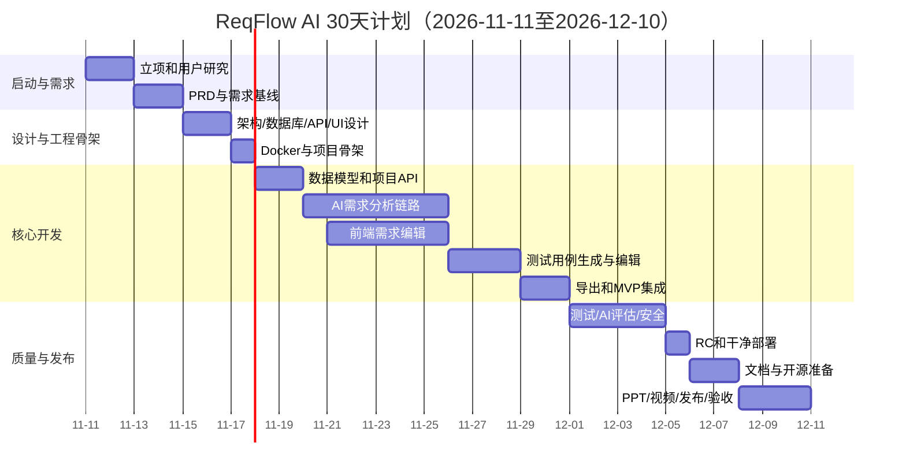

# 04 30天详细实施计划

**计划周期：2026-11-11至2026-12-10（30个自然日）**。每天均安排明确产物；A为前端/产品负责人，B为后端/AI负责人。两人每日同步并互相评审。

## 1. 每日任务表

| Day/日期 | 阶段 | 成员A任务 | 成员B任务 | AI辅助方式 | 当日交付与验收 |
|---|---|---|---|---|---|
| 1 / 11-11 | 启动 | 目标用户与场景草案、仓库初始化 | 技术风险清单、API服务商候选 | AI辅助头脑风暴，人工筛选 | 项目章程、初始Issue；两人确认范围 |
| 2 / 11-12 | 需求研究 | 访谈2-3名潜在用户或同学，记录原话 | 真实模型API连通Spike、请求/响应样例 | AI整理访谈，不生成虚构结论 | 访谈记录、API验证证据；至少一个模型可真实调用；记录语言/运行时/数据库及依赖可用版本（docs/25） |
| 3 / 11-13 | 需求分析 | 用户故事、流程和页面清单 | AI能力边界、输出样本和风险 | AI生成用户故事初稿和边界样本 | PRD初稿、AI样例集 |
| 4 / 11-14 | 需求基线 | 整理验收条件、优先级和非目标 | 审查可行性及AI需求 | AI检查歧义，人工最终裁决 | PRD 0.1基线、需求追踪矩阵；M1评审通过 |
| 5 / 11-15 | 架构设计 | 低保真线框图、交互状态 | 总体架构、模块边界和部署视图 | AI辅助设计评审清单 | UI草图、系统架构图 |
| 6 / 11-16 | 详细设计 | 页面组件、前端路由、API消费约定 | PostgreSQL ER、表结构、API契约 | AI审查字段和API一致性 | DB/API/UI设计评审通过 |
| 7 / 11-17 | 工程骨架 | Vue项目初始化、Nginx静态托管、前端测试框架选型验证（候选 Vitest） | FastAPI项目、PostgreSQL 17 Compose、健康检查 | AI生成Docker配置初稿并人工检查 | 三容器骨架启动；数据库健康；前端测试框架选型验证（候选 Vitest）完成；前后端依赖锁定并提交lock文件；M2 |
| 8 / 11-18 | 后端基础 | 前端项目列表页面静态骨架 | SQLAlchemy模型、Alembic首个迁移 | AI生成ORM/迁移草稿 | PostgreSQL表创建成功，迁移可重复执行 |
| 9 / 11-19 | 项目管理 | 项目列表/创建/详情UI | 项目CRUD API与测试 | AI生成接口测试初稿 | 前后端项目CRUD联调通过 |
| 10 / 11-20 | AI基础 | 需求输入表单、加载/错误状态、示例需求静态文本+一键填入/清空（FR-014，标注示例输入，不写库） | AI Provider适配层、配置、安全与超时 | AI检查供应商兼容性和异常路径 | 可读取模型配置；无Key时给出明确提示；示例需求一键填入/清空可用（FR-014，标注示例输入，不写库） |
| 11 / 11-21 | AI需求分析 | 需求结果页布局与数据映射 | 需求分析Prompt、JSON Schema、Pydantic模型 | AI对Prompt进行反例测试 | 固定样例可返回结构化需求和问题列表 |
| 12 / 11-22 | AI链路 | 前端触发分析、显示进度 | 分析API、保存AnalysisRun和结果 | AI辅助编写异常处理及日志 | 浏览器可提交输入并真实生成结果 |
| 13 / 11-23 | 数据编辑 | 需求条目、问题、验收标准编辑界面 | 需求/问题/验收条件持久化API | AI生成边界测试场景 | 编辑后刷新数据不丢失 |
| 14 / 11-24 | AI质量 | 准备需求分析结果人工评分表 | JSON修复重试、超时、限长、敏感日志检查 | AI协助生成测试样本，但人工标注标准答案 | AI测试样本集和第一次质量记录 |
| 15 / 11-25 | 迭代演示 | 演示完整需求分析和编辑流程 | 修复后端阻断、确认部署链路 | AI代码审查与缺陷归因 | AI需求分析垂直切片验收；M3 |
| 16 / 11-26 | 前端完善 | 统一导航、项目工作区和状态反馈 | 完善测试用例生成数据模型/API | AI辅助组件测试草稿 | 页面结构稳定、接口契约无冲突 |
| 17 / 11-27 | 用例生成 | 测试用例列表、详情与编辑UI | 测试用例生成Prompt和API | AI生成正反例并检查覆盖 | 已确认需求可生成结构化用例 |
| 18 / 11-28 | 用例持久化 | 测试用例编辑/保存交互 | 用例保存、查询、更新API | AI辅助SQL/API边界审查 | 用例可编辑，重启后数据仍存在 |
| 19 / 11-29 | 导出 | Markdown/CSV下载交互与文件名 | 导出服务、编码和内容校验 | AI审查导出字段与PRD一致性 | 两类导出文件可打开且内容正确 |
| 20 / 11-30 | MVP冻结 | 全流程验收、记录UI问题 | 全链路API/DB检查、冻结数据结构 | AI辅助追踪矩阵核对 | 需求→确认→用例→导出贯通；M4；停止加新功能 |
| 21 / 12-01 | 测试 | 前端流程测试、浏览器兼容检查 | 后端单元/接口/PostgreSQL集成测试 | AI生成测试数据和反例 | 第一轮测试记录、Bug列表 |
| 22 / 12-02 | AI评估 | 按评分量表评审模型结果 | 执行固定样本集、记录失败类型 | AI帮助聚类错误，人工判定 | AI质量评估表；不得只报告成功样本 |
| 23 / 12-03 | 安全与异常 | 空状态、错误提示、长文本交互测试 | API Key保护、输入限制、异常脱敏、日志审查 | AI代码安全审查辅助 | 核心安全检查通过，严重问题有处置 |
| 24 / 12-04 | 回归 | 端到端回归、问题复测 | 数据库迁移、备份恢复、容器健康测试 | AI辅助对照需求追踪 | P0用例通过，缺陷状态明确 |
| 25 / 12-05 | 发布候选 | 演示脚本预演、截图素材准备 | 干净环境部署、Compose重建和数据持久化 | AI审查部署步骤和失败提示 | RC候选版；P0缺陷清零；M5 |
| 26 / 12-06 | 文档 | 用户手册、UI截图、README使用部分 | 部署手册、维护手册、AI/DB文档核对 | AI整理文档草稿，人工对照实际实现 | 文档与当前代码一致 |
| 27 / 12-07 | 开源准备 | README、PPT初稿、许可证检查；LICENSE定稿：LICENSE 版权主体已替换为真实团队信息、正文仅含标准 MIT 文本（无占位符、无批注） | 贡献指南、Changelog、发布检查、CODE_OF_CONDUCT联系方式定稿 | AI辅助文案和拼写检查 | 仓库发布材料完整，密钥扫描通过，THIRD-PARTY-NOTICES.md（第三方许可证清单） |
| 28 / 12-08 | 成果展示 | PPT定稿、系统录屏 | 发布包、操作视频中的部署演示与复核 | AI辅助旁白和字幕初稿 | PPT、视频初版、演示环境冻结 |
| 29 / 12-09 | 发布 | 汇报演练、检查视频与截图 | 创建真实Release、标签和部署包 | AI辅助最终清单核对 | 开源仓库和Release真实可访问；M6 |
| 30 / 12-10 | 收尾 | 汇报、总结、收集评审反馈 | 最终验收、归档代码与证据 | AI协助整理复盘，人工核实 | 七类交付逐项签收、总结报告；M7 |

## 2. 甘特图（计划基线）

## 3. 里程碑与验收

| 里程碑 | 日期 | 验收条件 |
|---|---|---|
| M1 需求基线 | 11-14 | PRD、非目标、验收标准、用户故事评审通过 |
| M2 设计与骨架 | 11-17 | 架构/DB/API基线可读，三容器骨架和PostgreSQL健康检查通过 |
| M3 AI垂直切片 | 11-25 | 浏览器真实请求模型，结构化需求成功保存 |
| M4 MVP冻结 | 11-30 | 需求确认、用例生成、编辑和导出主流程贯通 |
| M5 发布候选 | 12-05 | 核心回归通过、P0清零、干净环境部署成功 |
| M6 开源发布 | 12-09 | 仓库、许可证、README、Release真实发布 |
| M7 最终验收 | 12-10 | 七类交付有文件和证据，项目总结据实完成 |

## 4. 关键路径

需求基线（Day 4）→ 数据模型/API契约（Day 6）→ PostgreSQL与后端骨架（Day 7-9）→ AI需求分析真实链路（Day 10-15）→ 需求确认与用例生成（Day 16-20）→ 全流程回归（Day 21-24）→ 干净环境部署（Day 25）→ 开源发布（Day 29）→ 最终验收（Day 30）。

## 5. 延期降级策略

- Day 10模型适配失败：切换到已验证的服务商，不增加多模型路由功能。
- Day 15未贯通：暂停UI美化和非核心分析字段，先打通真实AI输入输出保存。
- Day 20未完成：删除P1功能，不删除需求分析、确认、用例生成、PostgreSQL和Docker部署。
- Day 25部署失败：暂停PPT视觉优化和非必要功能，集中修复部署路径。
- 任何情况下保留至少3天做最终发布和验收，不以增加功能挤占。
