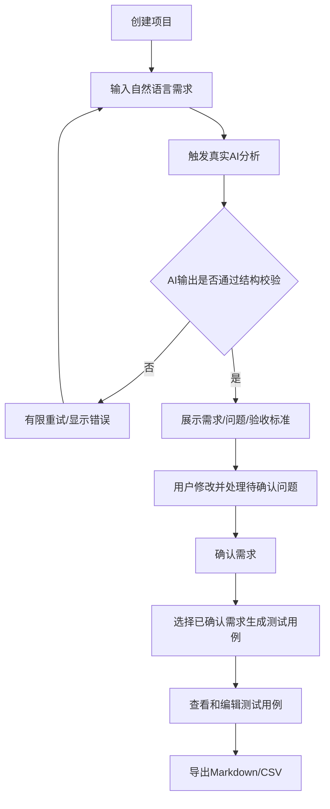

# 05 产品需求规格说明书（PRD）

**版本：** 0.1（规划基线）  
**产品：** ReqFlow AI  
**状态：** 待Day 4评审冻结

## 1. 产品概述

ReqFlow AI是一款面向软件工程学生、初级产品人员和小型团队个人成员（独立使用）的AI辅助需求分析与测试设计工具。用户输入自然语言需求，系统调用大模型提取结构化需求、待确认问题和验收标准；用户确认后，系统进一步生成可编辑测试用例并支持导出。

## 2. 产品目标与非目标

### 2.1 目标

- 降低自然语言需求整理成本。
- 辅助发现需求歧义、缺失条件和边界场景。
- 将已确认需求转化为可审阅的测试用例。
- 保留需求与测试用例之间的关联，便于追踪。

### 2.2 非目标

- 替代产品经理、开发人员或测试人员作出最终判断。
- 自动确定用户未提供的业务规则。
- 自动生成或执行程序代码。
- 成为完整项目管理/缺陷管理平台。
- 提供企业账号、权限和多租户能力。

## 3. 目标用户与画像

| 用户 | 特征 | 主要目标 | 使用频率假设 |
|---|---|---|---|
| 软件工程学生 | 做课程设计或团队项目 | 从需求描述快速得到需求条目和测试用例 | 项目阶段高频 |
| 初级产品人员 | 需求经验有限 | 检查需求完整性、组织验收标准 | 按需求迭代使用 |
| 小型团队中的个人开发者/成员 | 缺少专职测试/分析资源 | 独立整理需求并形成初版测试清单 | 按版本使用 |

以上画像为待验证假设；Day 2应通过简短访谈校验。

## 4. 用户痛点与核心场景

1. 需求以聊天、段落或口头描述形式存在，结构不统一。
2. 用户容易遗漏输入限制、异常流程、权限或边界条件。
3. 验收标准不具体，开发完成后容易出现理解分歧。
4. 测试用例从零编写耗时，异常和边界场景覆盖不足。

核心场景：用户创建项目→粘贴一段需求→得到需求拆分和待确认问题→回答/忽略问题→用户手动将已确认的答案补充到需求描述或验收标准→确认需求→生成测试用例→编辑→导出。

## 5. 用户流程

## 6. 功能需求

优先级：P0必须完成，P1有时间再做，P2不纳入30天MVP。

| 编号 | 功能 | 描述 | 优先级 | 验收标准 |
|---|---|---|---|---|
| FR-001 | 创建项目 | 输入项目名称、描述 | P0 | 校验必填项，创建后进入详情页 |
| FR-002 | 项目列表 | 查看项目名称、更新时间 | P0 | 列表正确显示数据库记录 |
| FR-003 | 项目详情/编辑/删除 | 管理项目信息 | P0 | 修改刷新后保留；删除需二次确认 |
| FR-004 | 需求输入 | 输入需求原文，限制长度 | P0 | 空文本拒绝；超长有明确提示 |
| FR-005 | AI需求分析 | 生成摘要、需求条目、问题、验收标准 | P0 | 真实模型调用，结构校验成功后保存 |
| FR-006 | 查看/编辑需求 | 用户可编辑标题、描述、类型、优先级 | P0 | 编辑后保存并在刷新后保留 |
| FR-007 | 待确认问题 | 查看问题、回答或忽略 | P0 | 未确认事项不自动变为正式需求 |
| FR-008 | 验收标准 | 查看、修改、关联需求 | P0 | 标准可追踪到所属需求 |
| FR-009 | 确认需求 | 用户明确确认需求条目 | P0 | 只有CONFIRMED需求可进入默认生成范围 |
| FR-010 | AI测试用例生成 | 根据已确认需求生成测试用例 | P0 | 用例具备步骤、预期结果和需求关联 |
| FR-011 | 编辑测试用例 | 修改前置条件、步骤、预期结果、优先级 | P0 | 保存后数据持久化 |
| FR-012 | Markdown导出 | 导出项目需求及验收标准 | P0 | 文件编码UTF-8，内容与页面一致 |
| FR-013 | CSV导出 | 导出测试用例 | P0 | UTF-8 with BOM，列头稳定 |
| FR-014 | 示例需求输入 | 提供一段前端内置、无个人信息的示例需求文本，可一键填入输入框并清空 | P0 | 点击后只填充输入框并显示“示例输入”；未提交分析前不写入数据库 |
| FR-015 | 测试用例质量建议 | 检查重复或缺失场景 | P1 | 作为建议，不自动覆盖用户内容 |
| FR-016 | 需求模板 | 提供登录/注册等常用模板 | P1 | 模板可一键填充输入框 |
| FR-017 | PDF导出 | 导出格式化文档 | P2 | 不影响核心交付 |

## 7. 用户故事与验收条件

### US-01 创建项目
作为项目成员，我希望创建一个项目，以便在独立空间管理需求和测试用例。

- Given 用户进入系统首页；When 输入合法项目名称并提交；Then 项目被保存并出现在项目列表。
- 项目名称不能为空，建议长度1-80字符；描述可选。

### US-02 分析需求
作为需求整理者，我希望粘贴自然语言需求并获得结构化分析。

- Given 项目已创建且模型配置可用；When 提交非空需求文本；Then 系统调用真实模型并返回需求摘要、需求条目、待确认问题和验收标准。
- 输出需通过JSON结构校验；失败时说明原因，不显示伪造结果。
- 原文未提供依据的业务规则必须列为待确认问题；MVP输出结构不提供独立假设字段，不得把模型推测写成需求或验收标准。

### US-03 确认需求
作为需求整理者，我希望修改并确认AI输出。

- Given AI已生成需求；When 用户修改并点击确认；Then 需求状态变为CONFIRMED并持久化。
- 未确认需求不得默认进入测试用例生成。

### US-04 生成测试用例
作为测试人员，我希望根据已确认需求生成测试用例。

- Given 至少存在一条已确认需求；When 触发生成；Then 系统返回测试用例，每条用例至少包含标题、类型、优先级、前置条件、步骤和预期结果，并关联来源需求。
- 没有已确认需求时，系统提示先确认需求。

### US-05 编辑和导出
作为项目成员，我希望修改用例并导出。

- Given 测试用例已保存；When 修改并保存；Then 刷新后仍显示修改内容。
- 导出文件可被常用文本编辑器或表格软件读取，导出字段与当前数据一致。

## 8. 关键业务规则

1. AI输出是草稿，不是权威需求；用户确认是业务状态变更的唯一入口。
2. 只有`CONFIRMED`状态的需求参与测试用例生成；其他需求统一保持`DRAFT`。澄清问题使用独立的OPEN/RESOLVED/IGNORED状态。
3. 每条测试用例关联且仅关联一条需求（单一`requirement_id`）；生成与保存新用例时，其关联需求状态必须为CONFIRMED；既有用例的查看、编辑与导出不受该时点约束。
4. 不完整的信息应保持未知，不能由模型自行补齐为确定事实。
5. 测试用例生成采用全有或全无：所选已确认需求中只要存在无法形成明确预期结果的需求，本次生成整体拒绝，不保存部分用例，并提示用户补充需求后重试。
6. 澄清问题属于一次分析运行（analysis_run），不是自动绑定到某条需求。回答问题只将答案保存到问题记录中，不会自动回写需求、验收标准或重新调用AI；用户需手动把答案补充到相关需求/标准后再确认。存在未处理问题时系统持续显示提醒，但不自动替用户确认或拒绝需求。用户明确点击确认即代表其对当前需求内容作出人工确认；问题本身的OPEN状态不会因需求确认而自动改变。
7. AI调用失败时，不得写入一份看似成功的空结果；保存失败状态和可理解错误。
8. 删除项目前确认；项目删除采用数据库级级联删除，UI需提示相关需求和用例也会删除。

## 9. 非功能需求

| 编号 | 类别 | 要求 |
|---|---|---|
| NFR-001 | 易部署 | 在Docker环境执行文档命令即可启动Web、API、PostgreSQL |
| NFR-002 | 持久化 | 重启或重建应用容器不丢失PostgreSQL卷数据 |
| NFR-003 | 可用性 | 页面显示加载、空数据、成功、失败和超时状态 |
| NFR-004 | 安全 | 默认回环地址绑定；密钥仅在后端；数据库不映射公网端口 |
| NFR-005 | 输入控制 | 需求文本默认最大12000字符，可配置；拒绝空文本 |
| NFR-006 | 可维护性 | 使用分层模块、类型校验、数据库迁移和结构化日志 |
| NFR-007 | 兼容性 | 以最新版Chrome/Edge桌面浏览器为主验收范围 |
| NFR-008 | 可追踪性 | 每个测试用例关联需求ID；AI运行记录保存模型和Prompt版本 |
| NFR-009 | 可恢复性 | 提供pg_dump备份和恢复步骤 |
| NFR-010 | 性能 | 非AI列表/详情请求目标P95<500ms（本地演示环境目标，需实测）；AI调用耗时依赖外部服务，不承诺固定时延 |
| NFR-011 | 健康检查 | db/backend/web三级健康检查，端点与判定见系统设计说明书（docs/07 §3）与部署手册（docs/12 §6） |

## 10. 页面清单

1. 首页/项目列表。
2. 新建项目弹窗或页面。
3. 项目工作区（需求输入、需求分析结果、待确认问题、验收标准）。
4. 测试用例列表和编辑抽屉/弹窗。
5. 设置/模型配置说明页（不在前端展示密钥；部署级配置由环境变量控制）。
6. 错误和空状态页面。

## 11. MVP验收

FR-001至FR-014全部通过；关键业务流程从项目创建到导出连续可用；真实模型至少成功完成一次需求分析和一次测试用例生成；PostgreSQL持久化和干净环境Compose部署测试通过。FR-014仅要求前端填充静态示例文本，不建立示例项目或数据库记录。

## 12. 用例说明

用例规格唯一主源为`docs/24-use-cases.md`；本节仅保留用例摘要与指针，不重复详细用例定义（参与者、前置条件、主/备选流程、后置条件），如两处表述不一致以docs/24为准。

- UC-01 项目创建与管理：创建、编辑、删除项目并持久化，详见docs/24。
- UC-02 AI需求分析：输入自然语言需求或加载示例需求，调用真实模型生成结构化分析结果，详见docs/24。
- UC-03 审阅需求和澄清问题：编辑需求/验收标准、回答或忽略澄清问题、确认需求，详见docs/24。
- UC-04 测试用例生成与导出：基于已确认需求生成、编辑并导出测试用例，详见docs/24。
- UC-05 Docker部署与数据恢复：干净环境Compose部署、三级健康检查与备份恢复，详见docs/24。
