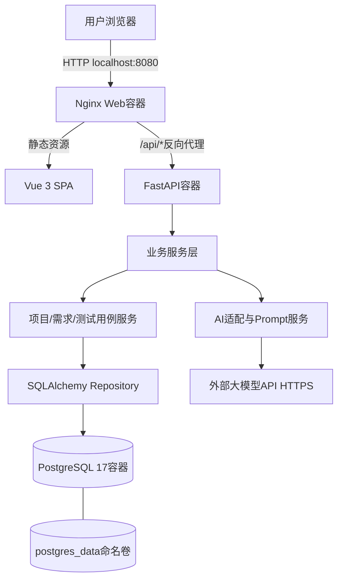
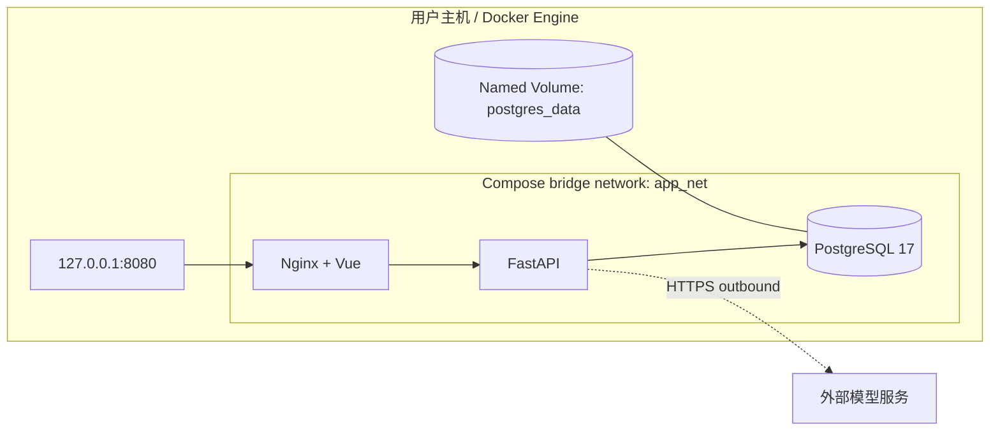
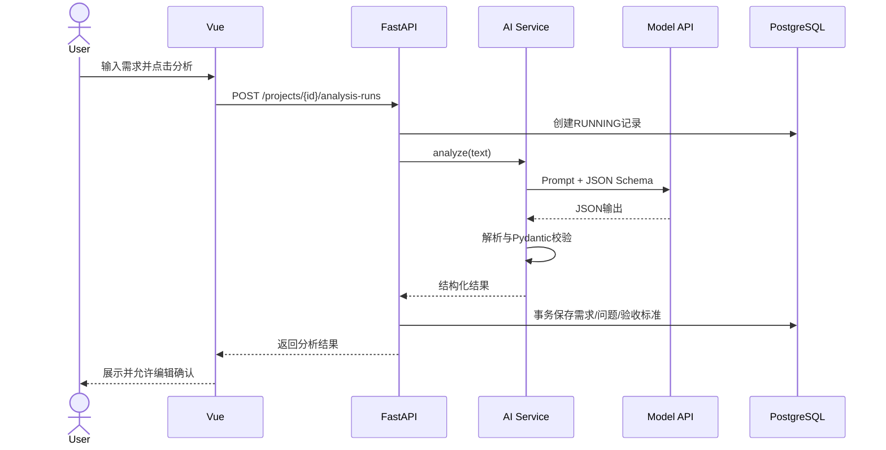
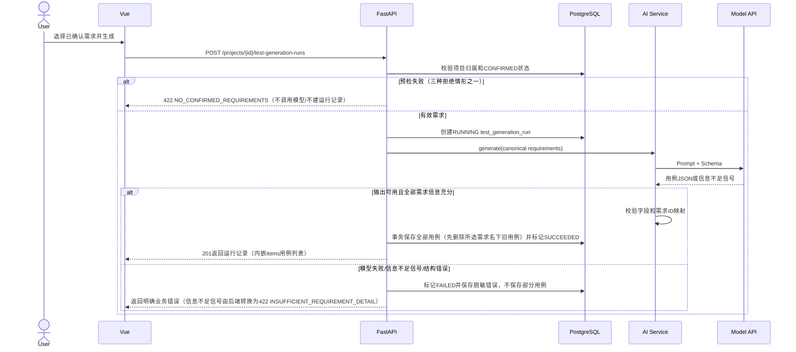
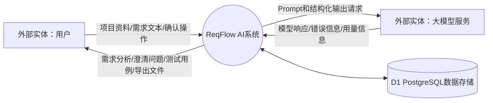
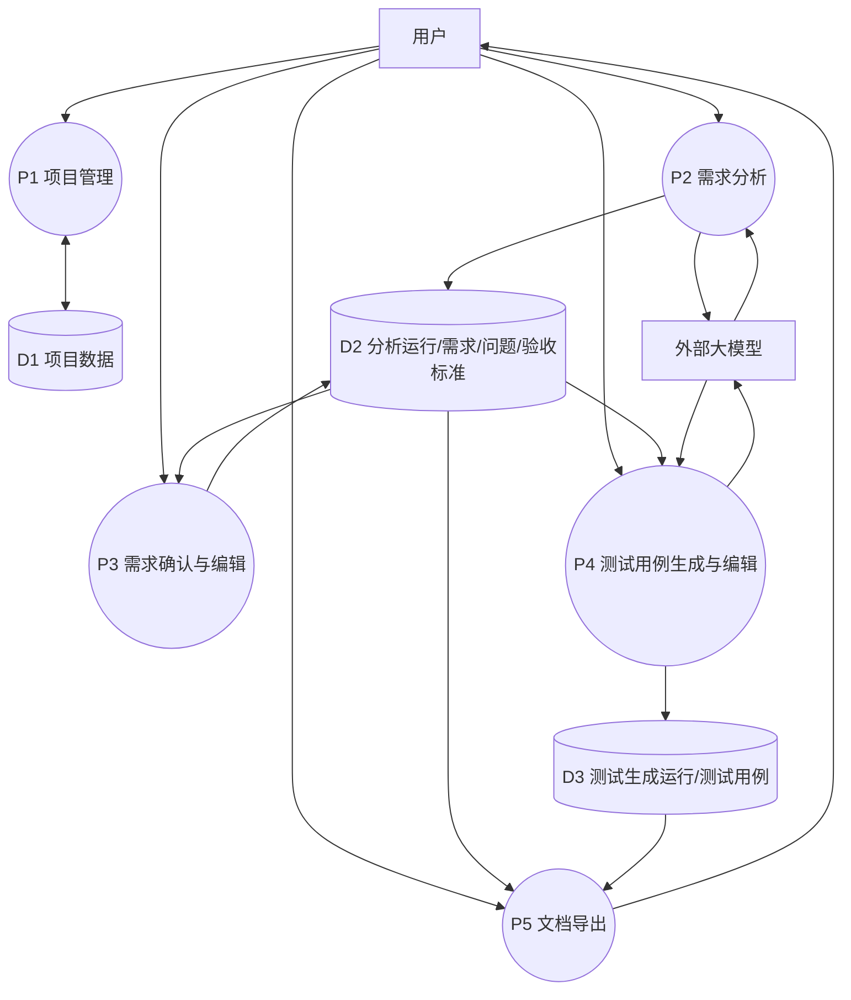

# 07 系统总体设计与详细设计说明书

## 1. 设计目标

**API路径约定：** 所有业务接口统一使用`/api/v1`前缀；本文件时序图如为简洁省略该前缀，实际实现必须与`docs/09-api-design.md`保持一致。健康检查完整路径为`/api/v1/health/live`和`/api/v1/health/ready`。

采用简单、可维护、可容器化的单体后端架构。一个FastAPI应用承载业务API和AI服务；PostgreSQL负责持久化；Nginx同时托管前端静态资源并反向代理API。MVP不引入微服务、Redis、消息队列或向量数据库。

## 2. 总体架构



## 3. 部署视图



容器划分：

1. `web`：前端静态资源和反向代理；宿主机只暴露可配置Web端口，默认绑定127.0.0.1。
2. `backend`：业务API和AI服务；不直接暴露宿主机端口。
3. `db`：PostgreSQL；不映射宿主机端口，只允许Compose网络内后端访问。

三个容器均配置健康检查：`db`使用`pg_isready`，`backend`访问`/api/v1/health/ready`（需验证数据库连接），`web`访问Nginx的`/health`。Compose使用`condition: service_healthy`控制backend等待db、web等待backend。

## 4. 模块划分

| 模块 | 责任 | 不负责 |
|---|---|---|
| 前端页面 | 输入、展示、编辑、下载、状态反馈 | 不直接调用模型或访问数据库 |
| API层 | 参数校验、鉴权边界（MVP无用户认证）、响应格式 | 不承载复杂Prompt文本 |
| 项目服务 | 项目CRUD、删除事务 | AI调用 |
| 需求服务 | 需求、问题、验收标准状态和持久化 | 自行猜测业务规则 |
| AI服务 | Provider适配、Prompt、解析、重试、日志 | 直接向前端暴露Key |
| 测试用例服务 | 基于确认需求生成、编辑和保存 | 自动执行测试 |
| 导出服务 | Markdown/CSV格式化 | 改写业务数据 |
| Repository/ORM | 数据访问和事务 | UI逻辑 |

## 5. 后端建议目录

```text
backend/
├── app/
│   ├── api/v1/              # 路由和依赖
│   ├── core/                # 配置、日志、异常
│   ├── db/                  # Session、Base、迁移配置
│   ├── models/              # SQLAlchemy模型
│   ├── schemas/             # Pydantic请求/响应模型
│   ├── repositories/        # 数据访问
│   ├── services/            # 项目、需求、用例、导出服务
│   ├── services/ai/         # provider、prompts、parsers
│   └── main.py
├── alembic/
├── tests/
├── Dockerfile
└── requirements.txt / lock文件
```

## 6. 前端建议目录

```text
frontend/src/
├── api/                     # API客户端
├── assets/
├── components/              # 共用组件
├── layouts/
├── views/                   # ProjectList、ProjectWorkspace
├── router/
├── stores/                  # 仅必要的轻状态
├── types/                   # API类型
└── main.ts
```

## 7. 关键业务序列

### 7.1 需求分析序列



### 7.2 测试用例生成序列



## 8. 错误处理设计

统一错误响应：

```json
{
  "error": {
    "code": "AI_PROVIDER_TIMEOUT",
    "message": "模型服务响应超时，请稍后重试。",
    "request_id": "<uuid>"
  }
}
```

`error`对象还可携带可选的`details`字符串数组，用于承载可定位的业务细节（如`INSUFFICIENT_REQUIREMENT_DETAIL`时给出各需求的`requirement_code`与缺失信息摘要）；完整结构与AI错误码映射表见`docs/09-api-design.md`§1、§8。

- 400：请求格式错误。
- 404：项目/需求/用例不存在。
- 409：状态冲突或重复操作。
- 422：字段校验或业务前置条件不满足（含`NO_CONFIRMED_REQUIREMENTS`、`INSUFFICIENT_REQUIREMENT_DETAIL`、`INPUT_TOO_LARGE`）。
- 429：模型服务限流（`AI_RATE_LIMITED`）。
- 502：上游模型调用失败（不可达`AI_PROVIDER_UNREACHABLE`、认证失败`AI_PROVIDER_AUTH_FAILED`、上游5xx`AI_PROVIDER_ERROR`、无效输出`AI_INVALID_OUTPUT`）。
- 503：未配置AI（`AI_NOT_CONFIGURED`）。
- 504：模型服务响应超时（`AI_PROVIDER_TIMEOUT`）。
- 500：未预期服务异常；日志保留request_id，不向用户返回堆栈。

## 9. 安全设计

- MVP仅单用户本机本地；无账号系统。
- Compose默认Web端口绑定127.0.0.1；公网使用前必须补充认证、HTTPS、访问控制、限流和密钥管理。
- 数据库不暴露宿主机端口。
- API Key只在后端环境变量中。
- 采用参数化ORM查询；限制输入长度；输出内容HTML转义。
- 不记录密钥、Authorization头和完整敏感请求。
- 删除项目需二次确认并级联删除关联数据。

## 10. 技术选型依据

- Vue 3 + TypeScript适合有限页面的交互式Web应用。
- FastAPI提供类型化请求校验和OpenAPI接口文档，适合小型Python API。
- SQLAlchemy 2.x + psycopg 3以同步方式访问PostgreSQL，降低并发模型和调试复杂度。
- Alembic管理Schema演进，避免手工改库。
- Backend从`DB_HOST`、`DB_PORT`、`POSTGRES_DB`、`POSTGRES_USER`、`POSTGRES_PASSWORD`读取连接字段，并使用SQLAlchemy `URL.create("postgresql+psycopg", ...)`构造连接，避免密码中保留特殊字符时手工拼接URL出错。
- Docker Compose统一开发、测试和演示部署。
- PostgreSQL是正式且唯一数据库；禁止为测试另设SQLite替代路径。

## 11. 性能与容量边界

MVP面向小规模单用户自托管场景，不承诺高并发。列表和详情采用分页/合理索引；AI请求设置超时和输出上限。性能目标必须在目标设备上实测并记录，不能仅写目标数值作为实际结果。


## 12. 数据流图（DFD）

### 12.1 上下文图（Level 0）



### 12.2 一级数据流图（Level 1）



数据存储仅包含项目、AI运行记录、需求、待确认问题、验收标准和测试用例；不保存模型供应商密钥。
