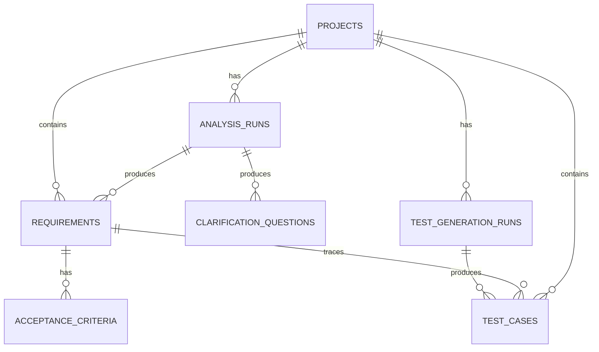

# 08 数据库设计说明书（PostgreSQL）

## 1. 数据库决策

正式数据库：**PostgreSQL 17**。本项目不使用SQLite，不提供SQLite降级路径。开发、测试、演示和最终部署统一使用PostgreSQL，减少数据库行为不一致。

访问方式：SQLAlchemy 2.x同步Session + psycopg 3。所有Schema变更通过Alembic迁移管理。主键使用UUID；时间字段使用`TIMESTAMPTZ`并按UTC存储；半结构化模型原始结果使用JSONB，核心业务字段使用独立列。

## 2. ER图



## 3. 表结构

### 3.1 projects

| 字段 | 类型 | 约束 | 说明 |
|---|---|---|---|
| id | UUID | PK | 项目ID |
| name | VARCHAR(80) | NOT NULL | 项目名称 |
| description | TEXT | NULL | 项目描述 |
| created_at | TIMESTAMPTZ | NOT NULL | 创建时间 |
| updated_at | TIMESTAMPTZ | NOT NULL | 更新时间 |

索引：`updated_at DESC`。

### 3.2 analysis_runs

| 字段 | 类型 | 约束 | 说明 |
|---|---|---|---|
| id | UUID | PK | 分析运行ID |
| project_id | UUID | FK projects.id ON DELETE CASCADE | 所属项目 |
| source_text | TEXT | NOT NULL | 用户本次输入 |
| status | VARCHAR(20) | NOT NULL | RUNNING/SUCCEEDED/FAILED |
| provider | VARCHAR(80) | NULL | 模型供应商标识 |
| model | VARCHAR(120) | NULL | 模型名称 |
| prompt_version | VARCHAR(40) | NOT NULL | Prompt版本 |
| result_json | JSONB | NULL | 已校验的结构化结果 |
| error_code | VARCHAR(80) | NULL | 失败错误码 |
| error_message | TEXT | NULL | 脱敏错误描述 |
| latency_ms | INTEGER | NULL | 调用耗时 |
| input_tokens | INTEGER | NULL | 供应商返回时记录 |
| output_tokens | INTEGER | NULL | 供应商返回时记录 |
| created_at | TIMESTAMPTZ | NOT NULL | 开始时间 |
| finished_at | TIMESTAMPTZ | NULL | 完成时间 |

索引：`(project_id, created_at DESC)`。

### 3.3 requirements

| 字段 | 类型 | 约束 | 说明 |
|---|---|---|---|
| id | UUID | PK | 需求ID |
| project_id | UUID | FK projects.id ON DELETE CASCADE | 所属项目 |
| analysis_run_id | UUID | FK analysis_runs.id ON DELETE SET NULL | 来源分析 |
| requirement_code | VARCHAR(32) | NOT NULL | 如REQ-001，项目内唯一 |
| title | VARCHAR(160) | NOT NULL | 标题 |
| description | TEXT | NOT NULL | 需求描述 |
| requirement_type | VARCHAR(30) | NOT NULL | functional/non_functional/constraint |
| priority | VARCHAR(10) | NOT NULL | high/medium/low |
| status | VARCHAR(24) | NOT NULL | DRAFT/CONFIRMED |
| source_excerpt | TEXT | NULL | 原文依据 |
| sort_order | INTEGER | NOT NULL DEFAULT 0 | 排序 |
| created_at | TIMESTAMPTZ | NOT NULL | 创建时间 |
| updated_at | TIMESTAMPTZ | NOT NULL | 更新时间 |

约束：`UNIQUE(project_id, requirement_code)`。索引：`(project_id, status, sort_order)`。

### 3.4 clarification_questions

| 字段 | 类型 | 约束 | 说明 |
|---|---|---|---|
| id | UUID | PK | 问题ID |
| project_id | UUID | FK projects.id ON DELETE CASCADE | 所属项目 |
| analysis_run_id | UUID | FK analysis_runs.id ON DELETE CASCADE | 来源分析 |
| question | TEXT | NOT NULL | 待确认问题 |
| reason | TEXT | NOT NULL | 为什么需要确认 |
| status | VARCHAR(20) | NOT NULL | OPEN/RESOLVED/IGNORED |
| answer | TEXT | NULL | 用户回答 |
| created_at | TIMESTAMPTZ | NOT NULL | 创建时间 |
| updated_at | TIMESTAMPTZ | NOT NULL | 更新时间 |

约束由应用服务校验：`RESOLVED`必须提供非空`answer`；`OPEN`和`IGNORED`的`answer`必须为空。将问题标记为IGNORED时清空既有答案。索引：`(project_id, status)`。

### 3.5 acceptance_criteria

| 字段 | 类型 | 约束 | 说明 |
|---|---|---|---|
| id | UUID | PK | 验收标准ID |
| requirement_id | UUID | FK requirements.id ON DELETE CASCADE | 所属需求 |
| criterion_text | TEXT | NOT NULL | 可验证的验收标准 |
| sort_order | INTEGER | NOT NULL DEFAULT 0 | 排序 |
| created_at | TIMESTAMPTZ | NOT NULL | 创建时间 |
| updated_at | TIMESTAMPTZ | NOT NULL | 更新时间 |

索引：`(requirement_id, sort_order)`。

### 3.6 test_generation_runs

| 字段 | 类型 | 约束 | 说明 |
|---|---|---|---|
| id | UUID | PK | 生成运行ID |
| project_id | UUID | FK projects.id ON DELETE CASCADE | 所属项目 |
| status | VARCHAR(20) | NOT NULL | RUNNING/SUCCEEDED/FAILED |
| provider | VARCHAR(80) | NULL | 模型供应商 |
| model | VARCHAR(120) | NULL | 模型名称 |
| prompt_version | VARCHAR(40) | NOT NULL | Prompt版本 |
| source_requirement_ids | JSONB | NOT NULL | 本次选择的需求ID列表 |
| result_json | JSONB | NULL | 校验后的结果 |
| error_code | VARCHAR(80) | NULL | 失败错误码 |
| error_message | TEXT | NULL | 脱敏错误描述 |
| created_at | TIMESTAMPTZ | NOT NULL | 创建时间 |
| finished_at | TIMESTAMPTZ | NULL | 完成时间 |

### 3.7 test_cases

| 字段 | 类型 | 约束 | 说明 |
|---|---|---|---|
| id | UUID | PK | 用例ID |
| project_id | UUID | FK projects.id ON DELETE CASCADE | 所属项目 |
| requirement_id | UUID | FK requirements.id ON DELETE CASCADE | 关联需求 |
| generation_run_id | UUID | FK test_generation_runs.id ON DELETE SET NULL | 来源生成运行 |
| case_code | VARCHAR(32) | NOT NULL | 如CASE-001（与文档测试用例ID TC-001区分） |
| title | VARCHAR(180) | NOT NULL | 用例标题 |
| test_type | VARCHAR(20) | NOT NULL | positive/negative/boundary |
| priority | VARCHAR(10) | NOT NULL | high/medium/low |
| preconditions | JSONB | NOT NULL DEFAULT '[]' | 前置条件数组 |
| steps | JSONB | NOT NULL | 有序步骤数组 |
| expected_result | TEXT | NOT NULL | 预期结果 |
| created_at | TIMESTAMPTZ | NOT NULL | 创建时间 |
| updated_at | TIMESTAMPTZ | NOT NULL | 更新时间 |

约束：`UNIQUE(project_id, case_code)`；应用层确保关联需求处于CONFIRMED状态。索引：`(project_id, requirement_id)`、`(project_id, priority)`。

## 4. 数据完整性规则

- 删除项目时关联数据级联删除；产品界面须二次确认。
- 需求状态仅由业务服务校验后更新。
- 测试用例必须且仅能关联同项目的一条已确认需求；后端保存前验证。
- 需求代码和业务测试用例代码（`REQ-001`、`CASE-001`）由服务层生成；为避免并发重复，生成时先对所属`projects`行执行`SELECT ... FOR UPDATE`，在同一事务内分配下一个编号，并由`UNIQUE(project_id, requirement_code)`和`UNIQUE(project_id, case_code)`作为最终保护。测试计划中的`TC-001`仅是测试执行用例编号，不是产品数据编号。
- JSONB仅用于步骤列表、原始模型结果等变化较大的结构；查询频繁字段仍使用普通列。
- 不保存API Key或Authorization信息。

## 5. 迁移策略

1. SQLAlchemy模型是代码层映射；Alembic migration是数据库变更依据。
2. 每次Schema变更先生成迁移，再人工检查upgrade/downgrade。
3. 测试环境使用真实PostgreSQL容器运行迁移。
4. 发布前备份数据库；升级失败需保留备份并按回滚说明处理。
5. 禁止直接手工修改线上表结构。

## 6. 备份与恢复

备份：

```bash
docker compose --env-file deploy/.env -f deploy/docker-compose.yml exec -T db \
  sh -c 'pg_dump -U "$POSTGRES_USER" "$POSTGRES_DB"' > backup.sql
```

恢复（建议先在测试实例验证）：

```bash
cat backup.sql | docker compose --env-file deploy/.env -f deploy/docker-compose.yml exec -T db \
  sh -c 'psql -U "$POSTGRES_USER" "$POSTGRES_DB"'
```

备份文件含用户需求数据，应限制访问权限并避免提交Git。
